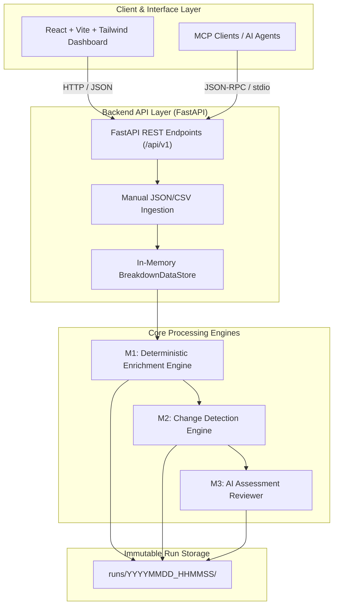
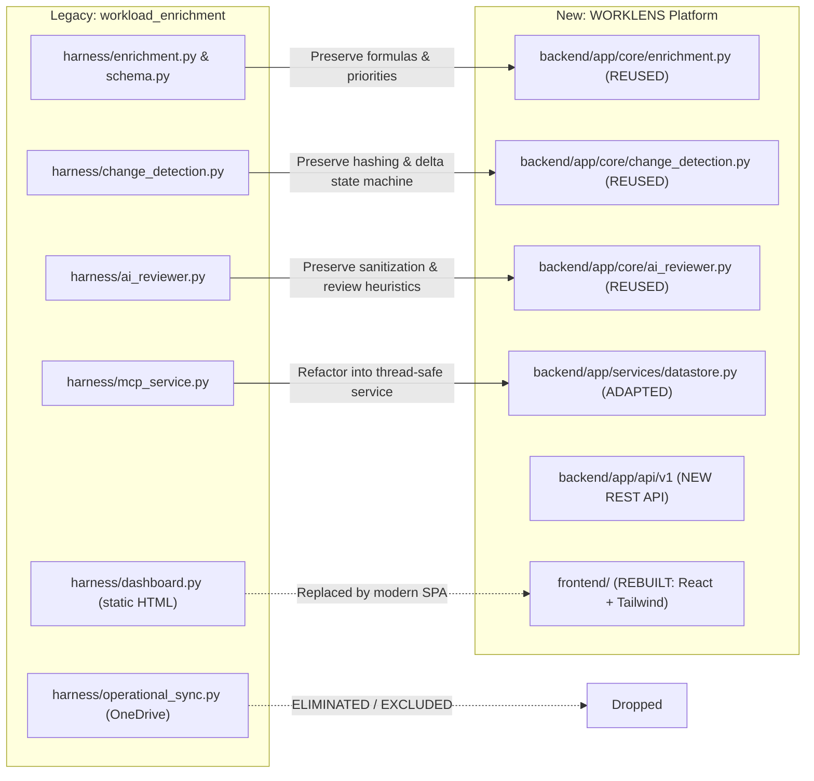

# WORKLENS Architecture Baseline

> **Version:** 1.0.0-draft  
> **Status:** Active Baseline  
> **Repository:** `worklens`  
> **Branch:** `develop`

---

## 1. System Overview

**WORKLENS (Workload Intelligence Platform)** is a unified platform engineered to ingest, enrich, validate, track, and analyze workload automation assessments.

---

## 2. Architectural Pillars & Core Constraints

1. **Source Immutability:**
   - Raw input assessments (JSON/CSV) are treated as strictly read-only.
   - Processing pipelines produce new enriched outputs without modifying source inputs.

2. **Deterministic vs. AI Separation:**
   - **Deterministic Processing (M1 & M2):** All 6 derived metrics (`Workload Saved`, `Workload Reduction %`, `Annualized Saved`, `Calculation Status`, `Evidence Status`, `Validation Notes`) and content hashing are calculated via strict code logic and mathematical formulas. AI/LLM never computes or alters numbers.
   - **AI Reviewer (M3):** Focuses strictly on qualitative observations (Data Quality, Assessment Consistency, Automation Opportunities). Results are stored in separate findings artifacts (`feedback_report.jsonl` and `.md`).

3. **Zero External Database Dependency (V1):**
   - The platform relies on an in-memory indexed query engine (`BreakdownDataStore`) for sub-millisecond query performance during interactive sessions.
   - Run results and audit trails are persisted as timestamped artifact directories (`runs/YYYYMMDD_HHMMSS/`).

4. **No Desktop Sync / Cloud Egress Overhead:**
   - Microsoft Graph API and OneDrive Desktop Sync dependencies are completely eliminated in WORKLENS.
   - Ingestion is handled exclusively via manual JSON/CSV uploads through the API/Dashboard.

---

## 3. Technology Stack

| Layer | Technology | Rationale |
|---|---|---|
| **Backend Framework** | Python 3.11+ / FastAPI | High-performance asynchronous API, auto-generated OpenAPI docs, seamless Pydantic integration. |
| **Data Validation** | Pydantic v2 | Strict request/response typing, schema validation, and runtime data integrity. |
| **Data Indexing** | In-Memory `BreakdownDataStore` | Fast multi-criteria search, filtering by application, status, and activity without database setup. |
| **AI Reviewer** | Google Gemini API (Mock default) | Pluggable qualitative assessment with offline deterministic mock mode for local testing. |
| **Agent Protocol** | FastMCP (Model Context Protocol) | Exposes workload analytics directly to AI coding agents and LLM workspaces. |
| **Frontend Framework** | React 18+ / TypeScript / Vite | Modern, lightning-fast SPA with strict compile-time type safety. |
| **UI & Styling** | Tailwind CSS / Lucide React | Utility-first, clean, modern dashboard aesthetic with responsive layouts. |
| **Testing** | Pytest (Backend) / Vitest (Frontend) | Comprehensive automated unit, integration, and regression test suites. |

---

## 4. Component Porting & Adaptation Strategy

### Detailed Component Assessment

1. **Reused Core (Zero business logic change):**
   - `CalculationStatus` priority hierarchy (`INVALID_INPUT` $\to$ `MISSING_INPUT` $\to$ `NEGATIVE_INPUT` $\to$ `ZERO_WORKLOAD` $\to$ `NEGATIVE_SAVINGS` $\to$ `CALCULATED`).
   - `EvidenceStatus` verification (`LINK_PROVIDED` vs `NO_LINK_ATTACHED`).
   - SHA-256 deterministic row content hashing with excluded calculated keys.
   - Delta classification state machine (`UNCHANGED`, `MODIFIED`, `ADDED`, `DELETED`, `REVIEW_REQUIRED`).
   - Local privacy sanitization regex (IPv4, IPv6, email, credential patterns).

2. **Adapted Components:**
   - `BreakdownDataStore`: Enhanced to support atomic dataset swapping upon manual upload with validation feedback.
   - Configuration: Migrated to Pydantic `BaseSettings` reading environment variables with typed fallbacks.
   - MCP Integration: Integrated as a first-class service callable via CLI, stdio, or REST endpoints.

3. **Rebuilt Components:**
   - **Frontend Dashboard:** Rich interactive UI replacing static HTML reports, featuring live filtering, KPI counters, application grouping, diff viewers, and review recommendation drawers.
   - **REST API:** Clean OpenAPI-compliant endpoints serving data to both the frontend and external automation scripts.

4. **Eliminated Components:**
   - `operational_sync.py`: All OneDrive Desktop sync and Microsoft Graph API synchronization logic removed.
