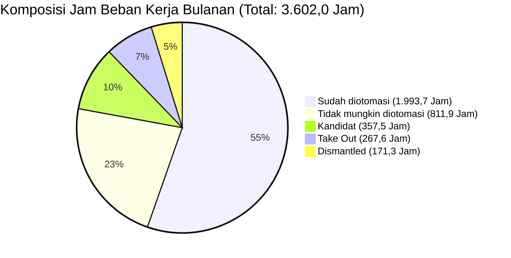
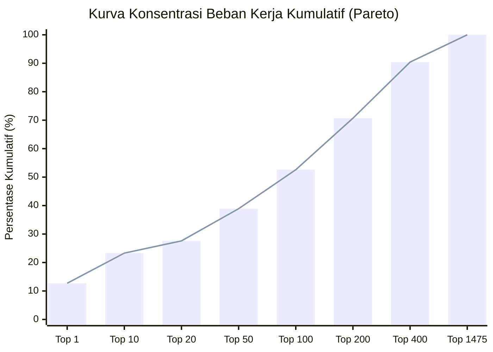

# WORKLENS — Business Metric Definition Workbook

> **Dokumen Otoritas:** Buku Kerja Definisi Bisnis Metrik Frontend  
> **Status:** REVIEW DRAFT — PENDING SME CONFIRMATION  
> **Dasar Otoritas Dokumen:**  
> - `docs/METRIC_DEFINITION_DICTIONARY.md` (Hasil Audit Empiris)  
> - `docs/domain/GLOSSARY.md` (Domain Vocabulary)  
> - `docs/domain/PRD_V1.md` (Locked Baseline V1)  
> - `docs/domain/TECHNICAL_SPECIFICATION.md` (Spesifikasi Teknis)  
> - `docs/domain/BUSINESS_DECISIONS_Q1_Q51.md` (Keputusan Bisnis L1 AGIT)  
> **Tanggal Penyusunan:** 2026-11-08  

---

## Panduan Penggunaan Workbook

Dokumen ini disusun sebagai instrumen formal untuk reviu dan penyelarasan makna bisnis (*business alignment*) bersama Subject Matter Expert (SME), Tim L1, dan manajemen operasional. 

Setiap metrik dianalisis secara seragam melalui 8 atribut:
1. **Display Name:** Nama metrik sebagaimana terlihat pada antarmuka frontend WORKLENS.
2. **Business Definition:** Penjelasan konseptual mengenai apa yang sebenarnya diukur oleh angka tersebut.
3. **Business Purpose:** Alasan strategis dan operasional mengapa metrik ini dipantau oleh organisasi.
4. **Measurement Logic:** Cara pengguna membaca, mengevaluasi, dan mengambil keputusan berdasarkan metrik.
5. **Formula:** Rumus matematis empiris yang ditemukan pada implementasi frontend/query engine.
6. **Data Source:** Kolom/field aktual pada dataset asesmen L1 (`Breakdown Activity`).
7. **Interpretation:** Pedoman interpretasi nilai tinggi, rendah, nol, atau kosong/hilang.
8. **Limitation:** Batasan analitis dan hal-hal yang **tidak boleh disimpulkan** secara keliru dari metrik tersebut.

Setiap metrik diberi status:
- **`ESTABLISHED`**: Definisi bisnis dan formula telah didukung penuh oleh dokumen baseline (`PRD_V1.md`, `GLOSSARY.md`, `Q1–Q51`).
- **`NEEDS BUSINESS CONFIRMATION`**: Terdapat ambiguitas semantik, deviasi klasifikasi, atau asumsi yang memerlukan keputusan formal SME sebelum disahkan.

---

## 1. Kelompok Tampilan: KPI Cards (4 Metrik)

### 1.1. Total Workload
- **Display Name:** `Total workload` (Nilai Prototype: `3.602,0 jam per bulan`)
- **Status Otoritas:** `NEEDS BUSINESS CONFIRMATION`
- **Business Definition:** Akumulasi total kapasitas waktu kerja operasional bulanan yang dialokasikan Tim L1 AGIT untuk mengeksekusi aktivitas SOP rutin yang memiliki nilai beban kerja terukur positif ($> 0$).
- **Business Purpose:** Menjadi baseline makro kapasitas beban kerja operasional untuk mengukur skala operasional L1, mengevaluasi kebutuhan staf (*resource sizing*), dan menjadi penyebut total bagi rasio efisiensi otomasi.
- **Measurement Logic:** Dibaca sebagai total waktu manusia (*man-hours*) yang dihabiskan dalam sebulan. Digunakan oleh manajemen untuk melihat volume beban kerja sebelum efisiensi.
- **Formula:**
  $$\text{Total Workload (Jam)} = \sum_{i \in \{r \mid \text{Workload}_i > 0\}} \frac{\text{Workload}_i}{60.0}$$
- **Data Source:** Kolom `Workload` (dalam satuan menit) dibagi 60.0.
- **Interpretation:**
  - *Tinggi:* Menunjukkan volume aktivitas rutin yang masif dan menyerap jam kerja staf yang besar.
  - *Rendah:* Menunjukkan operasional ramping atau aktivitas yang frekuensinya jarang.
  - *Nol / Kosong:* Diabaikan dalam akumulasi prototype (baris bernilai nol tidak menambah total jam).
- **Limitation:** Tidak mencakup 1.605 aktivitas yang berbeban nol dan 380 aktivitas yang datanya belum terisi (`MISSING_INPUT`). Subtitle *"seluruh aktivitas terhitung"* adalah misrepresentasi teknis karena hanya menghitung 1.475 baris aktif.
- **Poin Konfirmasi SME:** Apakah sub-label disetujui untuk diubah menjadi: *"jam per bulan · akumulasi 1.475 aktivitas berbeban positif"*?

---

### 1.2. Aktivitas Terukur
- **Display Name:** `Aktivitas terukur` (Nilai Prototype: `1.475`)
- **Status Otoritas:** `NEEDS BUSINESS CONFIRMATION`
- **Business Definition:** Jumlah baris aktivitas SOP yang memiliki durasi dan frekuensi kejadian bulanan di atas nol ($\text{Workload} > 0$).
- **Business Purpose:** Mengidentifikasi ukuran populasi aktivitas aktif yang secara riil berkontribusi terhadap jam kerja operasional L1.
- **Measurement Logic:** Digunakan sebagai basis pembanding (*universe of discourse*) untuk seluruh visualisasi turunan (Pareto, tipe aktivitas, tools, dan bucket).
- **Formula:**
  $$\text{Aktivitas Terukur} = \text{COUNT}(\{r \in \text{Dataset} \mid \text{Workload}(r) > 0\})$$
- **Data Source:** Kolom `Workload` (tipe numerik/menit).
- **Interpretation:**
  - *Tinggi:* Semakin banyak aktivitas yang aktif menyerap waktu staf.
  - *Rendah:* Sedikit aktivitas berulang; operasional terpusat pada beberapa tugas besar.
  - *Nol:* Tidak ada aktivitas yang aktif.
  - *Kosong:* Data asesmen belum dimasukkan.
- **Limitation:** Angka 1.475 **bukanlah** total baris yang selesai diasesmen. Terdapat 1.605 baris tambahan yang telah terukur dan bernilai $\text{Workload} = 0$. Menyebut 1.475 sebagai *"baris memiliki nilai workload"* mengaburkan 1.605 baris valid tersebut.
- **Poin Konfirmasi SME:** Apakah nama metrik disepakati untuk diperjelas menjadi **"Aktivitas Berbeban Positif"** atau tetap menggunakan **"Aktivitas Terukur"** dengan catatan bahwa aktivitas berbeban nol disajikan pada indikator terpisah?

---

### 1.3. Kandidat Otomasi
- **Display Name:** `Kandidat otomasi` (Nilai Prototype: `200`)
- **Status Otoritas:** `NEEDS BUSINESS CONFIRMATION`
- **Business Definition:** Jumlah aktivitas operasional rutin berbeban positif yang diidentifikasi oleh L1 dan L2 sebagai backlog peluang perbaikan untuk diotomasi di masa mendatang.
- **Business Purpose:** Menjadi corong prioritas inovasi (*automation backlog pipeline*) yang ditargetkan untuk dikembangkan solusinya oleh Tim L2/Engineering guna mengurangi beban manual L1.
- **Measurement Logic:** Dipantau sebagai KPI utama efisiensi; semakin cepat kandidat ini dikonversi menjadi *Already Automation*, semakin besar kapasitas L1 yang terbebaskan.
- **Formula:**
  $$\text{COUNT}(\{r \mid \text{Workload}(r) > 0 \land \text{Status}(r) \neq \text{"Take Out"} \land \text{Category Notes}(r) \in \{\text{"To Be Automated"}, \text{"As Is"}, \text{"Not Yet Solution"}, \text{"Need Further Assessment"}, \text{"Already Automated"}\}\})$$
- **Data Source:** Kolom `Workload`, `Status`, dan `Category Notes`.
- **Interpretation:**
  - *Tinggi:* Banyak peluang otomatisasi yang belum dieksekusi; backlog inovasi tinggi.
  - *Rendah:* Mayoritas aktivitas operasional telah diotomasi atau memang tidak mungkin diotomasi.
  - *Nol:* Tidak ada lagi peluang otomatisasi yang tersisa.
  - *Kosong:* Asesmen perbaikan belum ditentukan.
- **Limitation:** Angka 200 pada prototype mengandung 2 distorsi bisnis:
  1. *Typo Teknis:* Memasukkan 4 aktivitas UFO yang `Category Notes`-nya bertuliskan `"Already Automated"` (seharusnya *Sudah diotomasi*).
  2. *Inklusi "As Is":* Memasukkan 112 aktivitas manual berkategori `As Is` yang secara domain sebenarnya diputuskan tetap manual apa adanya.
- **Poin Konfirmasi SME:**
  1. Apakah 4 aktivitas typo UFO disetujui dikembalikan ke *Sudah diotomasi* (sehingga Kandidat murni menjadi 196 aktivitas)?
  2. Apakah 112 aktivitas `As Is` disepakati masuk sebagai *Kandidat Otomasi*, atau harus dipisahkan menjadi bucket sendiri (*Manual As-Is*)?

---

### 1.4. Potensi Hemat Indikatif
- **Display Name:** `Potensi hemat indikatif` (Nilai Prototype: `321,8 jam per bulan`)
- **Status Otoritas:** `NEEDS BUSINESS CONFIRMATION`
- **Business Definition:** Estimasi hipotetis penghematan waktu operasional bulanan yang dapat dicapai jika seluruh aktivitas dalam bucket *Kandidat* berhasil diotomasi dengan tingkat efisiensi reduksi standar sebesar 90%.
- **Business Purpose:** Memberikan estimasi awal *business value* / ROI kepada manajemen untuk menjustifikasi investasi pengembangan automasi oleh Tim L2.
- **Measurement Logic:** Digunakan sebagai angka proyeksi atas-kertas (*indicative scenario*), bukan sebagai metrik realisasi penghematan aktual.
- **Formula:**
  $$\text{Potensi Hemat Indikatif} = \text{Workload}(\text{Bucket: Kandidat}) \times 0.90 = 357,5\text{ jam} \times 0.9 = 321,75 \approx 321,8\text{ jam/bulan}$$
- **Data Source:** Agregasi jam bucket Kandidat dikalikan konstanta $0,90$.
- **Interpretation:**
  - *Tinggi:* Potensi dividen efisiensi waktu staf sangat besar jika otomatisasi dieksekusi.
  - *Rendah:* Peluang penghematan tambahan dari kandidat yang ada relatif marjinal.
  - *Nol:* Tidak ada kandidat otomatisasi yang teridentifikasi.
  - *Kosong:* Tidak ada data kandidat.
- **Limitation:** **Bukan penghematan aktual.** Metrik ini tidak menggunakan derived metrics PRD M1 ($\text{Workload Saved} = \text{Workload} - \text{Workload after}$), tidak memverifikasi bukti link/SOP, dan tidak mencerminkan `Status Triggered`. Angka 90% adalah murni asumsi heuristik prototype.
- **Poin Konfirmasi SME:** Apakah manajemen menyetujui metrik ini tetap ditampilkan sebagai simulasi skenario dengan label wajib *"asumsi 90%"*?

---

## 2. Kelompok Tampilan: Workload Distribution / Buckets (6 Metrik)

Distribusi beban kerja mengelompokkan 1.475 aktivitas berbeban positif ($3.602,0\text{ jam}$) ke dalam 5 status peluang operasional:



### 2.1. Bucket: Sudah diotomasi
- **Display Name:** `Sudah diotomasi` (Nilai Prototype: `1.993,7 jam` · 954 aktivitas · 55,4%)
- **Status Otoritas:** `NEEDS BUSINESS CONFIRMATION`
- **Business Definition:** Akumulasi beban kerja dan jumlah aktivitas yang solusi otomatisasinya (skrip, bot, AO, Grafana, dsb.) telah dibangun dan tersedia di lingkungan operasional L1.
- **Business Purpose:** Mengukur tingkat adopsi otomatisasi eksisting (*automation baseline coverage*) dan membuktikan efisiensi yang telah terbangun.
- **Measurement Logic:** Menggambarkan portofolio aktivitas yang seharusnya sudah berjalan secara otomatis atau semi-otomatis dalam keseharian operasional.
- **Formula:**
  $$\sum \frac{\text{Workload}}{60.0} \quad \text{untuk baris dengan } \text{Workload} > 0 \land \text{Status} \neq \text{"Take Out"} \land \text{Category Notes} == \text{"Already Automation"}$$
- **Data Source:** Kolom `Workload`, `Status`, dan `Category Notes`.
- **Interpretation:**
  - *Tinggi:* Tingkat otomatisasi SOP sudah mapan; operasional tidak bertumpu pada intervensi manual manual berulang.
  - *Rendah:* Operasional masih sangat konvensional/manual.
- **Limitation:** Status *Sudah diotomasi* di sini tidak menjamin automasi tersebut berjalan sukses 100% atau terpicu tanpa hambatan (sesuai Q34-Q35, automasi yang ada kendala tetap tercatat *Already Automation*). Angka ini belum menyertakan 4 aktivitas typo `Already Automated` ($38,2\text{ jam}$).
- **Poin Konfirmasi SME:** Menyetujui penggabungan 4 record typo `Already Automated` ke dalam bucket ini sehingga total menjadi **958 aktivitas** dan **2.031,8 jam** (56,4%).

---

### 2.2. Bucket: Tidak mungkin diotomasi
- **Display Name:** `Tidak mungkin diotomasi` (Nilai Prototype: `811,9 jam` · 178 aktivitas · 22,5%)
- **Status Otoritas:** `ESTABLISHED`
- **Business Definition:** Aktivitas operasional yang secara fundamental membutuhkan analisis kognitif manusia, pertimbangan otorisasi manajemen, verifikasi fisik, atau koordinasi lintas instansi yang tidak memungkinkan/tidak layak diotomasi.
- **Business Purpose:** Menetapkan batas wajar otomatisasi (*automation ceiling*), agar tim engineering tidak membuang sumber daya mencoba mengotomasi proses yang harus tetap manual.
- **Measurement Logic:** Menjadi penanda aktivitas manual permanen yang harus didukung dengan SOP tertulis yang jelas dan pelatihan operator.
- **Formula:**
  $$\sum \frac{\text{Workload}}{60.0} \quad \text{untuk baris dengan } \text{Workload} > 0 \land \text{Status} \neq \text{"Take Out"} \land \text{Category Notes} == \text{"Not Possible Automate"}$$
- **Data Source:** Kolom `Workload`, `Status`, dan `Category Notes`.
- **Interpretation:**
  - *Tinggi:* Porsi pekerjaan yang membutuhkan penilaian kualitatif analis cukup besar; tidak semua pekerjaan bisa digantikan mesin.
  - *Rendah:* Pekerjaan didominasi oleh eksekusi instruksi teknis berulang.
- **Limitation:** Penetapan status ini bergantung pada asesmen kualitatif analis L1 dan konfirmasi L2 pada saat survei; perubahan teknologi di masa depan dapat mengubah kelayakannya.

---

### 2.3. Bucket: Kandidat (Kandidat Otomasi)
- **Display Name:** `Kandidat otomasi` / `Kandidat` (Nilai Prototype: `357,5 jam` · 200 aktivitas · 9,9%)
- **Status Otoritas:** `NEEDS BUSINESS CONFIRMATION`
- **Business Definition:** Beban kerja bulanan dari seluruh aktivitas yang diusulkan atau direncanakan untuk diotomasi pada fase pengembangan berikutnya.
- **Business Purpose:** Menghitung ukuran potensi kapasitas yang dapat dialihkan dari pekerjaan manual ke kegiatan yang bernilai tambah lebih tinggi (*capacity reclamation*).
- **Measurement Logic:** Menjadi dasar prioritisasi antrean proyek otomasi L2; diurutkan dari aktivitas dengan jam bulanan terbesar.
- **Formula:**
  $$\sum \frac{\text{Workload}}{60.0} \quad \text{untuk baris dengan } \text{Workload} > 0 \land \text{Status} \neq \text{"Take Out"} \land \text{Category Notes} \in \{\text{"To Be Automated"}, \text{"As Is"}, \dots\}$$
- **Data Source:** Kolom `Workload`, `Status`, dan `Category Notes`.
- **Interpretation:**
  - *Tinggi:* Potensi efisiensi masa depan sangat besar; diperlukan alokasi developer L2 yang memadai.
  - *Rendah:* Ruang perbaikan otomasi menyempit; sistem mendekati otomatisasi penuh.
- **Limitation:** Tidak semua kandidat memiliki solusi teknis yang sudah siap (`Not Yet Solution` tercatat 9 baris); sebagian masih memerlukan kajian kelayakan L2.
- **Poin Konfirmasi SME:** Rekonsiliasi inclusion 112 baris `As Is` ($176,8\text{ jam}$) dan 4 baris typo `Already Automated` ($38,2\text{ jam}$).

---

### 2.4. Bucket: Take Out
- **Display Name:** `Take Out` (Nilai Prototype: `267,6 jam` · 80 aktivitas · 7,4%)
- **Status Otoritas:** `ESTABLISHED`
- **Business Definition:** Beban kerja dari aktivitas operasional yang diputuskan untuk dikeluarkan dari tanggung jawab L1 AGIT, dipindahkan ke tim lain, atau dinonaktifkan dari cakupan asesmen.
- **Business Purpose:** Membersihkan batasan tanggung jawab operasional L1 (*scope boundary control*) agar L1 tidak dibebani evaluasi aktivitas di luar kendalinya.
- **Measurement Logic:** Mengidentifikasi jam kerja yang secara administratif tidak lagi menjadi target efisiensi internal L1 AGIT.
- **Formula:**
  $$\sum \frac{\text{Workload}}{60.0} \quad \text{untuk baris dengan } \text{Workload} > 0 \land \text{Status} \in \{\text{"Take Out"}, \text{"Takeout"}, \text{"take Out"}\}$$
- **Data Source:** Kolom `Workload` dan `Status` (case-insensitive & trimmed).
- **Interpretation:**
  - *Tinggi:* Terjadi re-skoping besar atau transfer fungsi operasional dari L1 ke entitas luar.
  - *Rendah:* Ruang lingkup tanggung jawab L1 stabil.
- **Limitation:** Status Take Out ditetapkan di kolom `Status`, mengesampingkan nilai di kolom `Category Notes`. Jam kerja di sini tidak dapat diakui sebagai penghematan otomasi.

---

### 2.5. Bucket: Dismantled
- **Display Name:** `Dismantled` (Nilai Prototype: `171,3 jam` · 63 aktivitas · 4,8%)
- **Status Otoritas:** `ESTABLISHED`
- **Business Definition:** Beban kerja dari aktivitas SOP yang diputuskan untuk dihapus/ditiadakan sepenuhnya karena prosesnya sudah usang, redundan, atau sistemnya telah dipensiunkan (*decommissioned*).
- **Business Purpose:** Mencatat efisiensi yang diperoleh dari penyederhanaan proses bisnis (*process elimination/lean optimization*), tanpa perlu membangun bot atau skrip otomasi.
- **Measurement Logic:** Menggambarkan penghematan 100% instan karena pekerjaan tersebut dihentikan sepenuhnya dari SOP.
- **Formula:**
  $$\sum \frac{\text{Workload}}{60.0} \quad \text{untuk baris dengan } \text{Workload} > 0 \land \text{Status} \neq \text{"Take Out"} \land \text{Category Notes} == \text{"Dismantled"}$$
- **Data Source:** Kolom `Workload`, `Status`, dan `Category Notes`.
- **Interpretation:**
  - *Tinggi:* Banyak proses usang yang berhasil dieliminasi; bukti keberhasilan tata kelola SOP ramping.
  - *Rendah:* SOP relatif mutakhir tanpa banyak langkah redundan.
- **Limitation:** Pengurangan beban kerja di sini bersifat definitif karena proses dihentikan, bukan karena proses dipercepat dengan teknologi.

---

### 2.6. Bucket: Lainnya
- **Display Name:** `Lainnya` (Nilai Prototype: `0,0 jam` · 0 aktivitas · 0,0%)
- **Status Otoritas:** `ESTABLISHED`
- **Business Definition:** Bucket penampung (*fallback bucket*) untuk aktivitas berbeban positif yang nilai status atau kategorinya tidak terpetakan ke dalam salah satu dari 5 bucket utama.
- **Business Purpose:** Indikator integritas aturan klasifikasi (*catch-all integrity check*); memastikan tidak ada baris aktif yang tercecer tanpa klasifikasi.
- **Measurement Logic:** Nilai harus selalu nol; jika nilai $> 0$, berarti terdapat nilai kategori baru di data mentah yang belum memiliki aturan pemetaan.
- **Formula:**
  $$\sum \frac{\text{Workload}}{60.0} \quad \text{untuk baris dengan } \text{Workload} > 0 \text{ yang tidak masuk ke 5 bucket utama}$$
- **Data Source:** Logika fallback query engine.
- **Interpretation:**
  - *Nol (0):* Aturan klasifikasi mencakup 100% baris aktif tanpa residu (Kondisi Ideal).
  - *Positif (> 0):* Anomali klasifikasi terdeteksi; ada kategori baru yang belum diakomodasi.
- **Limitation:** Tidak boleh ada aktivitas yang sengaja ditampung di sini tanpa investigasi aturan bisnis.

---

## 3. Kelompok Tampilan: Pareto Concentration (8 Metrik)

Prinsip Pareto digunakan untuk mengidentifikasi tingkat konsentrasi beban kerja; membuktikan apakah sebagian besar jam kerja operasional L1 terkonsentrasi pada segelintir aktivitas kritis.



### 3.1. Top 1 Aktivitas
- **Display Name:** `Top 1 aktivitas` (Nilai: `456,0 jam` · 12,7%)
- **Status Otoritas:** `ESTABLISHED`
- **Business Definition:** Beban kerja tunggal terbesar di seluruh operasional L1 AGIT, yaitu aktivitas penanganan backup dan kuota mailbox Office 365 (`durasi = 1.440 menit`, `event = 19x/bln`).
- **Business Purpose:** Menyoroti risiko konsentrasi ekstrim (*single point of operational drag*) pada satu SOP spesifik.
- **Measurement Logic:** Mengevaluasi apakah 1 aktivitas ini merupakan outlier input atau memang menyerap 12,7% kapasitas seluruh unit L1.
- **Formula:** $\frac{\text{Workload}_{\text{rank 1}}}{3.602,0} \times 100\% = \frac{456,0}{3.602,0} \times 100\% = 12,7\%$.
- **Data Source:** Baris peringkat 1 kolom `Workload` terurut menurun.
- **Interpretation:** 1 aktivitas mengonsumsi waktu setara dengan hampir 3 orang staf purnawaktu.
- **Limitation:** Perlu konfirmasi apakah durasi 1.440 menit (24 jam) adalah waktu kerja aktif analis atau waktu tunggu proses otomatis sistem (*elapsed time*).

---

### 3.2. Top 10 Aktivitas
- **Display Name:** `Top 10 aktivitas` (Nilai: `839,9 jam` · 23,3%)
- **Status Otoritas:** `ESTABLISHED`
- **Business Definition:** Akumulasi beban kerja dari 10 aktivitas SOP dengan durasi bulanan tertinggi.
- **Business Purpose:** Menentukan target intervensi jangka sangat pendek (*quick win targets*); mengotomasi 10 aktivitas ini akan membebaskan hampir seperempat waktu L1.
- **Measurement Logic:** Menjadi daftar teratas bagi SME untuk mereview SOP prioritas tinggi.
- **Formula:** $\frac{\sum_{i=1}^{10} \text{Workload}_i}{3.602,0} \times 100\% = \frac{839,9}{3.602,0} \times 100\% = 23,3\%$.
- **Data Source:** Akumulasi 10 baris teratas kolom `Workload`.
- **Interpretation:** Menunjukkan rasio efisiensi tinggi: hanya fokus pada 0,68% aktivitas (10 dari 1.475) menyelesaikan 23,3% masalah beban kerja.
- **Limitation:** Beberapa dari 10 aktivitas ini sudah berstatus *Already Automation* (misal checking order UFO).

---

### 3.3. Top 20 Aktivitas
- **Display Name:** `Top 20 aktivitas` (Nilai: `992,4 jam` · 27,6%)
- **Status Otoritas:** `ESTABLISHED`
- **Business Definition:** Akumulasi beban kerja dari 20 aktivitas SOP teratas.
- **Business Purpose:** Memperluas cakupan inisiatif efisiensi operasional ke kuadran aktivitas bernilai tinggi.
- **Measurement Logic:** Evaluasi kapasitas beban kerja di level 1,3% populasi aktivitas.
- **Formula:** $\frac{\sum_{i=1}^{20} \text{Workload}_i}{3.602,0} \times 100\% = \frac{992,4}{3.602,0} \times 100\% = 27,6\%$.
- **Data Source:** Akumulasi 20 baris teratas kolom `Workload`.
- **Interpretation:** Menyerap lebih dari seperempat jam kerja bulanan unit L1.
- **Limitation:** Tidak membedakan apakah aktivitas tersebut berkategori kandidat, sudah otomatis, atau tidak mungkin diotomasi.

---

### 3.4. Top 50 Aktivitas
- **Display Name:** `Top 50 aktivitas` (Nilai: `1.401,9 jam` · 38,9%)
- **Status Otoritas:** `ESTABLISHED`
- **Business Definition:** Akumulasi beban kerja dari 50 aktivitas SOP teratas.
- **Business Purpose:** Menjadi batasan roadmap perbaikan operasional tahunan (*annual operational improvement target*).
- **Measurement Logic:** Digunakan pimpinan tim untuk memantau program otomatisasi lintas kuartal.
- **Formula:** $\frac{\sum_{i=1}^{50} \text{Workload}_i}{3.602,0} \times 100\% = \frac{1.401,9}{3.602,0} \times 100\% = 38,9\%$.
- **Data Source:** Akumulasi 50 baris teratas kolom `Workload`.
- **Interpretation:** Hampir 40% jam kerja unit L1 dikonsumsi oleh 50 aktivitas ini (3,4% dari seluruh SOP).
- **Limitation:** Memerlukan koordinasi lintas aplikasi karena mencakup sistem Core, FMC, dan Enterprise.

---

### 3.5. Top 100 Aktivitas
- **Display Name:** `Top 100 aktivitas` (Nilai: `1.895,8 jam` · 52,6%)
- **Status Otoritas:** `ESTABLISHED`
- **Business Definition:** Titik balik mayoritas beban kerja operasional L1 ($> 50\%$).
- **Business Purpose:** Membuktikan secara empiris validitas hukum Pareto: mayoritas beban kerja dikendalikan oleh kelompok minoritas (100 dari 1.475 aktivitas, atau ~6,8%).
- **Measurement Logic:** Dijadikan acuan bahwa Tim L1 tidak perlu mengotomasi seluruh 1.475 aktivitas untuk mencapai pemangkasan separuh beban operasional.
- **Formula:** $\frac{\sum_{i=1}^{100} \text{Workload}_i}{3.602,0} \times 100\% = \frac{1.895,8}{3.602,0} \times 100\% = 52,6\%$.
- **Data Source:** Akumulasi 100 baris teratas kolom `Workload`.
- **Interpretation:** Keberhasilan atau kegagalan efisiensi L1 ditentukan oleh performa 100 aktivitas teratas ini.
- **Limitation:** Setelah peringkat 100, penambahan beban per aktivitas menurun drastis.

---

### 3.6. Top 200 Aktivitas
- **Display Name:** `Top 200 aktivitas` (Nilai: `2.545,8 jam` · 70,7%)
- **Status Otoritas:** `ESTABLISHED`
- **Business Definition:** Akumulasi beban kerja dari 200 aktivitas SOP teratas (~13,5% populasi).
- **Business Purpose:** Batas ambang intervensi mendalam (*deep optimization zone*); mencakup lebih dari 70% seluruh waktu kerja L1.
- **Measurement Logic:** Mengukur titik di mana biaya perbaikan mulai mendekati batas imbal hasil (*diminishing returns*).
- **Formula:** $\frac{\sum_{i=1}^{200} \text{Workload}_i}{3.602,0} \times 100\% = \frac{2.545,8}{3.602,0} \times 100\% = 70,7\%$.
- **Data Source:** Akumulasi 200 baris teratas kolom `Workload`.
- **Interpretation:** Menjangkau 7 dari setiap 10 jam kerja yang dihabiskan analis L1.
- **Limitation:** Aktivitas di kuadran ini mulai memiliki variasi teknis dan sistem penunjang yang sangat beragam.

---

### 3.7. Top 400 Aktivitas
- **Display Name:** `Top 400 aktivitas` (Nilai: `3.255,4 jam` · 90,4%)
- **Status Otoritas:** `ESTABLISHED`
- **Business Definition:** Titik jenuh beban kerja operasional L1, di mana 400 aktivitas (~27% populasi) menguasai lebih dari 90% waktu.
- **Business Purpose:** Menetapkan batas henti efisiensi (*stop-loss threshold*); 1.075 aktivitas sisanya hanya memperebutkan 9,6% waktu.
- **Measurement Logic:** Menjustifikasi keputusan bahwa 1.075 aktivitas berbeban sangat kecil lebih efisien dibiarkan manual daripada dibangun automasi rumit.
- **Formula:** $\frac{\sum_{i=1}^{400} \text{Workload}_i}{3.602,0} \times 100\% = \frac{3.255,4}{3.602,0} \times 100\% = 90,4\%$.
- **Data Source:** Akumulasi 400 baris teratas kolom `Workload`.
- **Interpretation:** Portofolio 400 SOP teratas mewakili hampir seluruh denyut operasional harian L1.
- **Limitation:** 1.075 aktivitas di luar Top 400 memiliki rata-rata beban kerja di bawah 20 menit per bulan.

---

### 3.8. Top 1.475 Aktivitas
- **Display Name:** `Top 1475 aktivitas` (Nilai: `3.602,0 jam` · 100,0%)
- **Status Otoritas:** `ESTABLISHED`
- **Business Definition:** Totalitas seluruh populasi aktivitas operasional berbeban positif yang terdata di sistem WORKLENS.
- **Business Purpose:** Memverifikasi integritas matematis bahwa kurva Pareto mencapai tepat 100,0% pada baris terakhir.
- **Measurement Logic:** Digunakan sebagai baseline penutup agregasi query engine.
- **Formula:** $\frac{\sum_{i=1}^{1475} \text{Workload}_i}{3.602,0} \times 100\% = 100,0\%$.
- **Data Source:** Seluruh 1.475 baris dengan $\text{Workload} > 0$.
- **Interpretation:** Cakupan lengkap seluruh aktivitas aktif.
- **Limitation:** Memerlukan filter $\text{Workload} > 0$; baris berbeban nol tidak masuk dalam pemeringkatan ini.

---

## 4. Kelompok Tampilan: Activity Types Breakdown (8 Metrik)

Distribusi jam kerja berdasarkan fungsi operasional yang tercatat pada kolom `TYPE ACTIVITY`:

### 4.1. Monitoring and Alerting
- **Display Name:** `Monitoring and Alerting` (Nilai: `1.876,8 jam` · 52,1%)
- **Status Otoritas:** `ESTABLISHED`
- **Business Definition:** Waktu kerja yang dihabiskan analis L1 untuk memantau stabilitas sistem, dashboard utilisasi CPU/RAM, dan merespons trigger alert monitoring.
- **Business Purpose:** Mengidentifikasi bahwa tugas pengawasan pasif menyerap lebih dari separuh waktu staf, sehingga menjadi target utama otomasi alert terintegrasi.
- **Measurement Logic:** Mengukur ketergantungan L1 pada inspeksi visual layar; peluang terbesar otomasi berbasis webhook/AION.
- **Formula:** $\sum \frac{\text{Workload}}{60.0} \quad \text{untuk } \text{TYPE ACTIVITY} == \text{"Monitoring and Alerting"}$.
- **Data Source:** Kolom `TYPE ACTIVITY` dan `Workload`.
- **Interpretation:**
  - *Tinggi:* Analis L1 lebih banyak bertindak sebagai "penjaga layar" daripada penyelesai masalah (*problem solver*).
- **Limitation:** Mayoritas aktivitas ini (1.239,2 jam) sudah menggunakan tools Grafana, sehingga penghematan tambahan bergantung pada auto-acknowledgment.

---

### 4.2. Service Request
- **Display Name:** `Service Request` (Nilai: `790,6 jam` · 21,9%)
- **Status Otoritas:** `ESTABLISHED`
- **Business Definition:** Penanganan permintaan layanan standar dari pengguna, tim aplikasi, atau stakeholder (misal: tambah kuota, ekstensi masa aktif, penyediaan data).
- **Business Purpose:** Mengukur beban pemenuhan permintaan rutin yang berpotensi dialihkan menjadi layanan mandiri (*Self-Service Portal*).
- **Measurement Logic:** Porsi waktu terbesar kedua; kandidat ideal untuk integrasi formulir mandiri dan bot pemenuhan otomatis.
- **Formula:** $\sum \frac{\text{Workload}}{60.0} \quad \text{untuk } \text{TYPE ACTIVITY} == \text{"Service Request"}$.
- **Data Source:** Kolom `TYPE ACTIVITY` dan `Workload`.
- **Interpretation:** Beban pemenuhan permintaan tinggi; sering kali terhambat antrean manual.
- **Limitation:** Memerlukan validasi hak akses dan otorisasi sebelum dapat diotomasi penuh.

---

### 4.3. Daily Activity
- **Display Name:** `Daily Activity` (Nilai: `375,0 jam` · 10,4%)
- **Status Otoritas:** `ESTABLISHED`
- **Business Definition:** Tugas rutin harian terjadwal seperti rekapitulasi pelaporan, penarikan data transaksi berkala, dan pengecekan rekonsiliasi.
- **Business Purpose:** Mengidentifikasi pekerjaan klerikal rutin yang dapat dijadwalkan secara otomatis menggunakan skrip *cronjob* atau pipeline backend.
- **Measurement Logic:** Mengukur potensi waktu yang dapat dihemat dari pembuatan laporan manual harian.
- **Formula:** $\sum \frac{\text{Workload}}{60.0} \quad \text{untuk } \text{TYPE ACTIVITY} == \text{"Daily Activity"}$.
- **Data Source:** Kolom `TYPE ACTIVITY` dan `Workload`.
- **Interpretation:** Porsi waktu harian yang repetitif dan dapat diprediksi waktunya secara pasti.
- **Limitation:** Memerlukan kepastian format laporan agar otomasi tidak sering gagal saat struktur berubah.

---

### 4.4. Complaint Handling
- **Display Name:** `Complaint Handling` (Nilai: `259,7 jam` · 7,2%)
- **Status Otoritas:** `ESTABLISHED`
- **Business Definition:** Investigasi dan penanganan tiket keluhan pelanggan/pengguna terkait transaksi gagal, tagihan tidak sesuai, atau kendala aktivasi paket.
- **Business Purpose:** Mengukur beban reaktif penanganan keluhan; area kritis bagi persepsi kualitas layanan pelanggan (*Customer Experience*).
- **Measurement Logic:** Target utama perbaikan SLA penyelesaian tiket (*Mean Time to Resolve/MTTR*) melalui automasi pengecekan log.
- **Formula:** $\sum \frac{\text{Workload}}{60.0} \quad \text{untuk } \text{TYPE ACTIVITY} == \text{"Complaint Handling"}$.
- **Data Source:** Kolom `TYPE ACTIVITY` dan `Workload`.
- **Interpretation:** Beban reaktif; fluktuasi angka bergantung pada stabilitas rilis aplikasi baru.
- **Limitation:** Sering memerlukan koordinasi lintas tim sehingga sulit diotomasi end-to-end tanpa approval.

---

### 4.5. Incident Handling
- **Display Name:** `Incident Handling` (Nilai: `128,7 jam` · 3,6%)
- **Status Otoritas:** `ESTABLISHED`
- **Business Definition:** Penanganan insiden teknis kritis di lingkungan produksi seperti restart service, recycle memory, failover database, dan kill zombie process.
- **Business Purpose:** Mengukur waktu henti dan respons teknis terhadap degradasi layanan produksi (*Service Availability*).
- **Measurement Logic:** Target utama implementasi *Smart Healing* dan *Auto-Restart* via platform AION.
- **Formula:** $\sum \frac{\text{Workload}}{60.0} \quad \text{untuk } \text{TYPE ACTIVITY} == \text{"Incident Handling"}$.
- **Data Source:** Kolom `TYPE ACTIVITY` dan `Workload`.
- **Interpretation:** Durasi total relatif kecil (3,6%), namun memiliki urgensi bisnis dan risiko finansial tertinggi jika terlambat ditangani.
- **Limitation:** Jam kerja tidak mencerminkan tingkat keparahan insiden (*severity level*).

---

### 4.6. Change Management
- **Display Name:** `Change Management` (Nilai: `75,5 jam` · 2,1%)
- **Status Otoritas:** `ESTABLISHED`
- **Business Definition:** Pelaksanaan perubahan parameter terencana, instalasi sertifikat SSL baru, update konfigurasi endpoint, atau patching minor.
- **Business Purpose:** Mengukur waktu yang dihabiskan analis L1 untuk tugas implementasi perubahan sistem terencana.
- **Measurement Logic:** Target integrasi ke dalam pipeline otomatisasi CI/CD terstandarisasi.
- **Formula:** $\sum \frac{\text{Workload}}{60.0} \quad \text{untuk } \text{TYPE ACTIVITY} == \text{"Change Management"}$.
- **Data Source:** Kolom `TYPE ACTIVITY` dan `Workload`.
- **Interpretation:** Beban terencana dengan jendela waktu pemeliharaan (*maintenance window*).
- **Limitation:** Sering kali memerlukan persetujuan CAB (*Change Advisory Board*) sebelum eksekusi.

---

### 4.7. Audit Compliance
- **Display Name:** `Audit Compliance` (Nilai: `58,6 jam` · 1,6%)
- **Status Otoritas:** `ESTABLISHED`
- **Business Definition:** Penyusunan Berita Acara (BA), penarikan log trail audit (IPE), review parameter pengendalian, dan penyediaan bukti kepatuhan regulasi.
- **Business Purpose:** Memastikan kepatuhan terhadap kontrol kepatuhan internal Telkomsel dan regulasi SOX/auditor eksternal.
- **Measurement Logic:** Memantau beban administratif formal yang bersifat mandatori regulasi.
- **Formula:** $\sum \frac{\text{Workload}}{60.0} \quad \text{untuk } \text{TYPE ACTIVITY} == \text{"Audit Compliance"}$.
- **Data Source:** Kolom `TYPE ACTIVITY` dan `Workload`.
- **Interpretation:** Waktu klerikal kepatuhan; sangat terikat pada tenggat waktu siklus audit.
- **Limitation:** Tidak dapat dihilangkan (*dismantle*); hanya dapat diotomasi penarikan log dan pembuatan laporannya.

---

### 4.8. Housekeeping
- **Display Name:** `Housekeeping` (Nilai: `37,2 jam` · 1,0%)
- **Status Otoritas:** `ESTABLISHED`
- **Business Definition:** Pembersihan file sementara, rotasi log usang di direktori aplikasi/server, dan manajemen utilisasi ruang disk penyimpanan.
- **Business Purpose:** Pemeliharaan preventif (*preventive maintenance*) untuk mencegah server down akibat partisi disk penuh.
- **Measurement Logic:** Area paling mudah diotomasi secara tuntas menggunakan skrip otomatis (*Auto Housekeeping*).
- **Formula:** $\sum \frac{\text{Workload}}{60.0} \quad \text{untuk } \text{TYPE ACTIVITY} == \text{"Housekeeping"}$.
- **Data Source:** Kolom `TYPE ACTIVITY` dan `Workload`.
- **Interpretation:** Beban relatif kecil (1%), mengindikasikan sebagian besar housekeeping server sudah berjalan via cronjob.
- **Limitation:** Sisa aktivitas housekeeping yang masih manual biasanya berada pada server lawas tanpa akses cron terpusat.

---

## 5. Kelompok Tampilan: Tools Breakdown (10 Metrik)

Distribusi beban kerja berdasarkan teknologi otomasi yang dicatat pada kolom `Tools Automation` (Top 10 tools di frontend):

### 5.1. Not Automate
- **Display Name:** `Not Automate` (Nilai: `1.607,3 jam`)
- **Status Otoritas:** `ESTABLISHED`
- **Business Definition:** Akumulasi beban kerja dari aktivitas yang saat ini dieksekusi secara manual tanpa bantuan skrip otomasi apa pun.
- **Business Purpose:** Mengukur total beban manual murni (*pure manual drag*) di lingkungan operasional L1 AGIT.
- **Measurement Logic:** Sumber utama pencarian peluang efisiensi; kelompok ini adalah pasar sasaran terbesar untuk solusi otomasi baru.
- **Formula:** $\sum \frac{\text{Workload}}{60.0} \quad \text{untuk baris dengan } \text{Tools Automation} == \text{"Not Automate"}$.
- **Data Source:** Kolom `Tools Automation` dan `Workload`.
- **Interpretation:** Mewakili 44,6% dari total jam kerja; separuh operasional masih mengandalkan tangan manusia.
- **Limitation:** Sebagian dari aktivitas ini berstatus *Not Possible Automate* (tidak semuanya bisa diotomasi).

---

### 5.2. Grafana
- **Display Name:** `Grafana` (Nilai: `1.239,2 jam`)
- **Status Otoritas:** `ESTABLISHED`
- **Business Definition:** Jam kerja yang diasosiasikan dengan pemantauan metrik, dashboard performa, dan alert berbasis Grafana.
- **Business Purpose:** Mengidentifikasi ketergantungan L1 pada ekosistem observabilitas Grafana.
- **Measurement Logic:** Menilai sejauh mana Grafana telah diadopsi sebagai standar observabilitas aplikasi Telkomsel.
- **Formula:** $\sum \frac{\text{Workload}}{60.0} \quad \text{untuk baris dengan } \text{Tools Automation} == \text{"Grafana"}$.
- **Data Source:** Kolom `Tools Automation` dan `Workload`.
- **Interpretation:** Tools otomasi nomor satu; menyerap sepertiga jam kerja unit L1.
- **Limitation:** Meskipun berlabel tools otomasi, analis L1 sering kali masih harus melihat dashboard secara manual.

---

### 5.3. Shell script (Huruf Kecil)
- **Display Name:** `Shell script` (Nilai: `218,0 jam`)
- **Status Otoritas:** `NEEDS BUSINESS CONFIRMATION`
- **Business Definition:** Waktu operasional yang ditangani oleh skrip shell/bash/batch script mandiri pada server host.
- **Business Purpose:** Mengukur otomatisasi berbasis skrip lokal non-AO.
- **Measurement Logic:** Bersama dengan `Shell Script`, mewakili solusi otomatisasi skrip tradisional L1.
- **Formula:** $\sum \frac{\text{Workload}}{60.0} \quad \text{untuk baris dengan } \text{Tools Automation} == \text{"Shell script"}$.
- **Data Source:** Kolom `Tools Automation`.
- **Interpretation:** Pemanfaatan skrip lokal di level infrastruktur.
- **Limitation:** Mengalami fragmentasi penulisan teks di data sumber akibat tidak dinormalisasinya huruf kecil/besar.
- **Poin Konfirmasi SME:** Menyetujui normalisasi penggabungan dengan `Shell Script` (total gabungan: $301,0\text{ jam}$).

---

### 5.4. AION
- **Display Name:** `AION` (Nilai: `190,2 jam`)
- **Status Otoritas:** `ESTABLISHED`
- **Business Definition:** Jam kerja yang ditangani melalui platform orkestrasi otomatisasi AION (Telkomsel internal automation platform).
- **Business Purpose:** Mengukur efektivitas adopsi platform otomatisasi enterprise AION untuk auto-restart dan penyelesaian insiden.
- **Measurement Logic:** Menjadi tolok ukur kesuksesan integrasi SOP ke dalam ekosistem AION.
- **Formula:** $\sum \frac{\text{Workload}}{60.0} \quad \text{untuk baris dengan } \text{Tools Automation} == \text{"AION"}$.
- **Data Source:** Kolom `Tools Automation`.
- **Interpretation:** Platform otomasi modern dengan adopsi signifikan di lingkungan Core dan Mobile.
- **Limitation:** Sebagian tugas AION masih memerlukan trigger manual dari operator L1 (`Partial Automated`).

---

### 5.5. BMC
- **Display Name:** `BMC` (Nilai: `130,2 jam`)
- **Status Otoritas:** `ESTABLISHED`
- **Business Definition:** Aktivitas yang terotomasi atau terintegrasi dengan ekosistem BMC (Remedy/Control-M/ITSM tooling).
- **Business Purpose:** Mengukur otomatisasi alur tiket, pelaporan berkala, dan penanganan permintaan berbasis BMC.
- **Measurement Logic:** Menilai efisiensi pada proses operasional berbasis tiket ITSM.
- **Formula:** $\sum \frac{\text{Workload}}{60.0} \quad \text{untuk baris dengan } \text{Tools Automation} == \text{"BMC"}$.
- **Data Source:** Kolom `Tools Automation`.
- **Interpretation:** Otomasi alur kerja tiket enterprise.
- **Limitation:** Sangat bergantung pada ketersediaan API dan stabilitas integrasi BMC.

---

### 5.6. Internal Dashboard
- **Display Name:** `Internal Dashboard` (Nilai: `91,5 jam`)
- **Status Otoritas:** `ESTABLISHED`
- **Business Definition:** Jam kerja yang dipantau atau dieksekusi melalui dashboard internal kustom aplikasi (non-Grafana, non-AION).
- **Business Purpose:** Mengukur adanya perkakas pemantauan internal mandiri yang dibangun khusus untuk domain aplikasi tertentu.
- **Measurement Logic:** Mengidentifikasi tools kustom yang berpotensi distandarisasi ke Grafana atau AION.
- **Formula:** $\sum \frac{\text{Workload}}{60.0} \quad \text{untuk baris dengan } \text{Tools Automation} == \text{"Internal Dashboard"}$.
- **Data Source:** Kolom `Tools Automation`.
- **Interpretation:** Pemanfaatan konsol internal aplikasi.
- **Limitation:** Solusi sering kali bersifat spesifik aplikasi (*siloed*) dan sulit dibagikan ke unit lain.

---

### 5.7. Shell Script (Huruf Kapital)
- **Display Name:** `Shell Script` (Nilai: `83,0 jam`)
- **Status Otoritas:** `NEEDS BUSINESS CONFIRMATION`
- **Business Definition:** Sama dengan metrik 5.3; variasi penulisan teks untuk skrip otomatisasi shell.
- **Business Purpose:** Mengukur otomatisasi berbasis skrip shell lokal.
- **Measurement Logic:** Harus dibaca sebagai satu kesatuan dengan `Shell script` (5.3).
- **Formula:** $\sum \frac{\text{Workload}}{60.0} \quad \text{untuk baris dengan } \text{Tools Automation} == \text{"Shell Script"}$.
- **Data Source:** Kolom `Tools Automation`.
- **Interpretation:** Variasi data entry analis asesmen.
- **Limitation:** Terpisah dari entri huruf kecil karena string matching case-sensitive di frontend.
- **Poin Konfirmasi SME:** Menyetujui konsolidasi kedua entri menjadi satu baris: `Shell Script` ($301,0\text{ jam}$).

---

### 5.8. CICD
- **Display Name:** `CICD` (Nilai: `22,7 jam`)
- **Status Otoritas:** `ESTABLISHED`
- **Business Definition:** Jam kerja yang telah diotomasi menggunakan pipeline Continuous Integration / Continuous Deployment.
- **Business Purpose:** Mengukur otomatisasi pada rilis kode dan pembaruan konfigurasi server.
- **Measurement Logic:** Menilai kematangan praktik DevOps dalam tugas-tugas perubahan SOP.
- **Formula:** $\sum \frac{\text{Workload}}{60.0} \quad \text{untuk baris dengan } \text{Tools Automation} == \text{"CICD"}$.
- **Data Source:** Kolom `Tools Automation`.
- **Interpretation:** Efisiensi tinggi pada aktivitas Change Management.
- **Limitation:** Ruang lingkup terbatas pada aplikasi yang sudah mendukung arsitektur container/modern deployment.

---

### 5.9. Jenkins
- **Display Name:** `Jenkins` (Nilai: `10,5 jam`)
- **Status Otoritas:** `ESTABLISHED`
- **Business Definition:** Tugas pemeliharaan database dan job berkala yang dieksekusi otomatis oleh server Jenkins.
- **Business Purpose:** Mengukur otomatisasi job terjadwal di luar pipeline CI/CD rilis utama.
- **Measurement Logic:** Evaluasi keandalan penjadwalan tugas latar belakang (*batch scheduler*).
- **Formula:** $\sum \frac{\text{Workload}}{60.0} \quad \text{untuk baris dengan } \text{Tools Automation} == \text{"Jenkins"}$.
- **Data Source:** Kolom `Tools Automation`.
- **Interpretation:** Otomasi skrip terjadwal melalui pelari tugas Jenkins.
- **Limitation:** Jumlah jam relatif kecil; sering kali terpusat pada satu aplikasi (misal Subsdomain).

---

### 5.10. DSC
- **Display Name:** `DSC` (Nilai: `7,5 jam`)
- **Status Otoritas:** `ESTABLISHED`
- **Business Definition:** Aktivitas penyediaan layanan (*provisioning*) profil subscriber yang diotomasi melalui antarmuka sistem DSC (Device/Subscriber Control).
- **Business Purpose:** Mengukur otomatisasi transaksi aktivasi dan pengecekan profil pelanggan pada sistem jaringan Core.
- **Measurement Logic:** Efisiensi pada transaksi provisioning volume tinggi dengan durasi singkat.
- **Formula:** $\sum \frac{\text{Workload}}{60.0} \quad \text{untuk baris dengan } \text{Tools Automation} == \text{"DSC"}$.
- **Data Source:** Kolom `Tools Automation`.
- **Interpretation:** Otomasi transaksi jaringan spesifik domain Core Telecom.
- **Limitation:** Sangat spesifik untuk fungsi HSS/HLR Subscriber Profile.

---

## 6. Kelompok Tampilan: Teams QC Breakdown (7 Metrik)

Distribusi jam kerja bulanan berdasarkan penanggung jawab Quality Control (QC) tim operasional L1 yang tercatat pada kolom `Team QC`:

### 6.1. Tim E - Jajang
- **Display Name:** `E - Jajang` (Nilai: `963,7 jam` · 26,8%)
- **Status Otoritas:** `ESTABLISHED`
- **Business Definition:** Beban kerja bulanan dari SOP yang berada di bawah pengawasan dan validasi QC Tim E (Lead: Jajang).
- **Business Purpose:** Mengukur proporsi tanggung jawab tim; Tim E mengelola beban kerja terbesar di L1 AGIT (lebih dari seperempat beban total).
- **Measurement Logic:** Menjadi dasar penyeimbangan beban kerja (*workload balancing*) antar tim operasional L1.
- **Formula:** $\sum \frac{\text{Workload}}{60.0} \quad \text{untuk baris dengan } \text{Team QC} == \text{"E - Jajang"}$.
- **Data Source:** Kolom `Team QC` dan `Workload`.
- **Interpretation:** Tim dengan beban tugas operasional terberat di unit L1.
- **Limitation:** Beban besar ini dipengaruhi oleh kepemilikan SOP aplikasi berskala masif (seperti Agnosd, Loena, Telkomsel Portal, dan New USSDGW).

---

### 6.2. Tim D - Jajang
- **Display Name:** `D - Jajang` (Nilai: `726,7 jam` · 20,2%)
- **Status Otoritas:** `ESTABLISHED`
- **Business Definition:** Beban kerja bulanan dari SOP di bawah pengawasan Tim D (Lead: Jajang).
- **Business Purpose:** Memantau kapasitas operasional tim penanggung jawab sistem B2B, ByU, IoT, dan ekosistem MyTelkomsel.
- **Measurement Logic:** Tim dengan beban terbesar kedua; target prioritas pendampingan otomatisasi L2.
- **Formula:** $\sum \frac{\text{Workload}}{60.0} \quad \text{untuk baris dengan } \text{Team QC} == \text{"D - Jajang"}$.
- **Data Source:** Kolom `Team QC` dan `Workload`.
- **Interpretation:** Volume aktivitas tinggi pada domain layanan digital pelanggan dan analitik.
- **Limitation:** Banyak menangani aplikasi dengan variasi keluhan pengguna yang tinggi.

---

### 6.3. Tim BCorp - Apriyanto
- **Display Name:** `BCorp - Apriyanto` (Nilai: `712,0 jam` · 19,8%)
- **Status Otoritas:** `ESTABLISHED`
- **Business Definition:** Beban kerja dari SOP operasional sistem korporat, Office 365, Active Directory, dan ERP SAP Sienna (Lead: Apriyanto).
- **Business Purpose:** Mengukur alokasi waktu L1 pada sistem pendukung operasional internal perusahaan (*Enterprise Corporate Systems*).
- **Measurement Logic:** Fokus utama pembenahan SOP sistem korporat; mencakup aktivitas outlier Office 365.
- **Formula:** $\sum \frac{\text{Workload}}{60.0} \quad \text{untuk baris dengan } \text{Team QC} == \text{"BCorp - Apriyanto"}$.
- **Data Source:** Kolom `Team QC` dan `Workload`.
- **Interpretation:** Beban terpusat pada sistem korporat non-telco.
- **Limitation:** Nilai jam dipengaruhi signifikan oleh aktivitas outlier OneDrive/Mailbox ($456,0\text{ jam}$).

---

### 6.4. Tim A - Dwi
- **Display Name:** `A - Dwi` (Nilai: `558,5 jam` · 15,5%)
- **Status Otoritas:** `ESTABLISHED`
- **Business Definition:** Beban kerja dari SOP sistem Digital Core, Bulk Premium, Subsdomain, dan NBP Lite (Lead: Dwi).
- **Business Purpose:** Memantau kapasitas tim operasional pada platform integrasi digital dan monetisasi.
- **Measurement Logic:** Tim dengan keterlibatan tinggi dalam inisiatif adopsi otomatisasi BMC dan AION.
- **Formula:** $\sum \frac{\text{Workload}}{60.0} \quad \text{untuk baris dengan } \text{Team QC} == \text{"A - Dwi"}$.
- **Data Source:** Kolom `Team QC` dan `Workload`.
- **Interpretation:** Portofolio didominasi oleh transaksi pesan berbayar dan routing API.
- **Limitation:** Memerlukan kehati-hatian tinggi karena menyangkut transaksi finansial/billing critical.

---

### 6.5. Tim FMC - Alfian
- **Display Name:** `Tim FMC - Alfian` (Nilai: `233,5 jam` · 6,5%)
- **Status Otoritas:** `ESTABLISHED`
- **Business Definition:** Beban kerja dari SOP ekosistem Fixed-Mobile Convergence, IndiHome TV, dan OTT Playout (Lead: Alfian).
- **Business Purpose:** Mengukur waktu kerja operasional pada domain konvergensi fixed broadband pasca-merger IndiHome.
- **Measurement Logic:** Mengukur kematangan operasional unit baru konvergensi FMC.
- **Formula:** $\sum \frac{\text{Workload}}{60.0} \quad \text{untuk baris dengan } \text{Team QC} == \text{"Tim FMC - Alfian"}$.
- **Data Source:** Kolom `Team QC` dan `Workload`.
- **Interpretation:** Domain berkembang pesat dengan proporsi otomatisasi yang terus ditingkatkan.
- **Limitation:** Banyak aktivitas berstatus baru yang masih dalam fase stabilisasi operasional.

---

### 6.6. Tim B - Dwi
- **Display Name:** `B - Dwi` (Nilai: `204,2 jam` · 5,7%)
- **Status Otoritas:** `ESTABLISHED`
- **Business Definition:** Beban kerja dari SOP sistem UFO (Unified Fulfillment & Ordering), Customer Order (CO), dan Dunia Games (Lead: Dwi).
- **Business Purpose:** Memantau operasional alur order pelanggan dan transaksi gaming.
- **Measurement Logic:** Porsi waktu relatif sedang, namun memiliki volume frekuensi kejadian per bulan yang sangat padat.
- **Formula:** $\sum \frac{\text{Workload}}{60.0} \quad \text{untuk baris dengan } \text{Team QC} == \text{"B - Dwi"}$.
- **Data Source:** Kolom `Team QC` dan `Workload`.
- **Interpretation:** Karakteristik tugas berdurasi singkat dengan frekuensi sangat tinggi (ribuan event per bulan).
- **Limitation:** Memuat 4 record typo `Already Automated` yang perlu diselaraskan.

---

### 6.7. Tim C - Jajang
- **Display Name:** `C - Jajang` (Nilai: `203,4 jam` · 5,6%)
- **Status Otoritas:** `ESTABLISHED`
- **Business Definition:** Beban kerja dari SOP sistem SMS Gateway, SMSC, HSS Subscriber Profile, dan VMS (Lead: Jajang).
- **Business Purpose:** Mengukur operasional infrastruktur pesan singkat klasik dan provisioning kartu SIM.
- **Measurement Logic:** Unit spesialis infrastruktur telekomunikasi inti.
- **Formula:** $\sum \frac{\text{Workload}}{60.0} \quad \text{untuk baris dengan } \text{Team QC} == \text{"C - Jajang"}$.
- **Data Source:** Kolom `Team QC` dan `Workload`.
- **Interpretation:** Operasional berbasis mesin telekomunikasi yang sangat stabil.
- **Limitation:** Sebagian besar aktivitas penanganan SMS Gateway sudah terotomasi auto-restart via AION.

---

## 7. Kelompok Tampilan: Explorer Table Fields & Meta Aggregates (8 Metrik/Field)

Tabel penelusuran detail menyajikan data granular tingkat aktivitas SOP:

### 7.1. Aktivitas / Aplikasi
- **Display Name:** Header `Aktivitas / Aplikasi` (Contoh: `Restart Redis Service - offdeckpdb1` / `AdServer`)
- **Status Otoritas:** `ESTABLISHED`
- **Business Definition:** Nama resmi aktivitas operasional SOP beserta nama aplikasi/sistem target di mana aktivitas tersebut dijalankan.
- **Business Purpose:** Identifikasi kontekstual agar operator L1 mengenali secara pasti prosedur kerja dan sistem yang dimaksud.
- **Measurement Logic:** Digunakan sebagai filter pencarian teks (*search keyword*) utama pada dashboard.
- **Formula:** Nilai teks kolom `ACTIVITY NAME` sebagai judul tebal, dan kolom `APPS` sebagai teks sekunder.
- **Data Source:** Kolom `ACTIVITY NAME` dan `APPS`.
- **Interpretation:** Menggambarkan aksi teknis dan domain sistem kerja.
- **Limitation:** Nama aktivitas tidak dijamin unik tanpa prefiks `APPS` (kombinasi unik kanonikal adalah `activity_id = APPS + " - " + ACTIVITY NAME`).

---

### 7.2. Type (Tipe Aktivitas)
- **Display Name:** Header `Type` (Contoh: `Incident Handling`, `Daily Activity`)
- **Status Otoritas:** `ESTABLISHED`
- **Business Definition:** Kategori taksonomi fungsi operasional SOP.
- **Business Purpose:** Memfilter dan menganalisis beban kerja berdasarkan sifat pekerjaan (preventif, reaktif, pemeliharaan, atau administratif).
- **Measurement Logic:** Mengelompokkan aktivitas ke dalam 8 tipe baku SOP.
- **Formula:** Nilai teks kolom `TYPE ACTIVITY`.
- **Data Source:** Kolom `TYPE ACTIVITY`.
- **Interpretation:** Karakteristik operasional tugas.
- **Limitation:** Nilai harus dipilih dari 8 nilai taksonomi baku; tidak boleh diisi teks bebas.

---

### 7.3. Tools (Teknologi Otomasi)
- **Display Name:** Header `Tools` (Contoh: `Grafana`, `AION`, `Not Automate`)
- **Status Otoritas:** `NEEDS BUSINESS CONFIRMATION`
- **Business Definition:** Teknologi atau perangkat lunak otomatisasi yang digunakan untuk menjalankan aktivitas secara otomatis atau semi-otomatis.
- **Business Purpose:** Mengetahui ketergantungan teknologi otomasi pada setiap aktivitas.
- **Measurement Logic:** Mengidentifikasi apakah suatu aktivitas sudah memiliki tooling otomatis atau masih manual murni.
- **Formula:** Nilai teks kolom `Tools Automation`.
- **Data Source:** Kolom `Tools Automation` (Bukan kolom `Tools`!).
- **Interpretation:** Keberadaan teknologi pendukung otomatisasi.
- **Limitation:** Terdapat ketidaksesuaian penamaan label header (*Tools* vs *Tools Automation*). Kolom `Tools` pada data mentah adalah perangkat manual, sedangkan yang ditampilkan di tabel adalah `Tools Automation`.
- **Poin Konfirmasi SME:** Menyetujui perubahan label header kolom menjadi **"Tools Automation"** untuk mencegah kerancuan dengan perkakas manual eksisting.

---

### 7.4. Team QC
- **Display Name:** Header `Team QC` (Contoh: `A - Dwi`, `E - Jajang`)
- **Status Otoritas:** `ESTABLISHED`
- **Business Definition:** Tim penanggung jawab operasional dan kendali mutu asesmen SOP.
- **Business Purpose:** Memastikan akuntabilitas perbaikan dan tindak lanjut rekomendasi otomasi ke penanggung jawab yang tepat.
- **Measurement Logic:** Memfilter aktivitas berdasarkan kepemilikan tim L1.
- **Formula:** Nilai teks kolom `Team QC`.
- **Data Source:** Kolom `Team QC`.
- **Interpretation:** Unit kerja pemilik SOP.
- **Limitation:** Mewakili entitas tim, bukan nama individu pelaksana harian.

---

### 7.5. Durasi (Menit)
- **Display Name:** Header `Durasi` (Contoh: `15,0`)
- **Status Otoritas:** `ESTABLISHED`
- **Business Definition:** Estimasi waktu standar yang dibutuhkan staf L1 untuk menyelesaikan 1 kali pelaksanaan aktivitas SOP, dinyatakan dalam satuan menit.
- **Business Purpose:** Baseline waktu eksekusi manual per event (*cycle time per execution*).
- **Measurement Logic:** Faktor pengali pertama dalam pembentukan beban kerja bulanan.
- **Formula:** Nilai numerik kolom `Durasi (Menit)` yang telah dibersihkan dari pemisah koma desimal.
- **Data Source:** Kolom `Durasi (Menit)`.
- **Interpretation:**
  - *Tinggi:* Aktivitas rumit, membutuhkan investigasi mendalam atau proses loading lama.
  - *Rendah:* Eksekusi cepat/tugas singkat (misal 5-15 menit).
  - *Nol / Kosong:* Data durasi tidak valid atau belum diukur.
- **Limitation:** Bersifat estimasi waktu rata-rata; durasi aktual dapat berfluktuasi tergantung kasus insiden.

---

### 7.6. Event per Bulan
- **Display Name:** Header `Event/bln` (Contoh: `1,0`, `30,0`, `0,33`)
- **Status Otoritas:** `ESTABLISHED`
- **Business Definition:** Rata-rata frekuensi kejadian atau perulangan aktivitas SOP yang dieksekusi dalam kurun waktu satu bulan kalender.
- **Business Purpose:** Faktor pengali kedua dalam pembentukan beban kerja; mengukur intensitas perulangan tugas.
- **Measurement Logic:** Menunjukkan apakah tugas dilakukan harian (30x), mingguan (4x), bulanan (1x), atau triwulanan (0,33x).
- **Formula:** Nilai numerik kolom `Event Per Month`.
- **Data Source:** Kolom `Event Per Month`.
- **Interpretation:**
  - *Tinggi:* Tugas berulang sangat sering; kandidat utama otomasi meskipun durasinya pendek.
  - *Rendah:* Tugas ad-hoc atau berkala jarang.
- **Limitation:** Nilai desimal (seperti $0,33$) mencerminkan frekuensi triwulanan yang dinormalisasi ke bulanan ($1 / 3 = 0,333$).

---

### 7.7. Workload (Jam per Bulan)
- **Display Name:** Header `Workload` (Contoh: `<b>0,25</b> jam`, `<b>15,00</b> jam`)
- **Status Otoritas:** `ESTABLISHED`
- **Business Definition:** Total beban kerja operasional yang dikonsumsi oleh aktivitas tersebut dalam satu bulan kalender, dinyatakan dalam satuan jam.
- **Business Purpose:** Metrik utama pengurutan (*sorting key*) pada tabel eksplorasi; memastikan aktivitas berbeban terbesar tampil di urutan paling atas.
- **Measurement Logic:** Dihitung dari perkalian durasi dan event dibagi 60 menit.
- **Formula:**
  $$\text{Workload (Jam)} = \frac{\text{Durasi (Menit)} \times \text{Event Per Month}}{60.0}$$
- **Data Source:** Kolom `Workload` dibagi 60.0.
- **Interpretation:**
  - *Tinggi:* Aktivitas penyerap waktu terbesar; harus diprioritaskan untuk efisiensi.
  - *Rendah:* Beban marjinal terhadap kapasitas tim.
- **Limitation:** Dihitung murni matematis dari durasi dan event; tidak mempertimbangkan tingkat kerumitan kognitif analis.

---

### 7.8. Bucket (Badge Kelayakan)
- **Display Name:** Header `Bucket` (Contoh Badge: `Kandidat`, `Sudah diotomasi`, `Take Out`, `Dismantled`, `Tidak mungkin diotomasi`)
- **Status Otoritas:** `NEEDS BUSINESS CONFIRMATION`
- **Business Definition:** Klasifikasi kelayakan dan status otomasi aktivitas SOP berdasarkan hirarki aturan bisnis L1.
- **Business Purpose:** Memberikan indikator visual cepat (*status pill badge*) mengenai posisi tindak lanjut setiap aktivitas.
- **Measurement Logic:** Digunakan sebagai filter dropdown untuk menyaring antrean aktivitas per status peluang.
- **Formula:** Evaluasi hirarki status: `Take Out` $\to$ `Not Possible Automate` $\to$ `Already Automation` $\to$ `Dismantled` $\to$ `Kandidat` $\to$ `Lainnya`.
- **Data Source:** Derivasi dari kolom `Status` dan `Category Notes`.
- **Interpretation:** Kategori kesiapan perbaikan operasional.
- **Limitation:** Masih memuat anomali typo `Already Automated` dan inklusi `As Is` yang memerlukan konfirmasi SME.
- **Poin Konfirmasi SME:** Penyesuaian aturan penentuan badge bucket di tingkat frontend dan query engine.

---

## 8. Kelompok Tampilan: Data Quality & Metadata Indicators (10 Metrik `D.q`)

Panel catatan kualitas data di bagian bawah dashboard memuat metrik integritas dataset:

### 8.1. Total Records (`q.total`)
- **Display Name:** Teks Catatan `3.460` (Nilai: `3.460 records`)
- **Status Otoritas:** `NEEDS BUSINESS CONFIRMATION`
- **Business Definition:** Jumlah total baris asesmen yang tercatat pada lembar kerja sumber master `Breakdown Activity` L1 AGIT.
- **Business Purpose:** Menetapkan batas total data acuan audit agar tidak ada data yang hilang dalam proses transmisi/ekstraksi.
- **Measurement Logic:** Menjadi basis penyebut populasi master dataset.
- **Formula:** $\text{COUNT}(\text{All rows in raw workbook sheet})$.
- **Data Source:** Panjang total array JSON sumber.
- **Interpretation:** Skala komprehensif seluruh inventaris SOP L1 yang telah didokumentasikan.
- **Limitation:** Terdapat perbedaan antara file lama `breakdown_activity (1).json` (3.456 baris) dan file baru `breakdown_activity_261105_1704_1.json` (3.460 baris). Selisih 4 baris baru memiliki Workload kosong.
- **Poin Konfirmasi SME:** Menetapkan file 3.460 baris sebagai baseline resmi kanonikal untuk WORKLENS V1.

---

### 8.2. Positive Workload Rows (`q.wl_rows`)
- **Display Name:** Variabel `1.475` (Nilai: `1.475 baris`)
- **Status Otoritas:** `ESTABLISHED`
- **Business Definition:** Jumlah baris aktivitas yang memiliki beban kerja bulanan lebih besar dari nol ($\text{Workload} > 0$).
- **Business Purpose:** Memisahkan aktivitas yang secara aktif menyerap jam kerja dengan aktivitas pasif/berbeban nol.
- **Measurement Logic:** Digunakan sebagai jumlah baris yang ditampilkan pada komponen visualisasi dashboard.
- **Formula:** $\text{COUNT}(\{r \mid \text{Workload}(r) > 0\})$.
- **Data Source:** Kolom `Workload`.
- **Interpretation:** 42,6% dari total SOP memiliki beban kerja aktif.
- **Limitation:** Tidak boleh diinterpretasikan sebagai satu-satunya baris yang memiliki data terisi (karena 1.605 baris bernilai 0 juga terisi).

---

### 8.3. Missing Workload Rows (`q.missing_wl`)
- **Display Name:** Teks Catatan `380` (Nilai: `380 baris`)
- **Status Otoritas:** `ESTABLISHED`
- **Business Definition:** Jumlah baris aktivitas SOP yang tidak memiliki nilai pada kolom `Workload` (bernilai string kosong, spasi, atau null).
- **Business Purpose:** Indikator data yang belum lengkap (*data completeness gap*); target pembersihan dan re-asesmen oleh analis L1.
- **Measurement Logic:** Menjadi peringatan kualitas data bahwa nilai kosong **tidak boleh otomatis dianggap nol**, melainkan harus diverifikasi ulang ke analis pemilik SOP.
- **Formula:** $\text{COUNT}(\{r \mid \text{Workload}(r) \text{ IS NULL / BLANK}\}) = 380\text{ baris}$ (pada 3.460) atau $376\text{ baris}$ (pada 3.456).
- **Data Source:** Kolom `Workload`.
- **Interpretation:** 11,0% data asesmen masih memiliki celah kelengkapan data beban kerja.
- **Limitation:** Tidak dapat disimpulkan apakah aktivitas ini berbeban nol atau memang belum sempat dihitung durasinya.

---

### 8.4. Text/Non-numeric Duration Rows (`q.txt_dur`)
- **Display Name:** Teks Catatan `80` (Nilai: `80 baris Durasi`)
- **Status Otoritas:** `ESTABLISHED`
- **Business Definition:** Jumlah baris di mana kolom `Durasi (Menit)` diisi dengan teks bebas non-numerik (misal: *"ad-hoc"*, *"tergantung user"*, *"sesuai request"*, dsb.).
- **Business Purpose:** Mengidentifikasi pelanggaran validasi tipe data (*schema violation*) yang menghambat kalkulasi otomatis.
- **Measurement Logic:** Menunjukkan perlunya normalisasi input dan penyediaan opsi durasi terstandarisasi pada form input L1.
- **Formula:** $\text{COUNT}(\{r \mid \text{Durasi}(r) \neq \text{BLANK} \land \text{parse\_float}(\text{Durasi}(r)) \text{ GAGAL}\}) = 80\text{ baris}$.
- **Data Source:** Kolom `Durasi (Menit)`.
- **Interpretation:** Keberadaan teks bebas menunjukkan SOP tersebut belum memiliki estimasi waktu penyelesaian standar.
- **Limitation:** Selama masih berbentuk teks bebas, aktivitas ini tidak dapat dihitung nilai workload-nya.

---

### 8.5. Text/Non-numeric Event Rows (`q.txt_ev`)
- **Display Name:** Teks Catatan `75` (Nilai: `75 baris Event`)
- **Status Otoritas:** `ESTABLISHED`
- **Business Definition:** Jumlah baris di mana kolom `Event Per Month` diisi dengan teks non-numerik (misal: *"incidental"*, *"ad-hoc"*, *"kondisional"*).
- **Business Purpose:** Mengidentifikasi data frekuensi yang tidak terukur secara matematis.
- **Measurement Logic:** Menyoroti aktivitas insidental yang frekuensinya belum dapat diproyeksikan ke rata-rata bulanan.
- **Formula:** $\text{COUNT}(\{r \mid \text{Event}(r) \neq \text{BLANK} \land \text{parse\_float}(\text{Event}(r)) \text{ GAGAL}\}) = 75\text{ baris}$.
- **Data Source:** Kolom `Event Per Month`.
- **Interpretation:** Aktivitas yang terjadi tanpa pola jadwal atau tidak terlacak riwayat tiket bulanannya.
- **Limitation:** Memerlukan data log historis tiket untuk mengestimasi frekuensi rata-rata tahunan.

---

### 8.6. Missing/NA Priority Rows (`q.na_prio`)
- **Display Name:** Variabel `48` (Nilai: `48 baris`)
- **Status Otoritas:** `ESTABLISHED`
- **Business Definition:** Jumlah baris aktivitas SOP di mana tingkat kepentingan aplikasi (`APP PRIORITY`) belum diisi atau bernilai error `#N/A`.
- **Business Purpose:** Mengidentifikasi kelemahan data master aplikasi (*metadata deficiency*); prioritas aplikasi penting untuk menentukan urutan eskalasi.
- **Measurement Logic:** Menjadi antrean sinkronisasi dengan database Enterprise Architecture / CMDB Telkomsel.
- **Formula:** $\text{COUNT}(\{r \mid \text{APP PRIORITY}(r) \in \{\text{BLANK}, \text{"#N/A"}\}\}) = 48\text{ baris}$.
- **Data Source:** Kolom `APP PRIORITY`.
- **Interpretation:** Aplikasi internal minor atau sistem ad-hoc yang belum masuk dalam katalog resmi enterprise.
- **Limitation:** Tidak membatalkan kalkulasi workload, namun menurunkan bobot prioritas rekomendasi otomasi.

---

### 8.7. Missing/NA Division Rows (`q.na_div`)
- **Display Name:** Variabel `5` (Nilai: `5 baris`)
- **Status Otoritas:** `ESTABLISHED`
- **Business Definition:** Jumlah baris aktivitas di mana kepemilikan divisi organisasi (`DIV`) belum terdefinisi atau bernilai `#N/A`.
- **Business Purpose:** Menjaga kebersihan atribusi organisasi (*organizational attribution*).
- **Measurement Logic:** Memverifikasi integritas pelaporan ke tingkat General Manager / Vice President.
- **Formula:** $\text{COUNT}(\{r \mid \text{DIV}(r) \in \{\text{BLANK}, \text{"#N/A"}\}\}) = 5\text{ baris}$.
- **Data Source:** Kolom `DIV`.
- **Interpretation:** Anomali kecil (hanya 5 baris dari 3.460, atau 0,14%) yang mudah diselesaikan melalui lookup manual.
- **Limitation:** Tidak mempengaruhi kalkulasi jam kerja, hanya mempengaruhi filter agregasi level divisi.

---

### 8.8. Total Positive Workload Hours (`q.total_h`)
- **Display Name:** Variabel `3602.0` (Nilai: `3.602,0 jam`)
- **Status Otoritas:** `ESTABLISHED`
- **Business Definition:** Representasi numerik murni dari total jam kerja bulanan seluruh aktivitas berbeban positif (identik dengan KPI 1).
- **Business Purpose:** Variabel kontrol teknis (*checksum control variable*) pada layer data prototype.
- **Measurement Logic:** Menjadi angka penyebut (*denominator*) bagi seluruh kalkulasi persentase bucket dan diagram batang.
- **Formula:** $\sum_{i=1}^{1475} \frac{\text{Workload}_i}{60.0} = 3.602,0138\text{ jam}$.
- **Data Source:** Kolom `Workload`.
- **Interpretation:** Total jam kerja dasar.
- **Limitation:** Dibulatkan menjadi 1 angka desimal di frontend.

---

### 8.9. Post-Improvement Workload After Hours (`q.after_h`)
- **Display Name:** Variabel `445.7` (Nilai: `445,7 jam`)
- **Status Otoritas:** `ESTABLISHED`
- **Business Definition:** Akumulasi total estimasi beban kerja bulanan yang tersisa setelah implementasi otomatisasi/perbaikan, dihitung dari kolom `Workload after`.
- **Business Purpose:** Memberikan proyeksi kapasitas beban kerja L1 yang tersisa (*residual workload projection*) pasca-inisiatif efisiensi.
- **Measurement Logic:** Membandingkan beban sebelum ($3.602,0\text{ jam}$) vs beban sesudah ($445,7\text{ jam}$), mengindikasikan proyeksi pemangkasan waktu sebesar $3.156,3\text{ jam/bulan}$ (efisiensi ~87,6%).
- **Formula:**
  $$\sum \frac{\text{Workload after}}{60.0} \quad \text{untuk seluruh baris terisi}$$
- **Data Source:** Kolom `Workload after`.
- **Interpretation:**
  - Menunjukkan potensi efisiensi agregat yang sangat masif jika seluruh perbaikan terealisasi.
- **Limitation:** Kolom `Workload after` di dataset mentah saat ini mayoritas diisi dengan formula perkiraan seragam 10% dari beban awal (asumsi statis 90% efisiensi per baris). Bukan hasil pengukuran empiris pasca-rilis bot.

---

### 8.10. Maximum Outlier Workload Activity (`q.outlier_h`)
- **Display Name:** Teks Catatan `456,0` (Nilai: `456,0 jam/bulan`)
- **Status Otoritas:** `ESTABLISHED`
- **Business Definition:** Nilai beban kerja bulanan dari satu aktivitas tunggal tertinggi di seluruh dataset, yaitu aktivitas pemeliharaan backup dan storage Office 365.
- **Business Purpose:** Peringatan risiko kualitas data (*outlier anomaly alert*); mencegah distorsi pengambilan keputusan akibat angka ekstrim tunggal.
- **Measurement Logic:** Mengarahkan tim auditor dan SME untuk memverifikasi ulang apakah durasi 24 jam per event pada aktivitas tersebut mencerminkan waktu kerja analis atau waktu proses sistem otomatis.
- **Formula:** $\max_{r \in \text{Dataset}} \frac{\text{Workload}(r)}{60.0} = \frac{27.360\text{ menit}}{60.0} = 456,0\text{ jam}$.
- **Data Source:** Kolom `Workload` baris aktivitas Office 365 (`activity_id: Office 365 Productivity - Backup OneDrive files...`).
- **Interpretation:** Satu aktivitas ini menyumbang 12,7% dari seluruh beban L1; perubahan kecil pada asesmen aktivitas ini akan mengubah total jam kerja secara drastis.
- **Limitation:** Jika angka ini diverifikasi keliru oleh SME dan dikurangi, maka baseline $3.602,0\text{ jam}$ akan terkoreksi signifikan.

---

## 9. Matriks Rekonsiliasi & Ringkasan Status Otoritas Metrik

Tabel ringkasan status 61 indikator metrik bisnis:

| No | Kelompok Tampilan | Nama Metrik Display | Status Bisnis | Tindakan & Rekomendasi SME |
|:---:|---|---|:---:|---|
| 1 | **KPI Cards** | Total workload | `NEEDS CONFIRMATION` | Perjelas sub-label: akumulasi 1.475 aktivitas aktif (>0). |
| 2 | **KPI Cards** | Aktivitas terukur | `NEEDS CONFIRMATION` | Perjelas label: Aktivitas Berbeban Positif (bedakan dari 1.605 beban 0). |
| 3 | **KPI Cards** | Kandidat otomasi | `NEEDS CONFIRMATION` | Normalisasi typo 4 baris UFO dan konfirmasi perlakuan 112 baris *As Is*. |
| 4 | **KPI Cards** | Potensi hemat indikatif | `NEEDS CONFIRMATION` | Tetapkan status sebagai skenario simulasi 90%, bukan capaian terukur. |
| 5 | **Workload Distribution** | Sudah diotomasi | `NEEDS CONFIRMATION` | Masukkan 4 record typo `Already Automated` (menjadi 958 n / 2.031,8 h). |
| 6 | **Workload Distribution** | Tidak mungkin diotomasi | `ESTABLISHED` | Disahkan sesuai `Category Notes = Not Possible Automate`. |
| 7 | **Workload Distribution** | Kandidat | `NEEDS CONFIRMATION` | Konfirmasi perlakuan kategori *As Is* dan rekonsiliasi typo. |
| 8 | **Workload Distribution** | Take Out | `ESTABLISHED` | Disahkan sesuai filter kolom `Status = Take Out`. |
| 9 | **Workload Distribution** | Dismantled | `ESTABLISHED` | Disahkan sesuai `Category Notes = Dismantled`. |
| 10 | **Workload Distribution** | Lainnya | `ESTABLISHED` | Tetap bernilai 0 sebagai kontrol integritas klasifikasi. |
| 11–18 | **Pareto Concentration** | Top 1 s.d. Top 1475 (8 level) | `ESTABLISHED` | Disahkan sesuai akumulasi terurut matematis (100% presisi). |
| 19–26 | **Activity Types** | 8 Tipe Aktivitas | `ESTABLISHED` | Disahkan sesuai taksonomi kolom `TYPE ACTIVITY`. |
| 27 | **Tools Breakdown** | Not Automate | `ESTABLISHED` | Disahkan sebagai baseline aktivitas manual murni. |
| 28 | **Tools Breakdown** | Grafana | `ESTABLISHED` | Disahkan sesuai data `Tools Automation`. |
| 29 | **Tools Breakdown** | Shell script (lowercase) | `NEEDS CONFIRMATION` | Normalisasi konsolidasi ke entri `Shell Script`. |
| 30 | **Tools Breakdown** | AION | `ESTABLISHED` | Disahkan sesuai data `Tools Automation`. |
| 31 | **Tools Breakdown** | BMC | `ESTABLISHED` | Disahkan sesuai data `Tools Automation`. |
| 32 | **Tools Breakdown** | Internal Dashboard | `ESTABLISHED` | Disahkan sesuai data `Tools Automation`. |
| 33 | **Tools Breakdown** | Shell Script (capitalized) | `NEEDS CONFIRMATION` | Normalisasi konsolidasi dengan entri huruf kecil (total 301,0 h). |
| 34 | **Tools Breakdown** | CICD | `ESTABLISHED` | Disahkan sesuai data `Tools Automation`. |
| 35 | **Tools Breakdown** | Jenkins | `ESTABLISHED` | Disahkan sesuai data `Tools Automation`. |
| 36 | **Tools Breakdown** | DSC | `ESTABLISHED` | Disahkan sesuai data `Tools Automation`. |
| 37–43 | **Teams QC Breakdown** | 7 Tim L1 (E, D, BCorp, A, FMC, B, C) | `ESTABLISHED` | Disahkan sesuai data penanggung jawab kolom `Team QC`. |
| 44 | **Explorer Table** | Aktivitas / Aplikasi | `ESTABLISHED` | Disahkan sesuai gabungan `ACTIVITY NAME` dan `APPS`. |
| 45 | **Explorer Table** | Type | `ESTABLISHED` | Disahkan sesuai kolom `TYPE ACTIVITY`. |
| 46 | **Explorer Table** | Tools | `NEEDS CONFIRMATION` | Ubah label header menjadi `Tools Automation`. |
| 47 | **Explorer Table** | Team QC | `ESTABLISHED` | Disahkan sesuai kolom `Team QC`. |
| 48 | **Explorer Table** | Durasi | `ESTABLISHED` | Disahkan sesuai kolom `Durasi (Menit)`. |
| 49 | **Explorer Table** | Event/bln | `ESTABLISHED` | Disahkan sesuai kolom `Event Per Month`. |
| 50 | **Explorer Table** | Workload | `ESTABLISHED` | Disahkan sesuai formula $\text{Durasi} \times \text{Event} / 60$. |
| 51 | **Explorer Table** | Bucket | `NEEDS CONFIRMATION` | Selaraskan warna pill badge dengan keputusan bucket SME. |
| 52 | **Data Quality** | `q.total` (Total Baris) | `NEEDS CONFIRMATION` | Tetapkan baseline resmi 3.460 baris (snapshot mutakhir). |
| 53–61 | **Data Quality** | 9 Variabel Kualitas Lainnya | `ESTABLISHED` | Disahkan sesuai data profil integritas dataset mentah. |

---

## 10. Rekapitulasi Status Kesiapan Metrik

Berdasarkan hasil penyusunan buku kerja definisi bisnis metrik:

```text
┌─────────────────────────────────────────────────────────────┐
│ METRIC BUSINESS DEFINITION STATUS BREAKDOWN                 │
├─────────────────────────────────────────────────────────────┤
│ 1. Established (Definisi & Dasar Otoritas Kuat) : 51 Metrik │ ( 83,6% )
│ 2. Needs Business Confirmation (Perlu Reviu SME): 10 Metrik │ ( 16,4% )
│ 3. Insufficient Basis (Tidak Memiliki Dasar)   :  0 Metrik │ (  0,0% )
├─────────────────────────────────────────────────────────────┤
│ TOTAL INDIKATOR TERDAFTAR                      : 61 Metrik │ (100,0% )
└─────────────────────────────────────────────────────────────┘
```

### Kesimpulan & Rekomendasi untuk Diskusi SME:
1. **Tidak Ada Metrik Tanpa Dasar (Zero Undefined Metrics):** Seluruh 61 indikator yang terlihat pada frontend memiliki jejak kalkulasi dan sumber data yang jelas pada dataset `Breakdown Activity`.
2. **Sepuluh Metrik Memerlukan Konfirmasi Formal:** Seluruh 10 metrik yang bertanda `NEEDS BUSINESS CONFIRMATION` tidak memiliki masalah teknis komputasi, melainkan membutuhkan keputusan manajerial L1 untuk:
   - Menyetujui kejelasan label (membedakan beban positif $>0$ dari beban nol $=0$).
   - Menyetujui perlakuan kategori `As Is` (tetap masuk Kandidat atau dipisahkan).
   - Menyetujui koreksi typo data entry (`Already Automated` $\to$ `Already Automation`).
   - Menyetujui normalisasi kapitalisasi nama tools (`Shell script` $\to$ `Shell Script`).
3. **Kesiapan Implementasi:** Setelah SME memberikan persetujuan terhadap 4 poin keputusan di atas, tim engineering dapat langsung mengimplementasikan penyesuaian label UI dan query engine tanpa risiko mendistorsi logika M1/M2 yang sudah dikunci.

