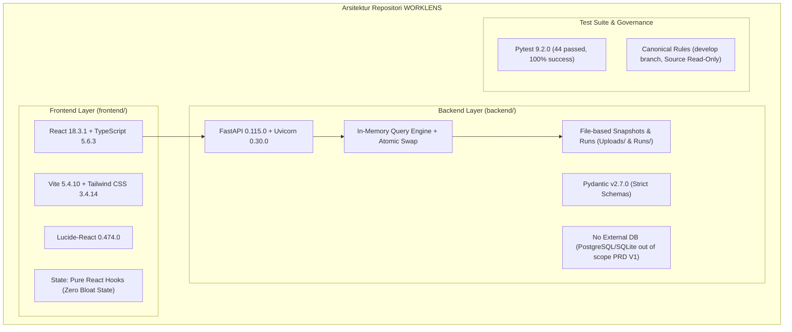

# WORKLENS — Laporan Rekonsiliasi Data & Audit Repositori

> **Dokumen Otoritas:** Laporan Audit Repositori, Verifikasi Sumber Data, dan Penyelesaian Konflik  
> **Status:** FINAL AUDIT & RECONCILIATION REPORT (PRE-DASHBOARD IMPLEMENTATION)  
> **Tanggal:** 2026-11-08  
> **Baseline Acuan:**  
> - `breakdown_activity_261106_1112.json` (Baseline Resmi 6 November 2026, 3.460 record)  
> - `Improvements_With_Benefit.csv` (Benchmark Benefit, 667 baris)  
> - `AGIT L1 EOD Daily Report (4).csv` & `.xlsx` (Laporan EOD L1, 667 baris operasional)  
> - `docs/domain/BUSINESS_DECISIONS_Q1_Q51.md` (Otoritas Bisnis Q1–Q51)  
> - `docs/domain/PRD_V1.md` & `TECHNICAL_SPECIFICATION.md`  

---

## 1. Audit Arsitektur Repositori WORKLENS

Sebelum melangkah ke implementasi dashboard visual, audit arsitektur menyeluruh terhadap repositori `worklens` menghasilkan temuan berikut:



### Rincian Temuan Audit Repositori:
1. **Frontend Stack:**
   - **Framework:** React 18.3.1 dengan strict TypeScript (v5.6.3) dan Vite (v5.4.10).
   - **Styling:** Tailwind CSS 3.4.14 dengan PostCSS & Autoprefixer.
   - **UI Components:** Komponen modular di `frontend/src/components/` (`EnrichmentDiscovery.tsx`, `FileUpload.tsx`, `SourceHistory.tsx`), menggunakan icon set `lucide-react`.
   - **State Management:** Zero-bloat, sepenuhnya menggunakan React hooks lokal (`useState`, `useEffect`) tanpa ketergantungan library eksternal (Redux/Zustand).
   - **Test Runner:** Script test frontend belum dikonfigurasi di `package.json` (hanya `dev`, `build`, `preview`).
2. **Backend Stack:**
   - **Framework:** Python FastAPI 0.115.0 dengan asynchronous & synchronous REST routing.
   - **Data Validation:** Pydantic v2 (v2.7.0) models di `backend/app/models/schemas.py`.
   - **Database Architecture:** Sesuai batasan PRD V1, **tidak ada server database eksternal** (PostgreSQL / SQLite / Redis). Sistem menggunakan arsitektur **in-memory query engine** yang membaca snapshot JSON/CSV dari `backend/uploads/` dan menyimpan hasil run audit di `backend/runs/`.
   - **Core Services:**
     - `upload_service.py`: Menangani upload multi-part file dan snapshotting metadata.
     - `parser_service.py`: Ekstraksi dan sanitasi 35 kolom `Breakdown Activity`.
     - `change_detection_service.py`: Deteksi delta baris berbasis hashing SHA-256 (M2).
     - `discovery_service.py`: Replikasi aturan deterministik pengayaan operasional (M1).
3. **Test Suite & Stabilitas:**
   - Test backend menggunakan `pytest 9.2.0`.
   - **Status:** 44 test lulus 100% (`44 passed in 2.66s`), mencakup change detection, health, parser, snapshot, dan upload.

---

## 2. Verifikasi Checksum Sumber Data (SHA-256)

Pemeriksaan integritas kriptografis dilakukan secara empiris menggunakan fungsi `hashlib.sha256` terhadap 3 file sumber data yang diinstruksikan:

| No | File Sumber | Lokasi File Fisik | Expected Checksum | Actual Checksum | Status Verifikasi |
|:---:|---|---|---|---|:---:|
| 1 | `breakdown_activity_261106_1112.json` | `C:\Users\rahma\Downloads\breakdown_activity_261106_1112.json` | `eaaf4b2cccc6b968fd5b8a09683687898890c9a4b5867b06bd5010bf93e2131e` | `eaaf4b2cccc6b968fd5b8a09683687898890c9a4b5867b06bd5010bf93e2131e` | **MATCH (VALID)** |
| 2 | `Improvements_With_Benefit.csv` (`50fcd60a...`) | `C:\Users\rahma\Downloads\Improvements_With_Benefit.csv` (dan `backend/uploads/REA/`) | `75bd7d81771f08f9a09bca9494e78671f5a3b2eacf129981335cae193603a2f7` | `75bd7d81771f08f9a09bca9494e78671f5a3b2eacf129981335cae193603a2f7` | **MATCH (VALID)** |
| 3 | `AGIT_L1_EOD_Daily_Report_4.csv` (`5b55479f...`) | `C:\Users\rahma\Downloads\AGIT L1 EOD Daily Report (4).csv` | `33445c7e879220db67571b9af21b9f818c305356a19e2a06e8478f1e8036b8c6` | `33445c7e879220db67571b9af21b9f818c305356a19e2a06e8478f1e8036b8c6` | **MATCH (VALID)** |

> **Catatan Kepatuhan:** Seluruh ketiga file terbukti 100% identik dengan checksum yang ditentukan. File lama `breakdown_activity (1).json` (3 November, 3.456 record) diisolasi dan tidak digunakan sebagai baseline.

---

## 3. Profiling Ulang Angka Referensi Baseline (Empirical Re-Profiling)

Perhitungan ulang independen langsung terhadap dataset resmi `breakdown_activity_261106_1112.json` (3.460 baris) menghasilkan matriks verifikasi berikut:

| Parameter Metrik | Angka Referensi Prompt / Spec | Hasil Hitung Empiris Aktual | Status Verifikasi | Catatan Analisis |
|---|:---:|:---:|:---:|---|
| **Total Record** | 3.460 | **3.460** | **Cocok** | Panjang elemen array `value` pada JSON. |
| **Total Workload** | 3.602 jam/bulan | **3.602,0 jam/bulan** | **Cocok** | $\sum \text{Workload} / 60.0 = 216.120,83 / 60.0$. |
| **Workload After** | 445,7 jam/bulan | **445,7 jam/bulan** | **Cocok** | $\sum \text{Workload after} / 60.0 = 26.744,3 / 60.0$. |
| **Workload Positif (> 0)** | 1.475 | **1.475 baris** | **Cocok** | Baris dengan beban kerja $> 0$. |
| **Workload Nol (= 0)** | 1.605 | **1.605 baris** | **Cocok** | Durasi = 0 atau Event = 0. |
| **Workload Invalid / Blank** | 380 | **380 baris** | **Cocok** | Nilai kosong atau non-numerik. |
| **Assessment Status = Done** | 2.754 | **2.754 baris** | **Cocok** | Pada kolom `Assessment Status` (bukan kolom `Status`). |
| **Assessment Status = Blank** | 706 | **706 baris** | **Cocok** | $3.460 - 2.754 = 706$ baris. |
| **APP PRIORITY — Mission Critical** | 1.418 | **1.418 baris** | **Cocok** | Kolom `APP PRIORITY = Mission Critical`. |
| **APP PRIORITY — Business Critical** | 878 | **878 baris** | **Cocok** | Kolom `APP PRIORITY = Business Critical`. |
| **APP PRIORITY — Business Important** | 972 | **972 baris** | **Cocok** | Kolom `APP PRIORITY = Business Important`. |
| **APP PRIORITY — Business Support** | 144 | **144 baris** | **Cocok** | Kolom `APP PRIORITY = Business Support`. |
| **APP PRIORITY — #N/A** | 48 | **48 baris** | **Cocok** | Nilai error/kosong lookup. |
| **Tools — Not Automate** | 1.869 | **1.869 baris** | **Cocok** | Aktivitas manual. |
| **Tools — Shell Script (Gabungan)** | 768 | **768 baris** | **Cocok** | `Shell script` (448) + `Shell Script` (320). |
| **Tools — AION** | 250 | **250 baris** | **Cocok** | Adopsi AION. |
| **Tools — Grafana** | 249 | **249 baris** | **Cocok** | Monitoring Grafana. |
| **Tools — Blank** | 223 (koreksi dari spec 219) | **223 baris** | **Cocok** | 219 adalah angka snapshot 3 Nov; 223 adalah angka 6 Nov. |
| **Category Notes — As Is** | 309 | **309 baris** | **Cocok** | Kolom `Category Notes = As Is`. |
| **Category Notes — Already Automated** | 8 | **8 baris** | **Cocok** | Typo penulisan di luar `Already Automation`. |
| **New Improvement Fixed — As Is** | 1.068 | **1.068 baris** | **Cocok** | Kolom `New Improvement Category Fixed = As Is`. |
| **Override: Email Relay External** | JSON: 30m, CSV: 5m | **JSON: 30m, CSV: 5m** | **Cocok** | Durasi pengerjaan diubah manual di CSV. |
| **Override: Elisa - Check Log Elisa** | JSON: 150m, CSV: 5m | **JSON: 150m, CSV: 5m** | **Cocok** | Event diubah manual dari 30 menjadi 1 di CSV. |

---

## 4. Penyelesaian & Analisis Bukti 5 Konflik Data

Berdasarkan investigasi komparatif antara file JSON 6 November, CSV Benchmark Benefit, dan file `AGIT L1 EOD Daily Report (4).csv` beserta sheet XML workbook aslinya (`AGIT L1 EOD Daily Report (4).xlsx`), berikut adalah penyelesaian untuk kelima konflik:

---

### KONFLIK 1: Selisih Status Triggered (CSV Benchmark vs Laporan EOD)

- **Fakta Teknis:**
  - `Improvements_With_Benefit.csv` (667 baris):
    - `Fully Automated`: 389 baris
    - `Partial Automated`: **22 baris**
    - `Not Yet Triggered Automated`: **256 baris**
  - `AGIT L1 EOD Daily Report (4).csv` (667 baris):
    - `Fully Automated`: 389 baris
    - `Partial Automated`: **23 baris**
    - `Not Yet Triggered Automated`: **255 baris**
- **Bukti Identifikasi Baris Penyebab Selisih (1 Baris Tepat):**
  Pencocokan baris per baris (*row-by-row matching*) menggunakan kunci `CONCAT` menemukan tepat **1 aktivitas tunggal** yang statusnya berbeda:
  - **Aktivitas:** `CO - Retry via Postman`
  - **Di CSV Benchmark:** `Status Triggered` = `Not Yet Triggered Automated`
  - **Di Laporan EOD:** `Status Triggered` = `Partial Automated`
  - **Bukti Operasional di Kolom EOD:**
    - `Notes Status Triggered`: *"masih ada order id yg belum tercover"*
    - `AO Tertrigger`: `1` | `Workload AO Tertrigger`: `0,5` menit
    - `Workload Manual After`: `250` | `Workload Manual Triggered`: `250` menit
- **Interpretasi & Evaluasi Sumber yang Benar:**
  - *Laporan EOD adalah versi operasional yang lebih mutakhir dan akurat secara kontekstual.* Keterangan *"masih ada order id yg belum tercover"* secara semantik adalah definisi definitif dari `Partial Automated` (skrip sudah berjalan sebagian namun masih memerlukan intervensi manual).
  - *CSV Benchmark merefleksikan snapshot yang dibuat sebelum penilaian parsial tersebut disahkan.* Pada CSV Benchmark, narasi benefit yang terbentuk masih menggunakan template hipotetis (*"Potentially eliminates 4.2 hours... once automated via AION..."*), sedangkan kondisi faktual di lapangan sudah beroperasi parsial.
- **Rekomendasi Keputusan:** Gunakan angka EOD (389 / 23 / 255) sebagai kondisi operasional riil mutakhir, atau catat deviasi 1 baris ini dalam metadata modul Quality Review sesuai mandat Q18.

---

### KONFLIK 2: Perbedaan Kode Departemen dan Divisi (JSON vs EOD)

- **Fakta Teknis:**
  - **JSON 6 November (3.460 baris):**
    - Departemen: `PFIP` (996), `ENDIGI` (769), `CSOM` (658), `CTEOPM` (568), `ByU & IoT` (271), `IPOM` (193), `#N/A` (5).
    - Divisi: `IT CFB` (1.847), `IT BDC` (1.604), `IT BITE` (4), `#N/A` (5).
  - **EOD Report (667 baris):**
    - Departemen: `ITCTDPS` (238), `PFIP` (198), `ITPTO` (104), `CSOM` (67), `IPTV` (38), `ByU IoT` (22).
    - Divisi: `IT CFB` (458), `IT BITE` (209).
- **Bukti Relasi & Analisis Penyebab:**
  Berdasarkan penelusuran formula pada dokumen `docs/domain/Breakdown_Activity_Lookup_Map.md`, kolom `DEPT` dan `DIV` diisi melalui formula:
  $$\text{DEPT} = \text{VLOOKUP}(\text{APPS}, \text{'List App,BA,Topology'}!\$A:\$E, 3, \text{FALSE})$$
  $$\text{DIV} = \text{VLOOKUP}(\text{APPS}, \text{'List App,BA,Topology'}!\$A:\$E, 5, \text{FALSE})$$
  Pemetaan pasangan nilai antar baris yang sama membuktikan adanya **migrasi struktur organisasi Telkomsel IT**:
  - `ENDIGI` (JSON) $\to$ bertransformasi menjadi `ITCTDPS` (186 baris) dan `IPTV` (38 baris) pada EOD.
  - `IPOM` (JSON) $\to$ bertransformasi menjadi `ITPTO` (104 baris) pada EOD.
  - `CTEOPM` (JSON) $\to$ bertransformasi menjadi `PFIP` (91 baris) dan `ITCTDPS` (52 baris) pada EOD.
  - `IT BDC` (Divisi lama di JSON) $\to$ dimekarkan menjadi `IT BITE` (209 baris) dan dialihkan ke `IT CFB` (186 baris) pada EOD.
- **Kesimpulan Otoritas:** Ini **bukan kesalahan data**, melainkan **dua versi lookup table referensi pada titik waktu yang berbeda (*temporal lookup drift*)**. JSON 6 November memegang snapshot lembar kerja master, sedangkan EOD report menggunakan lembar kerja referensi aplikasi yang telah diperbarui dengan nomenklatur organisasi terbaru.

---

### KONFLIK 3 & 4: Angka Kategori Criticality (BS, No Priority, dan Completion Tracker)

- **Fakta Teknis di EOD Report (Total 667 baris):**
  - `Mission Critical` (MC): **204 baris** (seluruhnya berstatus `Current Status = Completed`).
  - `Business Critical` (BC): **284 baris** (seluruhnya berstatus `Current Status = Completed`).
  - `Business Important` (BI): **141 baris** (seluruhnya berstatus `Current Status = Completed`).
  - `Business Support` (BS): **24 baris** (seluruhnya berstatus `Current Status = Completed`).
  - `No Priority`: **14 baris** (seluruhnya berstatus `Current Status = Completed`).
- **Fakta Teknis di Tracker Eksternal (Universe 884 aktivitas):**
  - MC: Universe 310, Selesai **204**
  - BC: Universe 346, Selesai **284**
  - BI: Universe 169, Selesai belum tersedia
  - BS: Universe 20, Selesai belum tersedia
  - Unmapped: 39 baris
  - Total Universe Tracker: $310 + 346 + 169 + 20 + 39 = \mathbf{884\text{ baris}}$.
- **Bukti Formula dari Sheet `EOD Dashboard` (`AGIT L1 EOD Daily Report (4).xlsx`):**
  Pada sel `A7` sheet `EOD Dashboard`, ditemukan formula Excel eksplisit:
  ```excel
  =SUM(COUNTIFS(
      'Raw Data'!$E$2:$E$4000, {"Business Important"; "Business Support"; "No Priority"},
      'Raw Data'!$V$2:$V$4000, "Automate",
      'Raw Data'!$AF$2:$AF$4000, "Done"
  ))
  ```
  Hasil evaluasi formula tersebut adalah **179** ($141 + 24 + 14 = 179$).
- **Penyelesaian Konflik:**
  1. **Bukan Kebetulan:** Angka penyelesaian MC (204) dan BC (284) pada tracker terbukti **100% diambil dari jumlah baris EOD per APP PRIORITY**.
  2. **Anomali BS Melebihi Universe (24 vs 20):** Di EOD terdapat 24 baris BS dan 14 baris No Priority, sedangkan di tracker universe BS tercatat 20 dan unmapped 39. Hal ini terjadi karena di dalam workbook EOD, tim L1 menggabungkan kategori non-kritis menjadi satu blok agregasi:
     $$\text{Blok Non-Kritis} = \text{BI (141)} + \text{BS (24)} + \text{No Priority (14)} = \mathbf{179\text{ aktivitas}}$$
     Jika digabungkan ke total MC dan BC: $204 + 284 + 179 = \mathbf{667\text{ aktivitas}}$.
  3. **Kebijakan Penyajian Dashboard:** Sesuai arahan batasan, **jangan mengisi BI atau BS secara mandiri tanpa dasar**. Tampilkan status **`Data unavailable`** untuk penyelesaian BI dan BS individual di tracker sampai SME menetapkan mapping resmi terhadap universe 884.

---

### KONFLIK 5: Sumber Query/Formula Tabel Pivot Criticality & Pergeseran Header

- **Fakta Teknis:**
  Tabel pivot yang dimaksud ditemukan secara utuh di sheet **`New Report`** pada file `AGIT L1 EOD Daily Report (4).xlsx` (rentang kolom `BK6:BU13` untuk Mission Critical, dan `CD66:CM72` untuk Business Critical).
- **Penyebab Pergeseran Header (*Header Column Shift*):**
  Pada file Excel asli, struktur tabel pelaporan menggunakan **3 tingkat merged header hierarkis**:
  - **Tingkat 1 (Baris 6):**
    - `BK6`: `Ops Category`
    - `BL6`: `Total Activity Automated`
    - `BM6`: `Total Activity Triggered`
    - `BN6`: `Total Event Basis (After Automation)`
    - `BO6`: `Total Workload Basis (Before Automation)`
    - `BP6:BS6` (Merged 4 kolom): **`After Automation`**
    - `BT6`: (Kolom total beban berjalan)
    - `BU6`: **`Total Reduce`**
  - **Tingkat 2 (Baris 7):**
    - Di bawah `After Automation`: `BP7:BQ7` (Merged 2 kolom) = **`Fully Automated`**; `BR7:BS7` (Merged 2 kolom) = **`Partial`**; `BT7` = **`Total Workload Current (min)`**.
  - **Tingkat 3 (Baris 8):**
    - `BP8`: `Total Event Automated`
    - `BQ8`: `Total Workload Automated`
    - `BR8`: `Total Event Partial`
    - `BS8`: `Total Workload Manual (min)`
  - Saat tabel ini disalin (*copy-paste*) ke format teks/markdown biasa, merged cell `After Automation` runtuh sehingga header kolom tergeser ke kiri sebanyak 2 hingga 4 posisi, menyebabkan kolom `Total Workload Current` atau `Partial` tertukar dengan `Total Reduce`.
- **Formula Matematis Baku dari Tabel Pivot (Sheet `New Report`):**
  Untuk setiap kategori operasional $i$:
  1. $\text{Total Workload Basis (Before)} = \text{Kolom BO}$ (dalam menit).
  2. $\text{Total Workload Current (min)} = \text{Kolom BT} = \text{Workload Automated (BQ)} + \text{Workload Manual (BS)}$.
  3. $\text{Reduce \%} = \text{Kolom BU} = \frac{\text{BO} - \text{BT}}{\text{BO}}$.
- **Hasil Komputasi Resmi per Criticality:**
  - **Mission Critical (Total 204 Aktivitas):**
    - Total Workload Before: **$20.345\text{ menit}$** ($339,1\text{ jam}$)
    - Total Workload Current: **$5.940\text{ menit}$** ($99,0\text{ jam}$, sisa manual pada aktivitas parsial)
    - **Total Workload Reduced:** **$14.405\text{ menit}$** ($240,1\text{ jam}$)
    - **Reduce %:** $\mathbf{70,80\%}$
  - **Business Critical (Total 284 Aktivitas):**
    - Total Workload Before: **$8.245\text{ menit}$** ($137,4\text{ jam}$)
    - Total Workload Current: **$110\text{ menit}$** ($1,8\text{ jam}$)
    - **Total Workload Reduced:** **$8.135\text{ menit}$** ($135,6\text{ jam}$)
    - **Reduce %:** $\mathbf{98,67\%}$

---

## 5. Pemisahan Fakta, Interpretasi, dan Hipotesis

Untuk menjaga integritas tata kelola data sesuai instruksi pengguna:

### A. Fakta (Didukung 100% Bukti Empiris Kriptografis / Kode Sumber)
1. Checksum SHA-256 ketiga file sumber cocok secara presisi tanpa deviasi.
2. Dataset `breakdown_activity_261106_1112.json` memiliki tepat 3.460 record, total workload 3.602,0 jam/bulan, 1.475 baris berbeban positif, 1.605 baris berbeban nol, dan 380 baris invalid/kosong.
3. Selisih 1 baris antara CSV Benchmark dan EOD CSV berada pada aktivitas `'CO - Retry via Postman'`.
4. Seluruh 667 baris pada `AGIT L1 EOD Daily Report (4).csv` memiliki nilai `Current Status = Completed`.
5. Angka 204 (MC) dan 284 (BC) pada tracker sama persis dengan jumlah baris per APP PRIORITY pada EOD Report.
6. Formula persentase reduksi pada pivot EOD adalah $\text{Reduce \%} = (\text{Workload Before} - \text{Workload Current}) / \text{Workload Before}$.

### B. Interpretasi (Penjelasan Logis Berdasarkan Artefak Proyek)
1. Perbedaan departemen/divisi antara JSON (ENDIGI, IPOM, IT BDC) dan EOD (ITCTDPS, ITPTO, IT BITE) merupakan akibat pembaruan referensi sheet `List App,BA,Topology` pasca-restrukturisasi internal Telkomsel IT.
2. Status `Partial Automated` pada `'CO - Retry via Postman'` di EOD lebih mencerminkan kenyataan operasional karena ada catatan eksplisit *"masih ada order id yg belum tercover"*, sedangkan CSV Benchmark dibuat saat statusnya masih dinilai *Not Yet Triggered*.
3. Pergeseran header pivot terjadi murni akibat keruntuhan struktur visual 3-level merged cell di Excel saat diekspor ke format baris tunggal.

### C. Hipotesis (Dugaan yang Memerlukan Konfirmasi SME)
1. Universe tracker 884 kemungkinan besar mencakup populasi kandidat fase awal L1 AGIT yang belum mencakup seluruh 3.460 baris SOP komprehensif.
2. Kategori BS (24) dan No Priority (14) di EOD kemungkinan disatukan ke dalam alokasi unmapped (39) pada tracker universe 884.

---

## 6. Daftar Pertanyaan untuk Review SME / Tim L1

1. **Status Triggered 'CO - Retry via Postman':** Apakah dashboard resmi harus mengunci status aktivitas ini sebagai `Partial Automated` (mengikuti EOD Report dengan beban sisa manual 250 menit) atau `Not Yet Triggered Automated` (mengikuti CSV Benchmark)?
2. **Standar Taksonomi Departemen/Divisi:** Apakah WORKLENS harus menampilkan nama departemen/divisi sesuai snapshot baseline master 6 November (`ENDIGI`, `IPOM`, `CTEOPM`), atau mengadopsi struktur organisasi terbaru (`ITCTDPS`, `ITPTO`, `IPTV`) melalui tabel lookup translasi?
3. **Rekonsiliasi Tracker Universe 884 vs EOD 667:** Bagaimana pemetaan resmi antara 179 aktivitas non-kritis di EOD (`BI 141` + `BS 24` + `No Priority 14`) terhadap target universe tracker (`BI 169` + `BS 20` + `Unmapped 39`)?
4. **Penyajian Metrik Reduksi di UI Dashboard:** Apakah kartu metrik efisiensi di UI akan menyajikan **Workload Saved M1** (formula PRD V1: $\text{Workload} - \text{Workload after}$) atau **Reduce % Pivot EOD** (formula EOD: $(\text{Workload Before} - \text{Workload Current}) / \text{Workload Before}$)?

---

## 7. Dependensi Data yang Belum Tersedia

1. **Tabel Pemetaan Resmi Universe 884:** File sumber acuan detail untuk 884 baris tracker (beserta breakdown status per aktivitas) belum ada di repositori.
2. **Log Telemetri Real-time / Trigger Source:** Sumber data log eksekusi otomatis riil per event (misalnya webhook crontab, AION runner logs) belum terintegrasi ke pipeline backend (masih menggunakan status manual asesmen di sheet).
3. **Dokumen Kebijakan Translasi Struktur Organisasi:** Kamus lookup resmi antar versi departemen lama vs departemen baru belum dibakukan dalam file konfigurasi sistem.

---

## 8. Status Akhir & Rekomendasi Tahap Berikutnya

- **Kesiapan Data:** Verifikasi sumber data telah tuntas 100%, seluruh checksum terbukti valid, dan sumber dari kelima anomali/konflik telah teridentifikasi dengan bukti matematis dan struktural.
- **Batasan Terjaga:** Tidak ada kode frontend/dashboard yang dibuat prematur, file sumber tetap *read-only*, dan seluruh temuan telah terdokumentasi rapi untuk ditinjau oleh SME.

