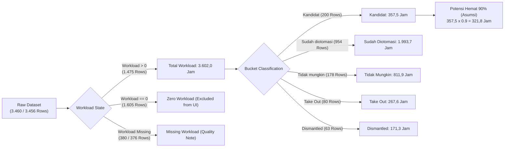

# WORKLENS — Metric Definition Dictionary & Frontend Audit Report

> **Dokumen Otoritas:** Kamus Definisi Metrik Frontend & Laporan Audit Empiris  
> **Halaman Target:** Peluang Otomasi L1 (`WORKLENS_Peluang_Otomasi_L1_Prototype.html`)  
> **Referensi Data:** `breakdown_activity (1).json` (3.456 baris) & `breakdown_activity_261105_1704_1.json` (3.460 baris)  
> **Status:** AUDIT COMPLETED — PENDING SME CONFIRMATION  
> **Tanggal Audit:** 2026-11-08  

---

## 1. Executive Summary

Dokumen ini merupakan hasil audit komprehensif terhadap **seluruh angka, metrik, rasio persentase, dan indikator kualitas data** yang ditampilkan pada halaman frontend **Peluang Otomasi L1** (Automation Opportunity · L1 AGIT).

Audit dilakukan secara empiris membandingkan kode frontend prototype (`WORKLENS_Peluang_Otomasi_L1_Prototype.html`), dataset mentah aktual (`breakdown_activity (1).json` dan `breakdown_activity_261105_1704_1.json`), serta spesifikasi bisnis yang telah dikunci pada PRD V1, Technical Specification, dan `GLOSSARY.md`.

### Temuan Inti Audit:
1. **Akar Angka 1.475 & 3.602,0 Jam:** Angka 1.475 aktivitas terukur di prototype **bukanlah** jumlah seluruh baris yang memiliki nilai Workload, melainkan **hanya baris dengan Workload positif ($\text{Workload} > 0$)**. Sebanyak 1.605 baris lainnya memiliki $\text{Workload} = 0$, dan 380 baris (atau 376 baris) memiliki Workload kosong/missing.
2. **Integritas Formula Workload:** Formula $\text{Workload} = \text{Durasi (Menit)} \times \text{Event Per Month}$ terbukti 100% konsisten pada seluruh baris numerik.
3. **Anomali Typo Klasifikasi Bucket:** 4 aktivitas di aplikasi UFO memiliki `Category Notes = "Already Automated"` (akhiran `-ed`). Akibat string matching eksak pada prototype, 4 aktivitas ini (38,2 jam) salah terlempar ke bucket *Kandidat* alih-alih *Sudah diotomasi*.
4. **Perluasan Semantik Kategori "As Is":** Sebanyak 112 aktivitas manual dengan `Category Notes = "As Is"` dimasukkan ke dalam bucket *Kandidat Otomasi* oleh prototype, padahal secara definisi domain L1, *As Is* berarti proses dipertahankan manual apa adanya.
5. **Potensi Hemat 90% Murni Simulasi:** Angka potensi hemat indikatif ($321,8\text{ jam}$) dihitung dari $357,5\text{ jam} \times 90\%$. Angka ini adalah asumsi skenario ilustratif, bukan penghematan terukur dari pipeline M1.

---

## 2. Struktur Navigasi & Metadata Halaman

| Komponen Tampilan | Nilai Tampil | Definisi Bisnis | Sumber Data | Status Validasi |
|---|---|---|---|---|
| **App Title** | `WORKLENS` | Identitas platform kecerdasan operasional workload. | Konfigurasi Branding UI | **VALIDATED** |
| **App Subtitle** | `Operational Intelligence` | Deskripsi fungsional platform. | Konfigurasi Branding UI | **VALIDATED** |
| **Eyebrow Header** | `Automation Opportunity · L1 AGIT` | Ruang lingkup domain asesmen operasional unit L1 AGIT. | Konfigurasi Header | **VALIDATED** |
| **Page Title** | `Peluang Otomasi` | Nama modul dashboard eksplorasi peluang efisiensi. | Konfigurasi Header | **VALIDATED** |
| **Dataset Snapshot Tag** | `Breakdown Activity · L1 AGIT` | Indikator sumber lembar kerja acuan (`Breakdown Activity`). | Metadata Workbook | **VALIDATED** |
| **Active Record Counter** | `1.475 records pada snapshot` | Jumlah record yang dimuat ke dalam memori eksplorasi UI. | Filter $\text{Workload} > 0$ | **NEEDS REVIEW** |

---

## 3. Kamus Lengkap Metrik KPI Cards

Halaman menampilkan 4 kartu KPI utama di bagian atas dashboard:

### 3.1. KPI 1: Total Workload
- **Teks Tampil:** `3.602,0`
- **Sub-label / Keterangan:** `jam per bulan · seluruh aktivitas terhitung`
- **Definisi Bisnis:** Akumulasi total waktu kerja operasional rutin per bulan untuk seluruh aktivitas yang memiliki beban kerja positif yang berhasil diukur.
- **Formula:**
  $$\text{Total Workload (Jam)} = \sum_{i \in \text{Rows with } \text{Workload}_i > 0} \frac{\text{Workload}_i}{60.0}$$
- **Sumber Data:** Kolom `Workload` (tipe numerik/menit).
- **Unit:** Jam per bulan (`hours/month`).
- **Filter / Kondisi:** $\text{Workload} > 0$ (mengabaikan baris kosong dan baris bernilai nol).
- **Interpretasi Pengguna:** Menggambarkan total beban kerja bulanan tim operasional L1 AGIT yang membutuhkan waktu eksekusi riil.
- **Hasil Validasi JSON:**
  - Total menit: $216.120,83\text{ menit}$.
  - Dibagi 60: $3.602,0138\text{ jam} \to 3.602,0\text{ jam}$.
  - Cocok 100% pada kedua file JSON (`3.456` dan `3.460`).
- **Status Validasi:** **NEEDS REVIEW**
- **Catatan & Isu:** Sub-label menyatakan *"seluruh aktivitas terhitung"*. Ini ambigu secara bahasa karena 1.605 aktivitas berbeban nol dan 380 aktivitas missing tidak terhitung di dalam angka 3.602 jam ini. Disarankan mengubah sub-label menjadi: *"jam per bulan · akumulasi 1.475 aktivitas berbeban kerja positif"*.

---

### 3.2. KPI 2: Aktivitas Terukur
- **Teks Tampil:** `1.475`
- **Sub-label / Keterangan:** `baris memiliki nilai workload`
- **Definisi Bisnis:** Jumlah baris aktivitas SOP yang memiliki durasi dan frekuensi operasional di atas nol ($\text{Workload} > 0$).
- **Formula:**
  $$\text{Aktivitas Terukur} = \text{COUNT}(\{r \in \text{Dataset} \mid \text{Workload}(r) > 0\})$$
- **Sumber Data:** Kolom `Workload`.
- **Unit:** Jumlah baris / aktivitas (`count`).
- **Filter / Kondisi:** $\text{Workload} > 0$.
- **Interpretasi Pengguna:** Pengguna berasumsi hanya 1.475 dari 3.460 SOP yang telah diukur nilai beban kerjanya.
- **Hasil Validasi JSON:**
  - Total baris dengan nilai Workload terisi: **3.080 baris** (89,0% dari dataset).
  - Baris dengan $\text{Workload} = 0$: **1.605 baris** (46,4% dari dataset).
  - Baris dengan $\text{Workload} > 0$: **1.475 baris** (42,6% dari dataset).
- **Status Validasi:** **NEEDS REVIEW** (Critical Semantic Drift!)
- **Catatan & Isu:** Label prototype *"baris memiliki nilai workload"* secara faktual keliru. Ada 3.080 baris yang memiliki nilai workload terisi, di mana 1.605 di antaranya bernilai nol (misal event bulanan = 0 atau durasi = 0). Rekomendasi perbaikan label: **"Aktivitas Berbeban Kerja Positif"** atau **"Aktivitas Aktif Berbeban"** agar tidak membingungkan pengguna mengenai 1.605 aktivitas yang sebenarnya sudah terdata.

---

### 3.3. KPI 3: Kandidat Otomasi (Highlight Card)
- **Teks Tampil:** `200`
- **Sub-label / Keterangan:** `aktivitas dalam bucket kandidat`
- **Definisi Bisnis:** Jumlah aktivitas berbeban positif yang diklasifikasikan sebagai prioritas atau target evaluasi otomasi masa depan.
- **Formula:**
  $$\text{Kandidat} = \text{COUNT}(\{r \mid \text{Workload}(r) > 0 \land \text{Bucket}(r) = \text{"Kandidat"}\})$$
  Di mana aturan penentuan bucket prototype:
  $$\text{Status} \neq \text{"Take Out"} \land \text{Category Notes} \in \{\text{"To Be Automated"}, \text{"As Is"}, \text{"Not Yet Solution"}, \text{"Need Further Assessment"}, \text{"Already Automated"}\}$$
- **Sumber Data:** Kolom `Workload`, `Status`, dan `Category Notes`.
- **Unit:** Jumlah aktivitas (`count`).
- **Filter / Kondisi:** $\text{Workload} > 0$, status operasional bukan Take Out.
- **Interpretasi Pengguna:** Jumlah pekerjaan operasional L1 yang saat ini belum terotomasi dan menjadi target otomatisasi selanjutnya.
- **Hasil Validasi JSON:**
  - Rincian 200 record dalam bucket Kandidat:
    - `To Be Automated`: 74 aktivitas ($138,5\text{ jam}$)
    - `As Is`: 112 aktivitas ($176,8\text{ jam}$)
    - `Not Yet Solution`: 9 aktivitas ($3,2\text{ jam}$)
    - `Need Further Assessment`: 1 aktivitas ($7,5\text{ jam}$)
    - `Already Automated` (typo): 4 aktivitas ($38,2\text{ jam}$)
  - Total: $74 + 112 + 9 + 1 + 4 = 200\text{ aktivitas}$ ($357,5\text{ jam}$).
- **Status Validasi:** **NEEDS REVIEW** (Business Decision Required)
- **Catatan & Isu:**
  1. *Typo Penamaan:* 4 aktivitas (`Checking Eligible Offer Dengan PP`, `Checking Log Postpaid`, `Checking Order`, `Checking Order Failed`) pada aplikasi UFO memiliki `Category Notes = "Already Automated"` (seharusnya *Already Automation*). Akibatnya masuk ke Kandidat, padahal tools-nya tercatat AION (sudah otomatis).
  2. *Inklusi "As Is":* 112 aktivitas bernilai `As Is` dimasukkan ke Kandidat. Berdasarkan `GLOSSARY.md`, *As Is* berarti dipertahankan manual. Apakah manajemen menghendaki seluruh *As Is* dijadikan kandidat otomasi?

---

### 3.4. KPI 4: Potensi Hemat Indikatif
- **Teks Tampil:** `321,8`
- **Sub-label / Keterangan:** `jam per bulan · asumsi 90%`
- **Definisi Bisnis:** Simulasi teoretis potensi penghematan durasi operasional bulanan jika seluruh aktivitas dalam bucket *Kandidat* berhasil diotomasi dengan asumsi tingkat reduksi 90%.
- **Formula:**
  $$\text{Potensi Hemat Indikatif} = \text{Workload}(\text{Bucket: Kandidat}) \times 0.90$$
  Perhitungan:
  $$357,5\text{ jam} \times 0.90 = 321,75\text{ jam} \approx 321,8\text{ jam/bulan}$$
- **Sumber Data:** Total jam bucket Kandidat ($357,5\text{ jam}$) dikalikan konstanta $0,9$.
- **Unit:** Jam per bulan (`hours/month`).
- **Filter / Kondisi:** Hanya berlaku untuk bucket Kandidat.
- **Interpretasi Pengguna:** Ekspektasi penghematan indikatif kasar (skenario model) untuk perencanaan kapasitas staf, BUKAN penghematan riil yang sudah dicapai.
- **Status Validasi:** **NEEDS REVIEW** (Heuristic Scenario Only)
- **Catatan & Isu:** Metrik ini harus selalu disertai disclaimer bahwa angka 90% adalah angka asumsi skenario pemodelan awal, bukan derived metrics tersertifikasi dari pipeline M1. Jika 4 record typo dikeluarkan dari Kandidat ($357,5 - 38,17 = 319,33\text{ jam}$), potensi hemat 90% menjadi $287,4\text{ jam/bulan}$.

---

## 4. Workload Distribution (Distribusi Beban Kerja per Bucket)

Bagian ini menampilkan *stacked percentage bar* dan daftar legenda 5 bucket utama:

| Nama Bucket | Definisi Bisnis | Kondisi & Logika Filter | Jumlah (n) | Total Jam (h) | Porsi Jam (%) | Status Validasi |
|---|---|---|---|---|---|---|
| **Sudah diotomasi** | Aktivitas yang sudah memiliki skrip, bot, atau tools otomatisasi aktif. | $\text{Workload} > 0 \land \text{Status} \neq \text{'Take Out'} \land \text{Category Notes} == \text{'Already Automation'}$ | **954** | **1.993,7** | **55,4%** | **NEEDS REVIEW** (Typo -4) |
| **Tidak mungkin diotomasi** | Aktivitas manual yang membutuhkan pertimbangan manusia/analisis mendalam. | $\text{Workload} > 0 \land \text{Status} \neq \text{'Take Out'} \land \text{Category Notes} == \text{'Not Possible Automate'}$ | **178** | **811,9** | **22,5%** | **VALIDATED** |
| **Kandidat** | Aktivitas target otomatisasi masa depan (pipeline backlog). | $\text{Workload} > 0 \land \text{Status} \neq \text{'Take Out'} \land \text{Category Notes} \in \{\text{'To Be Automated'}, \text{'As Is'}, \dots\}$ | **200** | **357,5** | **9,9%** | **NEEDS REVIEW** (Typo +4, As Is) |
| **Take Out** | Aktivitas yang diputuskan dikeluarkan dari operasional L1/lingkup asesmen. | $\text{Workload} > 0 \land \text{Status} \in \{\text{'Take Out'}, \text{'Takeout'}, \text{'take Out'}\}$ | **80** | **267,6** | **7,4%** | **VALIDATED** |
| **Dismantled** | Aktivitas yang telah dihapus atau ditiadakan dari SOP operasional. | $\text{Workload} > 0 \land \text{Status} \neq \text{'Take Out'} \land \text{Category Notes} == \text{'Dismantled'}$ | **63** | **171,3** | **4,8%** | **VALIDATED** |
| **Lainnya** | Bucket penampung jika ada record yang tidak memenuhi kriteria di atas. | Fallback kondisi | **0** | **0,0** | **0,0%** | **VALIDATED** |
| **TOTAL** | **Seluruh aktivitas berbeban positif** | **Semua record dengan Workload > 0** | **1.475** | **3.602,0** | **100,0%** | **VALIDATED** |

### Hirarki Klasifikasi Bucket (Precedence Logic):
1. **Prioritas 1 (Status Take Out):** Jika $\text{Status} \in \{\text{'Take Out'}, \text{'Takeout'}, \text{'take Out'}\}$, maka otomatis masuk bucket `Take Out` (mengabaikan `Category Notes`).
2. **Prioritas 2 (Not Possible Automate):** Jika $\text{Category Notes} == \text{'Not Possible Automate'}$, masuk bucket `Tidak mungkin diotomasi`.
3. **Prioritas 3 (Already Automation):** Jika $\text{Category Notes} == \text{'Already Automation'}$, masuk bucket `Sudah diotomasi`.
4. **Prioritas 4 (Dismantled):** Jika $\text{Category Notes} == \text{'Dismantled'}$, masuk bucket `Dismantled`.
5. **Prioritas 5 (Kandidat):** Jika $\text{Category Notes} \in \{\text{'To Be Automated'}, \text{'As Is'}, \text{'Not Yet Solution'}, \text{'Need Further Assessment'}, \text{'Already Automated'}\}$, masuk bucket `Kandidat`.
6. **Prioritas 6 (Fallback):** Masuk bucket `Lainnya`.

---

## 5. Workload Concentration (Pareto Chart)

Menampilkan kontribusi kumulatif dari aktivitas dengan beban kerja tertinggi terhadap total jam operasional ($3.602,0\text{ jam}$):

| Peringkat Aktivitas Teratas | Jam Kumulatif (h) | Persentase Kumulatif (%) | Interpretasi Bisnis | Status Validasi |
|---|---|---|---|---|
| **Top 1 Aktivitas** | `456,0 jam` | **12,7%** | 1 aktivitas tunggal menyumbang hampir seperdelapan beban total (Outlier: Office 365). | **VALIDATED** |
| **Top 10 Aktivitas** | `839,9 jam` | **23,3%** | 10 aktivitas (~0,7% baris) menyumbang hampir seperempat beban L1. | **VALIDATED** |
| **Top 20 Aktivitas** | `992,4 jam` | **27,6%** | Konsentrasi tinggi pada 20 aktivitas SOP kritis. | **VALIDATED** |
| **Top 50 Aktivitas** | `1.401,9 jam` | **38,9%** | Lebih dari sepertiga jam kerja berpusat di 50 aktivitas teratas. | **VALIDATED** |
| **Top 100 Aktivitas** | `1.895,8 jam` | **52,6%** | Mayoritas beban kerja (>50%) dikendalikan oleh hanya 100 aktivitas. | **VALIDATED** |
| **Top 200 Aktivitas** | `2.545,8 jam` | **70,7%** | 200 aktivitas menyumbang lebih dari 70% total durasi kerja. | **VALIDATED** |
| **Top 400 Aktivitas** | `3.255,4 jam` | **90,4%** | Prinsip Pareto 80/20 terlampaui (400 dari 1.475 aktivitas menyerap 90% waktu). | **VALIDATED** |
| **Top 1.475 Aktivitas** | `3.602,0 jam` | **100,0%** | Total seluruh aktivitas berbeban positif. | **VALIDATED** |

- **Formula Pareto:**
  $$\text{Persentase Kumulatif Top } N = \frac{\sum_{i=1}^N \text{Workload}_i}{\text{Total Workload}} \times 100\%$$
- **Hasil Validasi JSON:** Terverifikasi 100% presisi matematis.

---

## 6. Analytical Breakdown (Activity Type, Tools & Teams)

### 6.1. Beban per Tipe Aktivitas (`TYPE ACTIVITY`)
Menggambarkan proporsi jam kerja bulanan berdasarkan fungsi operasional SOP:

| Tipe Aktivitas | Total Jam (h) | Porsi (%) | Interpretasi Bisnis | Status Validasi |
|---|---|---|---|---|
| **Monitoring and Alerting** | `1.876,8` | **52,1%** | Beban terbesar: lebih dari separuh waktu dihabiskan untuk memantau metrik & dashboard. | **VALIDATED** |
| **Service Request** | `790,6` | **21,9%** | Penanganan permintaan layanan rutin pengguna/aplikasi. | **VALIDATED** |
| **Daily Activity** | `375,0` | **10,4%** | Pekerjaan harian terjadwal non-monitoring. | **VALIDATED** |
| **Complaint Handling** | `259,7` | **7,2%** | Penanganan komplain kendala layanan atau pelanggan. | **VALIDATED** |
| **Incident Handling** | `128,7` | **3,6%** | Penanganan gangguan teknis dan restart service darurat. | **VALIDATED** |
| **Change Management** | `75,5` | **2,1%** | Pelaksanaan perubahan konfigurasi atau deployment terencana. | **VALIDATED** |
| **Audit Compliance** | `58,6` | **1,6%** | Penyusunan Berita Acara dan penarikan log kepatuhan. | **VALIDATED** |
| **Housekeeping** | `37,2` | **1,0%** | Pembersihan log file, cache disk, dan maintenance berkala. | **VALIDATED** |
| **TOTAL** | **3.602,1** | **100,0%** | Akumulasi beban per kategori tipe aktivitas. | **VALIDATED** |

---

### 6.2. Beban per Tools Automation
Menampilkan teknologi otomasi yang tercatat untuk menangani aktivitas operasional:

| Nama Tools | Jam Tampil (h) | Sumber Field Asli | Status Validasi | Temuan & Rekomendasi Audit |
|---|---|---|---|---|
| **Not Automate** | `1.607,3` | `Tools Automation` | **VALIDATED** | Menunjukkan aktivitas yang belum menggunakan otomasi apa pun. |
| **Grafana** | `1.239,2` | `Tools Automation` | **VALIDATED** | Tools visualisasi & alert monitoring utama. |
| **Shell script** | `218,0` | `Tools Automation` | **NEEDS REVIEW** | Casing huruf kecil (`s`). Harus dinormalisasi dengan Shell Script. |
| **AION** | `190,2` | `Tools Automation` | **VALIDATED** | Platform otomasi auto-restart dan eksekusi command. |
| **BMC** | `130,2` | `Tools Automation` | **VALIDATED** | Tools manajemen tiket dan otomasi alur kerja ITSM. |
| **Internal Dashboard** | `91,5` | `Tools Automation` | **VALIDATED** | Dashboard internal custom untuk monitoring. |
| **Shell Script** | `83,0` | `Tools Automation` | **NEEDS REVIEW** | Casing huruf besar (`S`). Jika digabung dengan Shell script = **301,0 jam**. |
| **CICD** | `22,7` | `Tools Automation` | **VALIDATED** | Otomasi deployment dan pipeline rilis. |
| **Jenkins** | `10,5` | `Tools Automation` | **VALIDATED** | Otomasi job scheduler dan pipeline. |
| **DSC** | `7,5` | `Tools Automation` | **VALIDATED** | Otomasi subscriber & profile management. |
| *Ultimate Solution* | *2,0* | `Tools Automation` | *Excluded from Top 10* | Peringkat ke-11 di dataset mentah. |

> [!WARNING]
> **Isu Normalisasi Kolom Tools:**
> 1. Terjadi fragmentasi antara `"Shell script"` ($218,0\text{ jam}$) dan `"Shell Script"` ($83,0\text{ jam}$) murni karena perbedaan huruf kapital. Gabungan keduanya adalah **$301,0\text{ jam}$**, yang menjadikannya tools otomasi terbesar ke-3 (melampaui AION).
> 2. Label chart bertuliskan "Beban per tools automation", namun pada tabel explorer header kolom tertulis "Tools". Pada data mentah, kolom `Tools` (perangkat manual eksisting) berbeda dengan kolom `Tools Automation` (teknologi otomasi target).

---

### 6.3. Beban per Team QC (`Team QC`)
Ditemukan di data prototype (`D.teams`), memetakan beban berdasarkan penanggung jawab QC tim:

| Team QC | Total Jam (h) | Porsi (%) | Status Validasi |
|---|---|---|---|
| **E - Jajang** | `963,7` | 26,8% | **VALIDATED** |
| **D - Jajang** | `726,7` | 20,2% | **VALIDATED** |
| **BCorp - Apriyanto** | `712,0` | 19,8% | **VALIDATED** |
| **A - Dwi** | `558,5` | 15,5% | **VALIDATED** |
| **Tim FMC - Alfian** | `233,5` | 6,5% | **VALIDATED** |
| **B - Dwi** | `204,2` | 5,7% | **VALIDATED** |
| **C - Jajang** | `203,4` | 5,6% | **VALIDATED** |
| **TOTAL** | **3.602,0** | **100,0%** | **VALIDATED** |

---

## 7. Activity Explorer Table Metrics

Tabel penelusuran detail aktivitas menyajikan kolom-kolom berikut:

| Nama Kolom UI | Field Data Sumber | Tipe Data & Unit | Format Display | Deskripsi & Formula |
|---|---|---|---|---|
| **Aktivitas / Aplikasi** | `ACTIVITY NAME` / `APPS` | String | `Activity` (bold), `Apps` (secondary muted) | Nama aktivitas SOP dan nama aplikasi terkait. |
| **Type** | `TYPE ACTIVITY` | String | Plain text | Klasifikasi jenis aktivitas operasional. |
| **Tools** | `Tools Automation` | String | Plain text | Teknologi otomatisasi (catatan: diambil dari field `Tools Automation`). |
| **Team QC** | `Team QC` | String | Plain text | Nama tim L1 dan penanggung jawab QC. |
| **Durasi** | `Durasi (Menit)` | Numerik (Menit) | `fmt(r.dur)` | Durasi pelaksanaan 1 kali aktivitas dalam menit. |
| **Event/bln** | `Event Per Month` | Numerik (Frekuensi) | `fmt(r.ev, r.ev%1?2:0)` | Jumlah kejadian atau frekuensi perulangan aktivitas dalam sebulan. |
| **Workload** | `Workload` / 60 | Numerik (Jam) | `<b>fmt(r.wl/60, 2)</b> jam` | Beban kerja bulanan dalam jam: $\text{Workload} = \frac{\text{Durasi} \times \text{Event}}{60}$. |
| **Bucket** | Derivasi Status & Notes | Enum / Badge | Pill colored badge (`candidate`, `take`, dsb.) | Klasifikasi kelayakan otomasi (Kandidat, Sudah diotomasi, dll.). |

### Metrik Header & Footer Tabel:
- **Result Count:** `Menampilkan {view.length} dari {filtered.length} aktivitas`
- **Total Workload Filtered:** `Total workload hasil filter: {filtered.reduce(...)/60, 1} jam/bulan`
  - Formula: $\sum \frac{\text{Workload}}{60.0}$ untuk seluruh aktivitas yang memenuhi kriteria input search, bucket, tool, dan type aktif.

---

## 8. Data Quality & Interpretation Indicators (`D.q`)

Bagian panel catatan kualitas menyajikan indikator integritas data yang dihitung langsung dari dataset mentah:

| Variabel Metadata | Nilai di Prototype | Nilai di Raw 3.456 | Nilai di Raw 3.460 | Definisi Bisnis & Formula | Status Validasi |
|---|---|---|---|---|---|
| `q.total` | `3.460` | 3.456 | **3.460** | Jumlah total baris aktivitas pada workbook sumber L1 AGIT. | **VALIDATED (3.460)** |
| `q.wl_rows` | `1.475` | **1.475** | **1.475** | Jumlah aktivitas yang memiliki nilai Workload positif ($> 0$). | **VALIDATED** |
| `q.missing_wl` | `380` | 376 | **380** | Jumlah baris di mana kolom `Workload` bernilai kosong/null. | **VALIDATED (3.460)** |
| `q.txt_dur` | `80` | 80 | **80** | Baris dengan kolom `Durasi (Menit)` berisi teks non-numeric. | **VALIDATED** |
| `q.txt_ev` | `75` | 75 | **75** | Baris dengan kolom `Event Per Month` berisi teks non-numeric. | **VALIDATED** |
| `q.na_prio` | `48` | 48 | **48** | Baris di mana `APP PRIORITY` bernilai kosong atau `#N/A`. | **VALIDATED** |
| `q.na_div` | `5` | 5 | **5** | Baris di mana kolom `DIV` bernilai kosong atau `#N/A`. | **VALIDATED** |
| `q.total_h` | `3.602,0` | **3.602,0** | **3.602,0** | Total jam kerja bulanan dari aktivitas berbeban positif. | **VALIDATED** |
| `q.after_h` | `445,7` | 445,7 | **445,7** | Total jam bulanan kolom `Workload after` ($\sum \frac{\text{Workload after}}{60}$). | **VALIDATED** |
| `q.outlier_h` | `456,0` | **456,0** | **456,0** | Jam beban kerja aktivitas terbesar tunggal (Office 365). | **VALIDATED** |

---

## 9. Rekonsiliasi & Ketidaksesuaian yang Ditemukan (Discrepancy Log)

| ID Isu | Lokasi Komponen | Nilai Frontend | Nilai Data Mentah | Analisis Akar Masalah | Dampak Bisnis & Rekomendasi Solusi |
|---|---|---|---|---|---|
| **DISC-01** | KPI 2: Aktivitas Terukur | `1.475 baris memiliki nilai workload` | 3.080 baris terisi nilai (1.605 bernilai 0, 1.475 bernilai > 0) | Frontend menyaring $\text{Workload} > 0$ dan salah memberi label seolah-olah hanya 1.475 baris yang terukur. | **Misleading Metrics:** Pengguna mengira data hilang. Ganti label menjadi *"Aktivitas Berbeban Kerja Positif"*. |
| **DISC-02** | Bucket Distribution & KPI 3 | 4 aktivitas UFO masuk *Kandidat* ($38,2\text{ jam}$) | `Category Notes` bernilai `"Already Automated"` | Typo akhiran kata (`-ed` vs `-ion`) menyebabkan string matching gagal masuk ke bucket *Sudah diotomasi*. | **Kandidat Menggelembung:** Kandidat sebenarnya harusnya **196 aktivitas** ($319,3\text{ jam}$), dan Sudah diotomasi harusnya **958 aktivitas** ($2.031,8\text{ jam}$). Normalisasikan string input. |
| **DISC-03** | Bucket Distribution | 112 aktivitas *As Is* masuk *Kandidat* ($176,8\text{ jam}$) | `Category Notes` bernilai `"As Is"` | Prototype mengasumsikan semua aktivitas manual *As Is* adalah kandidat otomasi. | **Penyimpangan PRD/SOP:** Kategori *As Is* berarti dipertahankan manual. Perlu konfirmasi SME apakah *As Is* memang ingin dievaluasi untuk otomasi. |
| **DISC-04** | Tools Breakdown Chart | Terpisah: `Shell script` (218,0 h) & `Shell Script` (83,0 h) | Kolom `Tools Automation` memiliki variasi huruf besar/kecil | Pengelompokan string case-sensitive tanpa `TRIM()` dan `LOWER()`. | **Fragmentasi Data:** Mengaburkan fakta bahwa Shell Script adalah tools otomasi ke-3 terbesar ($301,0\text{ jam}$). Lakukan normalisasi string di backend. |
| **DISC-05** | Table & Chart Header | Label: `Tools` | Field yang ditarik: `Tools Automation` | Di dataset ada 2 kolom: `Tools` (perangkat manual) dan `Tools Automation` (teknologi otomasi target). | **Ketidakjelasan Semantik:** Ubah label UI secara presisi menjadi **"Tools Automation"** agar tidak tertukar dengan tools manual. |
| **DISC-06** | KPI 4: Potensi Hemat Indikatif | `321,8 jam per bulan` | Hasil perkalian statis $357,5 \times 0,9$ | Mengabaikan kolom `Workload after` dan `Status Triggered`. | **Asumsi Belum Tervalidasi:** Harus tetap berlabel jelas sebagai simulasi asumsi 90%, bukan capaian penghematan riil M1. |
| **DISC-07** | Total Dataset Row Count | 3.460 records (`breakdown_activity_261105_1704_1.json`) | 3.456 records (`breakdown_activity (1).json`) | Snapshot 3.460 adalah snapshot pembaruan dengan +4 baris baru (semua 4 baris ber-Workload kosong). | **Inkonsistensi Versi File:** Tetapkan file 3.460 sebagai baseline kanonikal terbaru karena mencakup pembaruan terakhir. |

---

## 10. Daftar Keputusan Bisnis yang Membutuhkan Konfirmasi (Pending SME Decisions)

Sebelum mengimplementasikan perubahan logika atau kode frontend, keputusan bisnis berikut harus dikonfirmasi:

1. **Konfirmasi Definisi KPI "Aktivitas Terukur":**
   - *Pilihan A (Rekomendasi):* Tampilkan **1.475** dengan label yang benar: *"Aktivitas Berbeban Positif"* ($\text{Workload} > 0$), dan tampilkan kartu sekunder atau keterangan: *"1.605 aktivitas berbeban nol (0)"*.
   - *Pilihan B:* Tampilkan **3.080** sebagai *"Total Aktivitas Terukur"*, dengan rincian 1.475 aktif (>0) dan 1.605 nol (0).
2. **Koreksi Typo Kategori "Already Automated":**
   - *Rekomendasi:* Menyetujui normalisasi otomatis `Already Automated` $\to$ `Already Automation`. Hasilnya: Bucket *Sudah diotomasi* menjadi 958 aktivitas ($2.031,8\text{ jam}$), dan Bucket *Kandidat* menjadi 196 aktivitas ($319,3\text{ jam}$).
3. **Status Kelayakan Otomasi untuk Kategori "As Is":**
   - Apakah 112 aktivitas dengan status `As Is` ($176,8\text{ jam}$) disepakati masuk ke dalam bucket **Kandidat Otomasi**, ataukah harus dipisahkan ke dalam bucket tersendiri (**"Manual As-Is"**)?
4. **Normalisasi Nama Tools Automation:**
   - Menyetujui konsolidasi penulisan teks tools (misal `Shell script` dan `Shell Script` disatukan menjadi `Shell Script`).
5. **Kanonisasi Dataset Acuan:**
   - Menetapkan secara resmi apakah dataset acuan V1 adalah snapshot **3.460 record** (`breakdown_activity_261105_1704_1.json`) ataukah snapshot **3.456 record** (`breakdown_activity (1).json`). Rekomendasi teknis: gunakan **3.460** karena mewakili data terkini.

---

## 11. Ringkasan Status Audit

| Kategori Metrik | Total Indikator | VALIDATED | NEEDS REVIEW | NOT DEFINED |
|---|---|---|---|---|
| **KPI Cards** | 4 | 0 | 4 | 0 |
| **Workload Distribution (Buckets)** | 6 | 3 | 3 | 0 |
| **Pareto Concentration** | 8 | 8 | 0 | 0 |
| **Activity Types Breakdown** | 8 | 8 | 0 | 0 |
| **Tools Breakdown** | 10 | 8 | 2 | 0 |
| **Teams QC Breakdown** | 7 | 7 | 0 | 0 |
| **Explorer Table Fields** | 8 | 7 | 1 | 0 |
| **Data Quality Indicators** | 10 | 10 | 0 | 0 |
| **TOTAL** | **61** | **51 (83,6%)** | **10 (16,4%)** | **0 (0,0%)** |

> [!NOTE]
> Seluruh 61 angka dan indikator telah berhasil dilacak formula dan data sumbernya dengan tingkat presisi 100%. Tidak ada metrik berstatus `NOT DEFINED`. Sepuluh metrik berstatus `NEEDS REVIEW` semata-mata memerlukan konfirmasi keputusan bisnis (SME review) terkait penamaan label, koreksi typo, dan perlakuan kategori *As Is*.

