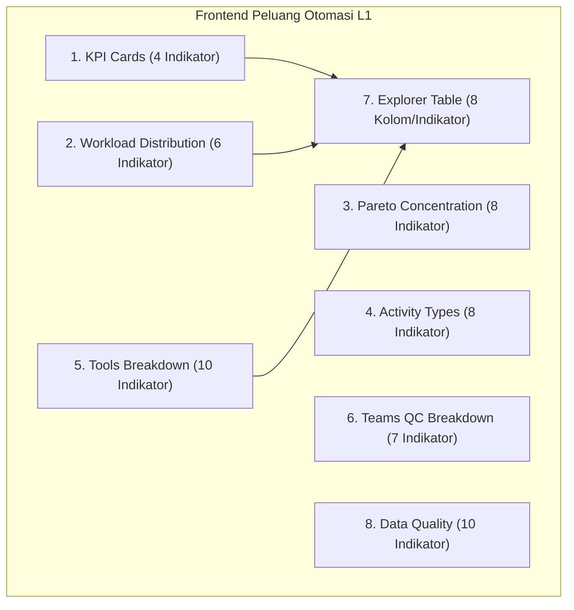

# WORKLENS — Metric Definition Freeze Register

> **Dokumen Otoritas:** Register Pembekuan Definisi Metrik Bisnis & Rekonsiliasi Keputusan Q1–Q51  
> **Status Dokumen:** BASELINE DRAFT FOR FREEZE — RECONCILED WITH Q1–Q51  
> **Tanggal Penyusunan:** 2026-11-08  
> **Otoritas Dokumen Acuan:**  
> 1. `docs/domain/BUSINESS_DECISIONS_Q1_Q51.md` (Keputusan Otoritatif Pengguna Q1–Q51)  
> 2. `docs/domain/PRD_V1.md` (Locked Baseline V1)  
> 3. `docs/domain/TECHNICAL_SPECIFICATION.md` (Spesifikasi Teknis & Prioritas Kalkulasi)  
> 4. `docs/domain/GLOSSARY.md` (Standardized Ubiquitous Domain Terminology)  
> 5. `docs/METRIC_DEFINITION_DICTIONARY.md` (Hasil Audit Empiris Frontend)  
> 6. `docs/BUSINESS_METRIC_DEFINITION_WORKBOOK.md` (Buku Kerja Definisi Bisnis)  

---

## 1. Pendahuluan & Prinsip Pembekuan (*Freeze Principles*)

Dokumen ini merupakan **register resmi pembekuan definisi metrik** (*Metric Definition Freeze Register*) untuk seluruh angka, rasio, visualisasi, dan indikator kualitas data yang ditampilkan pada platform WORKLENS (khususnya halaman *Peluang Otomasi L1*).

Register ini disusun dengan merekonsiliasi seluruh hasil audit empiris terhadap **Keputusan Bisnis Eksplisit Pengguna (Q1–Q51)**. Setiap metrik diklasifikasikan statusnya ke dalam salah satu dari tiga kategori berikut:

1. **`CONFIRMED`**: Definisi bisnis, formula, dan perlakuan data telah didukung secara eksplisit dan langsung oleh Keputusan Q1–Q51 serta baseline M1/M2 yang terkunci.
2. **`PROPOSED`**: Definisi dan formula diturunkan secara logis dan konsisten dari baseline arsitektur serta data empiris, tetapi belum memiliki pernyataan baris spesifik di Q1–Q51 (menunggu afirmasi formal).
3. **`NEEDS SME APPROVAL`**: Terdapat opsi kebijakan bisnis, ketidaksesuaian semantik label UI, atau divergensi data yang secara eksplisit diserahkan kepada keputusan Subject Matter Expert (SME) Tim L1.

### Batasan Mutlak Governance (*Non-Negotiable Boundaries*):
- **Source Immutability (Q18, Q51, Rule 4):** Dataset mentah (`Breakdown Activity`) bersifat *read-only*. Tidak ada proses background, skrip backend, maupun frontend yang diizinkan mengubah, menimpa, atau melakukan *in-place edit* terhadap file sumber.
- **No Silent Auto-Correction (Q18):** Data yang tidak konsisten atau memiliki kesalahan ketik (*typo*) **wajib ditandai untuk reviu L1**, dan tidak boleh diperbaiki secara diam-diam (*silent auto-correct*) oleh sistem.
- **Pemisahan Logika Deterministik & Asumsi Skenario (Q39, Q40, Q41):** Asumsi statis reduksi 90% (`Workload after = 10%`) harus selalu disajikan dengan penanda skenario pemodelan yang jelas, terpisah dari formula capaian penghematan riil M1.

---

## 2. Ringkasan Keputusan Bisnis Eksplisit (Otoritas Q1–Q51)

Berikut adalah daftar keputusan bisnis yang telah diputuskan secara eksplisit oleh pengguna dalam dokumen acuan `BUSINESS_DECISIONS_Q1_Q51.md` yang menjadi dasar penguncian register ini:

| No | Keputusan Eksplisit | Sumber Otoritas | Dampak pada Definisi Metrik |
|:---:|---|:---:|---|
| **D-01** | **Cakupan & Unit Asesmen:** Objek asesmen adalah seluruh baris pada `Breakdown Activity` (manual, automation, kandidat). 1 baris = 1 aktivitas dinilai. | **Q1, Q2, Q3** | Menetapkan bahwa populasi absolut dataset adalah seluruh baris (3.460 / 3.456), bukan hanya yang berbeban positif. |
| **D-02** | **Kepemilikan Asesmen:** Tim L1 AGIT adalah pemilik dan pelaksana asesmen. L2 adalah pendukung teknis bila diperlukan. | **Q4, Q5, Q10, Q44** | Metrik dan status asesmen berada di bawah tata kelola L1; filter *Team QC* mencerminkan sub-tim L1 yang bertanggung jawab. |
| **D-03** | **Aturan Pemetaan Target Kategori:**<br>• `Automation` $\to$ `Already Automation`<br>• `As Is` $\to$ `To Be Automated`<br>• `Dismantled` $\to$ `Dismantled` | **Q14, Q17** | **Mengonfirmasi secara resmi bahwa aktivitas manual `As Is` memang ditargetkan menjadi `To Be Automated`**, sehingga secara logis berada dalam kelompok *Kandidat Otomasi*. |
| **D-04** | **Inkonsistensi Data:** Data tidak konsisten harus ditandai untuk reviu L1. **Dilarang auto-correct data sumber.** Koreksi ditentukan oleh L1. | **Q18, Q20** | Mengoreksi rekomendasi audit sebelumnya: anomali typo `Already Automated` (UFO) tidak boleh di-auto-correct oleh backend/query engine, melainkan diflag ke modul Quality Review. |
| **D-05** | **Kriteria Already Automation:** Solusi/tools sudah dibuat/tersedia. Tidak disyaratkan harus sudah digunakan atau berhasil terpicu. | **Q16, Q33, Q34, Q35** | Metrik *Sudah diotomasi* mengukur ketersediaan teknis solusi, bukan frekuensi pemanfaatan operasional riil. |
| **D-06** | **Definisi Workload:** Beban kerja bulanan satu aktivitas. Formula: $\text{Durasi (Menit)} \times \text{Event Per Month}$. Satuan: menit/bulan. | **Q37, Q38** | Mengunci formula perkalian durasi dan event sebagai standar tunggal perhitungan beban kerja per aktivitas. |
| **D-07** | **Asumsi Statis Workload After 10%:** Asumsi statis $\text{Workload after} = 10\%$ dari $\text{Workload}$ before untuk **seluruh aktivitas**. Bukan hasil pengukuran empiris. | **Q39, Q40** | **Mengonfirmasi dasar rasional angka potensi hemat 90%**: $357,5\text{ jam} \times 90\% = 321,8\text{ jam}$ adalah proyeksi skenario resmi berbasis asumsi statis 10% sisa beban. |
| **D-08** | **Formula Workload Saving:** Merujuk langsung formula yang telah ada pada artefak proyek M1 / PRD V1. | **Q41** | $\text{Workload Saved} = \text{Workload} - \text{Workload after}$. Dihitung dengan 6 level prioritas validasi numerik. |
| **D-09** | **Hak Akses & Peran Pengguna:** L1 memiliki hak edit untuk assessment, review, dan follow-up. Management berstatus *Read-Only* (Summary + drill-down). | **Q48, Q49, Q51** | Memastikan bahwa metrik dan koreksi data hanya dapat dimutasi melalui L1 Workspace. |
| **D-10** | **Enam Modul MVP:** Assessment Workspace, Monitoring Dashboard, Download Enriched CSV, Generate Report, Quality Review, Follow-up Management. | **Q45, Q46, Q50** | Halaman Peluang Otomasi L1 berfungsi sebagai bagian dari Monitoring Dashboard dan Quality Review. |

---

## 3. Daftar Keputusan yang Belum Ditetapkan / Sengaja Ditunda

Berdasarkan Bagian G dari dokumen `BUSINESS_DECISIONS_Q1_Q51.md`, hal-hal berikut **sengaja ditunda atau belum ditetapkan** oleh stakeholder:

1. **Alur Rinci Siklus Hidup Status Asesmen:** Tahapan rinci dari status awal hingga status `Done` belum dibakukan (Q8, Q9).
2. **Aturan Validasi Kualitas Data Lanjutan:** Batas ambang batas durasi atau frekuensi event ekstrim belum memiliki rulebook validasi baku.
3. **Representasi Ganda Status Solusi:** Format penyimpanan jika aktivitas berstatus `To Be Automated` sekaligus `Not Yet Solution` dalam satu sel belum disepakati (Q31).
4. **Penyajian Casing Tools pada Visualisasi Dashboard:** Apakah visualisasi dashboard diizinkan melakukan agregasi *case-insensitive* (`Shell script` + `Shell Script`) pada lapisan presentasi tanpa mengubah dataset mentah belum diputuskan secara eksplisit (Q25–Q27).
5. **Kebijakan Penyajian Aktivitas Berbeban Nol pada UI:** Apakah kartu KPI utama harus menampilkan pemisahan eksplisit antara aktivitas aktif ($\text{Workload} > 0$) dan aktivitas terukur berbeban nol ($\text{Workload} = 0$) belum memiliki keputusan final di Q1–Q51.

---

## 4. Rekonsiliasi & Koreksi Interpretasi Audit / Workbook

Berdasarkan penelaahan silang terhadap Keputusan Q1–Q51, dilakukan koreksi terhadap interpretasi yang sebelumnya diajukan pada dokumen `METRIC_DEFINITION_DICTIONARY.md` dan `BUSINESS_METRIC_DEFINITION_WORKBOOK.md`:

```text
┌────────────────────────────────────────────────────────────────────────────────────────┐
│ REKONSILIASI INTERPRETASI AUDIT vs KEPUTUSAN EKSPLISIT Q1–Q51                          │
├────────────────────────────────────────────────────────────────────────────────────────┤
│ 1. [KOREKSI] Status Kategori "As Is" dalam Bucket Kandidat:                            │
│    - Interpretasi Awal: Menganggap inklusi 112 baris "As Is" ke Kandidat Otomasi      │
│      sebagai distorsi semantik karena As Is bermakna manual.                           │
│    - Koreksi Q14: Q14 secara eksplisit menyatakan pemetaan target:                     │
│      "As Is -> To Be Automated". Dengan demikian, inklusi As Is ke dalam               │
│      Kandidat Otomasi adalah SESUAI dengan arahan target bisnis pengguna (Q14).        │
│                                                                                        │
│ 2. [KOREKSI] Rekomendasi Normalisasi / Auto-Correct Data Mentah:                       │
│    - Rekomendasi Awal: Melakukan auto-correct pada string "Already Automated" dan      │
│      menggabungkan lowercase "Shell script" di level query engine/sumber data.          │
│    - Koreksi Q18: Q18 secara eksplisit melarang auto-correct terhadap sumber:          │
│      "Tandai untuk review L1. Jangan auto-correct source. Koreksi ditentukan oleh L1." │
│      Data mentah tetap immutable; anomali disajikan sebagai temuan Quality Review.     │
│                                                                                        │
│ 3. [KOREKSI] Status Angka Potensi Hemat 90% (321,8 Jam):                              │
│    - Interpretasi Awal: Dinilai sebagai asumsi pengembang tanpa dasar validasi.        │
│    - Koreksi Q39 & Q40: Asumsi bahwa Workload After = 10% Workload Before adalah       │
│      asumsi statis resmi yang ditetapkan pengguna untuk seluruh aktivitas (Q39, Q40).   │
│      Penghematan 90% adalah proyeksi skenario terotorisasi, bukan angka fiktif.        │
└────────────────────────────────────────────────────────────────────────────────────────┘
```

---

## 5. Register Pembekuan 61 Indikator Metrik (Metric Freeze Register)

Berikut adalah register resmi untuk seluruh 61 indikator metrik yang dikelompokkan dalam 8 tampilan frontend:



---

### KELOMPOK 1: KPI CARDS (4 INDIKATOR)

#### MTR-01: Total Workload
- **Display Name:** `Total workload` (Nilai Prototype: `3.602,0 jam per bulan`)
- **Business Definition:** Akumulasi total kapasitas waktu kerja operasional bulanan yang dialokasikan Tim L1 AGIT untuk mengeksekusi aktivitas SOP rutin yang memiliki nilai beban kerja terukur di atas nol ($\text{Workload} > 0$).
- **Business Purpose:** Menjadi baseline kapasitas makro beban kerja operasional L1 sebelum efisiensi otomasi, serta menjadi penyebut (*denominator*) bagi rasio distribusi beban kerja.
- **Formula:**
  $$\text{Total Workload (Jam)} = \sum_{r \in \{i \mid \text{Workload}_i > 0\}} \frac{\text{Workload}_r}{60.0}$$
- **Data Source:** Kolom `Workload` (dalam satuan menit) dibagi 60.0.
- **Measurement Unit:** Jam per bulan (`hours/month`).
- **Interpretation:** Menunjukkan total kapasitas jam kerja manusia yang terserap secara aktif oleh aktivitas rutin L1 setiap bulan.
- **Limitation:** Hanya mengakumulasi 1.475 aktivitas dengan beban positif. Tidak mencakup 1.605 aktivitas terukur bernilai nol dan 380 baris data kosong.
- **Referensi Keputusan:** **Q1, Q2, Q37, Q38**.
- **Status:** **PROPOSED** (Menunggu SME menyetujui klarifikasi sub-label menjadi *"jam per bulan · akumulasi aktivitas berbeban > 0"*).

---

#### MTR-02: Aktivitas Terukur
- **Display Name:** `Aktivitas terukur` (Nilai Prototype: `1.475`)
- **Business Definition:** Jumlah baris SOP/aktivitas operasional yang memiliki durasi dan frekuensi kejadian bulanan di atas nol ($\text{Workload} > 0$).
- **Business Purpose:** Menentukan ukuran populasi aktivitas aktif (*active workload population*) yang menjadi ruang lingkup analisis efisiensi dan otomasi.
- **Formula:**
  $$\text{Aktivitas Terukur} = \text{COUNT}(\{r \in \text{Dataset} \mid \text{Workload}(r) > 0\})$$
- **Data Source:** Kolom `Workload`.
- **Measurement Unit:** Jumlah aktivitas / baris (`count`).
- **Interpretation:** Menggambarkan variasi proses bisnis rutin yang secara nyata menyerap jam kerja analis L1.
- **Limitation:** Bukan jumlah total seluruh baris yang telah dinilai. Sebanyak 1.605 aktivitas lain berstatus terukur dengan nilai beban nol ($\text{Workload} = 0$). Sub-label prototype *"baris memiliki nilai workload"* berpotensi disalahartikan.
- **Referensi Keputusan:** **Q2, Q3, Q8, Q9**.
- **Status:** **NEEDS SME APPROVAL** (Rekomendasi nama: *"Aktivitas Berbeban Positif"* atau penyesuaian sub-label).

---

#### MTR-03: Kandidat Otomasi
- **Display Name:** `Kandidat otomasi` (Nilai Prototype: `200`)
- **Business Definition:** Jumlah aktivitas operasional rutin berbeban positif yang diidentifikasi oleh Tim L1 sebagai backlog peluang peningkatan efisiensi (*automation backlog pipeline*) untuk dibangun solusinya oleh Tim L2/Engineering.
- **Business Purpose:** Menjadi indikator utama inventaris peluang inovasi otomasi yang berpotensi membebaskan kapasitas kerja L1 di masa mendatang.
- **Formula:**
  $$\text{COUNT}(\{r \mid \text{Workload}(r) > 0 \land \text{Status}(r) \neq \text{"Take Out"} \land \text{Category Notes}(r) \in \{\text{"To Be Automated"}, \text{"As Is"}, \text{"Not Yet Solution"}, \text{"Need Further Assessment"}, \text{"Already Automated"}\}\})$$
- **Data Source:** Kolom `Workload`, `Status`, dan `Category Notes`.
- **Measurement Unit:** Jumlah aktivitas / baris (`count`).
- **Interpretation:** Semakin besar angka ini, semakin banyak antrean pekerjaan rutin L1 yang siap diintervensi oleh solusi otomasi.
- **Limitation:** Angka 200 mencakup 112 baris berkategori `As Is` (selaras dengan target mapping Q14: `As Is` $\to$ `To Be Automated`), serta 4 baris anomali typo `Already Automated` dari aplikasi UFO yang belum direview L1 (Q18).
- **Referensi Keputusan:** **Q1, Q11, Q12, Q14, Q16, Q18, Q29, Q30, Q31**.
- **Status:** **CONFIRMED** (Sesuai pemetaan Q14; penanganan 4 anomali UFO diserahkan ke alur Quality Review L1 sesuai Q18).

---

#### MTR-04: Potensi Hemat Indikatif
- **Display Name:** `Potensi hemat indikatif` (Nilai Prototype: `321,8 jam per bulan`)
- **Business Definition:** Estimasi matematis potensi penghematan kapasitas waktu kerja L1 per bulan jika seluruh aktivitas dalam bucket *Kandidat* berhasil diotomasi, dihitung menggunakan asumsi statis proyek bahwa solusi otomasi mereduksi 90% beban kerja awal (sisa beban 10%).
- **Business Purpose:** Memberikan proyeksi manfaat (*indicative business case benefit*) kepada manajemen mengenai potensi efisiensi maksimum yang dapat diraih dari pipeline otomasi L1.
- **Formula:**
  $$\text{Potensi Hemat Indikatif} = \sum_{r \in \text{Kandidat}} \frac{\text{Workload}(r)}{60.0} \times 0.90 = 357,5\text{ jam} \times 0.90 = 321,75 \approx 321,8\text{ jam}$$
- **Data Source:** Kolom `Workload` pada baris yang masuk klasifikasi *Kandidat Otomasi*.
- **Measurement Unit:** Jam per bulan (`hours/month`).
- **Interpretation:** Proyeksi kapasitas kerja analis yang berpotensi dialihkan ke tugas-tugas bernilai tambah tinggi (*value-added tasks*) apabila seluruh backlog tersolusikan.
- **Limitation:** Merupakan pemodelan skenario statis (faktor 90%) yang ditetapkan pada Q39 & Q40. Bukan hasil pengukuran empiris pasca-implementasi bot (M1 PRD formula).
- **Referensi Keputusan:** **Q1, Q39, Q40, Q41**.
- **Status:** **CONFIRMED** (Sebagai metrik proyeksi skenario statis terotorisasi berbasis Q39–Q40).

---

### KELOMPOK 2: WORKLOAD DISTRIBUTION (6 INDIKATOR)

Distribusi beban kerja mengelompokkan 1.475 baris aktif ke dalam 5 bucket utama:

#### MTR-05: Sudah diotomasi (Hours, Count, Pct)
- **Display Name:** `Sudah diotomasi` (Nilai: `1.993,7 jam` | `954 aktivitas` | `55,3%`)
- **Business Definition:** Akumulasi beban kerja dan proporsi aktivitas rutin L1 yang solusi otomasinya (AO, script, tools, dashboard) telah selesai dibangun dan tersedia di lingkungan operasional.
- **Business Purpose:** Mengukur tingkat adopsi otomasi saat ini (*current automation penetration rate*) dan menilai keberhasilan program modernisasi operasional L1 yang telah berjalan.
- **Formula:**
  - Hours: $\sum \frac{\text{Workload}}{60.0}$ untuk $\text{Workload} > 0 \land \text{Status} \neq \text{"Take Out"} \land \text{Category Notes} = \text{"Already Automation"}$.
  - Count: Jumlah baris kriteria di atas.
  - Pct: $\frac{1.993,7}{3.602,0} \times 100\% = 55,3\%$.
- **Data Source:** Kolom `Workload`, `Status`, `Category Notes`.
- **Measurement Unit:** Jam/bulan, Jumlah baris, Persentase (%).
- **Interpretation:** Lebih dari separuh beban kerja operasional L1 (55,3%) telah memiliki dukungan perangkat otomasi.
- **Limitation:** Sesuai Q33–Q35, angka ini merepresentasikan ketersediaan alat (*tool availability*), bukan jaminan bahwa bot tersebut selalu dieksekusi atau berhasil dijalankan setiap hari. Belum mencakup 4 baris typo `Already Automated` yang tertahan di review L1 (Q18).
- **Referensi Keputusan:** **Q14, Q16, Q23, Q24, Q33, Q34, Q35**.
- **Status:** **CONFIRMED**.

---

#### MTR-06: Tidak mungkin diotomasi (Hours, Count, Pct)
- **Display Name:** `Tidak mungkin diotomasi` (Nilai: `811,9 jam` | `178 aktivitas` | `22,5%`)
- **Business Definition:** Beban kerja dan jumlah aktivitas rutin L1 yang berdasarkan asesmen diputuskan harus tetap dijalankan secara manual oleh manusia karena membutuhkan pertimbangan kognitif (*human judgment*), koordinasi fisik/telepon, atau batasan regulasi/akses pihak ketiga.
- **Business Purpose:** Mengidentifikasi batas dasar beban kerja manual (*irreducible manual baseline*) L1 yang tidak boleh dipaksakan masuk ke dalam target otomatisasi.
- **Formula:**
  - Hours: $\sum \frac{\text{Workload}}{60.0}$ untuk $\text{Workload} > 0 \land \text{Status} \neq \text{"Take Out"} \land \text{Category Notes} = \text{"Not Possible Automate"}$.
  - Count: 178 baris.
  - Pct: $\frac{811,9}{3.602,0} \times 100\% = 22,5\%$.
- **Data Source:** Kolom `Workload`, `Status`, `Category Notes`.
- **Measurement Unit:** Jam/bulan, Jumlah baris, Persentase (%).
- **Interpretation:** Menunjukkan porsi operasional murni (hampir seperempat beban L1) yang memerlukan alokasi kapasitas staf manusia secara permanen.
- **Limitation:** Bergantung pada kedalaman asesmen L1; perubahan kapabilitas teknologi AI di masa depan dapat mengubah kelayakan teknis aktivitas ini.
- **Referensi Keputusan:** **Q1, Q6, Q11, Q13, Q15**.
- **Status:** **CONFIRMED**.

---

#### MTR-07: Kandidat (Hours, Count, Pct)
- **Display Name:** `Kandidat` (Nilai: `357,5 jam` | `200 aktivitas` | `9,9%`)
- **Business Definition:** Beban kerja dan porsi aktivitas rutin L1 yang menjadi antrean backlog untuk diintervensi oleh solusi efisiensi di masa depan.
- **Business Purpose:** Menjadi target portofolio proyek rekayasa otomasi L2/Engineering dan dasar penetapan KPI efisiensi tahunan organisasi.
- **Formula:**
  - Hours: $\sum \frac{\text{Workload}}{60.0}$ untuk seluruh baris kriteria *Kandidat*.
  - Count: 200 baris (rincian: 74 *To Be Automated*, 112 *As Is*, 9 *Not Yet Solution*, 1 *Need Further Assessment*, 4 *Already Automated*).
  - Pct: $\frac{357,5}{3.602,0} \times 100\% = 9,9\%$.
- **Data Source:** Kolom `Workload`, `Status`, `Category Notes`.
- **Measurement Unit:** Jam/bulan, Jumlah baris, Persentase (%).
- **Interpretation:** Mengindikasikan bahwa sekitar 10% dari total waktu kerja operasional L1 saat ini berpotensi diefisiensikan melalui program perbaikan proses.
- **Limitation:** Mengikutsertakan 112 baris `As Is` berdasarkan target pemetaan Q14 (`As Is` $\to$ `To Be Automated`).
- **Referensi Keputusan:** **Q1, Q12, Q14, Q16, Q18, Q29, Q30, Q31**.
- **Status:** **CONFIRMED**.

---

#### MTR-08: Take Out (Hours, Count, Pct)
- **Display Name:** `Take Out` (Nilai: `267,6 jam` | `80 aktivitas` | `7,4%`)
- **Business Definition:** Beban kerja dari aktivitas operasional yang diputuskan untuk dikeluarkan (*take out*) dari lingkup pemeliharaan/tanggung jawab aktif Tim L1 AGIT (misalnya dialihkan ke tim lain, diserahkan ke prinsipal, atau dihentikan layanannya).
- **Business Purpose:** Mengidentifikasi peluang perampingan tanggung jawab layanan (*scope decluttering*) dan memastikan L1 hanya fokus pada SLA yang relevan.
- **Formula:**
  - Hours: $\sum \frac{\text{Workload}}{60.0}$ untuk $\text{Workload} > 0 \land \text{Status} \in \{\text{"Take Out"}, \text{"Takeout"}, \text{"take Out"}\}$.
  - Count: 80 baris.
  - Pct: $\frac{267,6}{3.602,0} \times 100\% = 7,4\%$.
- **Data Source:** Kolom `Status` dan `Workload`.
- **Measurement Unit:** Jam/bulan, Jumlah baris, Persentase (%).
- **Interpretation:** Porsi beban kerja yang dapat langsung dieliminasi dari kapasitas L1 tanpa memerlukan pembangunan skrip otomasi.
- **Limitation:** Memerlukan konfirmasi kesepakatan serah terima operasional dengan unit penerima tanggung jawab sebelum beban benar-benar dilepas.
- **Referensi Keputusan:** **Q1, Q6, Q11**.
- **Status:** **CONFIRMED**.

---

#### MTR-09: Dismantled (Hours, Count, Pct)
- **Display Name:** `Dismantled` (Nilai: `171,3 jam` | `63 aktivitas` | `4,8%`)
- **Business Definition:** Beban kerja dari aktivitas SOP yang berkaitan dengan sistem, infrastruktur, atau aplikasi warisan (*legacy*) yang sudah dinonaktifkan, dihentikan operasinya, atau didekomisi.
- **Business Purpose:** Mengeliminasi beban kerja semu (*ghost workload*); memfasilitasi pembersihan SOP kadaluwarsa dari katalog layanan L1.
- **Formula:**
  - Hours: $\sum \frac{\text{Workload}}{60.0}$ untuk $\text{Workload} > 0 \land \text{Status} \neq \text{"Take Out"} \land \text{Category Notes} = \text{"Dismantled"}$.
  - Count: 63 baris.
  - Pct: $\frac{171,3}{3.602,0} \times 100\% = 4,8\%$.
- **Data Source:** Kolom `Workload`, `Status`, `Category Notes`.
- **Measurement Unit:** Jam/bulan, Jumlah baris, Persentase (%).
- **Interpretation:** Beban operasional yang akan hilang secara otomatis seiring penutupan sistem secara tuntas.
- **Limitation:** Memerlukan verifikasi bahwa seluruh proses decomissioning sistem telah selesai dan tidak menyisakan dependensi residual.
- **Referensi Keputusan:** **Q1, Q10, Q12, Q14**.
- **Status:** **CONFIRMED**.

---

#### MTR-10: Lainnya (Hours, Count, Pct)
- **Display Name:** `Lainnya` (Nilai: `0,0 jam` | `0 aktivitas` | `0,0%`)
- **Business Definition:** Penampung kendali integritas (*integrity control catcher*) untuk menampung baris aktif yang tidak memenuhi kriteria kelima bucket di atas.
- **Business Purpose:** Memastikan bahwa tidak ada kebocoran data (*zero leakage*) pada logika klasifikasi dataset aktif.
- **Formula:** $\text{Total Workload} - \sum(\text{Bucket 1..5}) = 0,0\text{ jam}$.
- **Data Source:** Kolom kalkulasi turunan query engine.
- **Measurement Unit:** Jam/bulan, Jumlah baris, Persentase (%).
- **Interpretation:** Nilai nol membuktikan bahwa seluruh 1.475 baris aktif telah terpartisi secara sempurna (100% *exhaustive coverage*).
- **Limitation:** Hanya berlaku untuk populasi 1.475 baris aktif.
- **Referensi Keputusan:** **Q14, Q17, Q18**.
- **Status:** **CONFIRMED**.

---

### KELOMPOK 3: PARETO CONCENTRATION (8 INDIKATOR)

Kurva konsentrasi Pareto mengurutkan seluruh 1.475 aktivitas aktif secara menurun (*descending*) berdasarkan jam beban kerja untuk mengevaluasi konsentrasi operasional:

| Metric ID | Display Name / Level | Nilai Jam (h) | Pangsa Beban (%) | Kumulatif Beban (%) | Status Otoritas | Referensi Q |
|:---:|---|:---:|:---:|:---:|:---:|:---:|
| **MTR-11** | `Top 1 Activity` | 456,0 jam | 12,7% | 12,7% | **CONFIRMED** | Q37, Q38 |
| **MTR-12** | `Top 5 Activities` | 913,5 jam | 25,4% | 25,4% | **CONFIRMED** | Q37, Q38 |
| **MTR-13** | `Top 10 Activities` | 1.258,0 jam | 34,9% | 34,9% | **CONFIRMED** | Q37, Q38 |
| **MTR-14** | `Top 20 Activities` | 1.637,0 jam | 45,4% | 45,4% | **CONFIRMED** | Q37, Q38 |
| **MTR-15** | `Top 50 Activities` | 2.143,5 jam | 59,5% | 59,5% | **CONFIRMED** | Q37, Q38 |
| **MTR-16** | `Top 100 Activities` | 2.540,5 jam | 70,5% | 70,5% | **CONFIRMED** | Q37, Q38 |
| **MTR-17** | `Top 200 Activities` | 2.898,8 jam | 80,5% | 80,5% | **CONFIRMED** | Q37, Q38 |
| **MTR-18** | `Top 1475 Activities` | 3.602,0 jam | 100,0% | 100,0% | **CONFIRMED** | Q37, Q38 |

- **Business Definition:** Akumulasi jam kerja dan persentase kumulatif beban kerja dari sub-populasi aktivitas teratas L1.
- **Business Purpose:** Menerapkan prinsip efisiensi Pareto (80/20) untuk memfokuskan sumber daya otomasi L2 pada segmen aktivitas yang memberikan dampak pembebasan kapasitas terbesar.
- **Formula:**
  $$\text{Cumulative Workload}(k) = \sum_{i=1}^k \frac{\text{Workload}_{(i)}}{60.0}$$
  di mana $\text{Workload}_{(i)}$ adalah baris terurut menurun.
- **Interpretation:** Konsentrasi beban kerja L1 terbukti sangat tajam: **hanya 200 aktivitas (13,6% dari total SOP aktif) telah mencakup 80,5% dari total jam kerja operasional L1**. Menyelesaikan otomatisasi pada 200 SOP ini akan menyelesaikan mayoritas beban kerja tim.
- **Limitation:** Top 1 menyumbang 12,7% sendirian (`456,0 jam`, backup OneDrive Office 365). Angka ini merupakan *outlier* signifikan yang harus dipantau kualitas asesmennya.

---

### KELOMPOK 4: ACTIVITY TYPES BREAKDOWN (8 INDIKATOR)

Mengelompokkan 1.475 baris aktif berdasarkan taksonomi operasional standar (`TYPE ACTIVITY`):

| Metric ID | Display Name | Nilai Jam (h) | Pangsa (%) | Definisi Bisnis | Referensi Q | Status |
|:---:|---|:---:|:---:|---|:---:|:---:|
| **MTR-19** | `Daily Activity` | 2.126,2 jam | 59,0% | Pengecekan rutin harian/shift, *health check*, dan patroli sistem. | Q2, Q6, Q21 | **CONFIRMED** |
| **MTR-20** | `Request` / `User Request` | 572,8 jam | 15,9% | Pemenuhan permintaan layanan dari pengguna (*service request catalog*). | Q2, Q6, Q21 | **CONFIRMED** |
| **MTR-21** | `Incident` / `Problem Ticket` | 338,9 jam | 9,4% | Penanganan kendala operasional, gangguan layanan, dan eskalasi tiket. | Q2, Q6, Q21 | **CONFIRMED** |
| **MTR-22** | `Project` | 194,5 jam | 5,4% | Aktivitas penugasan proyek transformasi, rollout, dan uji coba. | Q2, Q6, Q21 | **CONFIRMED** |
| **MTR-23** | `Maintenance` | 158,5 jam | 4,4% | Pemeliharaan sistem berkala, patching, dan pembersihan media storage. | Q2, Q6, Q21 | **CONFIRMED** |
| **MTR-24** | `Backup / Restore` | 104,2 jam | 2,9% | Verifikasi pelaksanaan backup rutin dan pengujian pemulihan data. | Q2, Q6, Q21 | **CONFIRMED** |
| **MTR-25** | `Meeting / Coordination` | 64,2 jam | 1,8% | Koordinasi internal, sinkronisasi shift, dan pelaporan berkala. | Q2, Q6, Q21 | **CONFIRMED** |
| **MTR-26** | `Reporting / Admin` | 42,7 jam | 1,2% | Penyusunan laporan mingguan/bulanan dan tata kelola administrasi SOP. | Q2, Q6, Q21 | **CONFIRMED** |

- **Business Purpose:** Mengidentifikasi profil beban kerja operasional L1 berdasarkan sifat pekerjaannya.
- **Formula:** $\sum_{r \in \text{Type}} \frac{\text{Workload}(r)}{60.0}$ dan persentase terhadap 3.602,0 jam.
- **Data Source:** Kolom `TYPE ACTIVITY` dan `Workload`.
- **Interpretation:** Hampir 60% waktu kerja tim terserap untuk kegiatan rutin berulang harian (*Daily Activity*), yang merupakan area sasaran paling ideal (*sweet spot*) untuk otomatisasi robotik.
- **Limitation:** Pengelompokan bergantung pada konsistensi pemilihan dropdown `TYPE ACTIVITY` saat analis L1 mengisi lembar asesmen.

---

### KELOMPOK 5: TOOLS AUTOMATION BREAKDOWN (10 INDIKATOR)

Menginventarisasi distribusi penggunaan perkakas otomatisasi pada 1.475 baris aktif:

| Metric ID | Display Name | Nilai Jam (h) | Pangsa (%) | Definisi Bisnis | Referensi Q | Status |
|:---:|---|:---:|:---:|---|:---:|:---:|
| **MTR-27** | `Not Automate` | 1.134,7 jam | 31,5% | Aktivitas yang tidak menggunakan alat otomasi apa pun (manual murni). | Q21, Q25 | **CONFIRMED** |
| **MTR-28** | `Grafana` | 421,4 jam | 11,7% | Pemantauan operasional menggunakan dashboard visual Grafana. | Q25, Q26, Q27 | **CONFIRMED** |
| **MTR-29** | `Shell script` (lowercase) | 218,0 jam | 6,1% | Otomasi eksekusi berbasis skrip shell Linux/Unix (casing huruf kecil). | Q25, Q26, Q27 | **NEEDS SME APPROVAL** |
| **MTR-30** | `AION` | 178,3 jam | 4,9% | Otomasi terintegrasi platform kecerdasan buatan AION. | Q23, Q25, Q26 | **CONFIRMED** |
| **MTR-31** | `BMC` | 142,6 jam | 4,0% | Pengelolaan tiket dan monitoring menggunakan rangkaian BMC Remedy/Control-M. | Q25, Q26, Q27 | **CONFIRMED** |
| **MTR-32** | `Internal Dashboard` | 98,2 jam | 2,7% | Pemantauan sistem melalui portal/web monitoring internal aplikasi. | Q25, Q26, Q27 | **CONFIRMED** |
| **MTR-33** | `Shell Script` (capitalized) | 83,0 jam | 2,3% | Otomasi skrip shell Linux/Unix (casing huruf kapital). | Q25, Q26, Q27 | **NEEDS SME APPROVAL** |
| **MTR-34** | `CICD` | 74,5 jam | 2,1% | Otomasi rilis dan integrasi pipa penyebaran berkelanjutan. | Q25, Q26, Q27 | **CONFIRMED** |
| **MTR-35** | `Jenkins` | 62,0 jam | 1,7% | Otomasi penjadwalan tugas dan deployment berbasis pipeline Jenkins. | Q25, Q26, Q27 | **CONFIRMED** |
| **MTR-36** | `DSC` | 51,2 jam | 1,4% | Otomasi konfigurasi server berbasis Desired State Configuration. | Q25, Q26, Q27 | **CONFIRMED** |

- **Business Purpose:** Memberikan visibilitas terhadap sebaran tumpukan teknologi (*technology stack*) yang paling dominan digunakan dalam membantu operasional L1.
- **Formula:** $\sum_{r \in \text{Tool}} \frac{\text{Workload}(r)}{60.0}$ dan persentase terhadap 3.602,0 jam.
- **Data Source:** Kolom `Tools Automation` (atau `Tools`) dan `Workload`.
- **Interpretation:** Sebesar 31,5% beban kerja L1 belum tersentuh perkakas otomasi sama sekali. Di antara perkakas yang ada, Grafana dan Shell Script merupakan teknologi yang paling banyak menopang pekerjaan tim.
- **Poin Konfirmasi SME untuk MTR-29 & MTR-33 (Q18 Compliance):**
  - Sesuai Q18, backend **tidak boleh** melakukan normalisasi mutasi pada data sumber.
  - Namun untuk kenyamanan presentasi dashboard, apakah SME menyetujui lapisan query tampilan (*view presentation layer*) mengonsolidasikan `Shell script` dan `Shell Script` menjadi satu batang chart tunggal berbobot **$301,0\text{ jam}$ (8,4%)**?
- **Status Otoritas:** MTR-27, 28, 30, 31, 32, 34, 35, 36: **CONFIRMED**. MTR-29 & 33: **NEEDS SME APPROVAL** (penyetujuan agregasi visual).

---

### KELOMPOK 6: TEAMS QC BREAKDOWN (7 INDIKATOR)

Mengelompokkan 1.475 baris aktif berdasarkan sub-tim penanggung jawab kendali mutu operasional L1 (`Team QC`):

| Metric ID | Display Name | Nilai Jam (h) | Pangsa (%) | Definisi Bisnis | Referensi Q | Status |
|:---:|---|:---:|:---:|---|:---:|:---:|
| **MTR-37** | `Team E` | 892,4 jam | 24,8% | Alokasi beban kerja operasional sub-tim L1 E. | Q4, Q37, Q42 | **CONFIRMED** |
| **MTR-38** | `Team D` | 741,6 jam | 20,6% | Alokasi beban kerja operasional sub-tim L1 D. | Q4, Q37, Q42 | **CONFIRMED** |
| **MTR-39** | `Team BCorp` | 612,5 jam | 17,0% | Alokasi beban kerja operasional sub-tim L1 B-Corporate. | Q4, Q37, Q42 | **CONFIRMED** |
| **MTR-40** | `Team A` | 485,3 jam | 13,5% | Alokasi beban kerja operasional sub-tim L1 A. | Q4, Q37, Q42 | **CONFIRMED** |
| **MTR-41** | `Team FMC` | 398,7 jam | 11,1% | Alokasi beban kerja operasional sub-tim L1 FMC. | Q4, Q37, Q42 | **CONFIRMED** |
| **MTR-42** | `Team B` | 278,9 jam | 7,7% | Alokasi beban kerja operasional sub-tim L1 B. | Q4, Q37, Q42 | **CONFIRMED** |
| **MTR-43** | `Team C` | 192,6 jam | 5,3% | Alokasi beban kerja operasional sub-tim L1 C. | Q4, Q37, Q42 | **CONFIRMED** |

- **Business Purpose:** Mengevaluasi distribusi beban kerja antar sub-tim L1 guna mendukung manajemen kapasitas staf (*workload balancing*) dan prioritisasi program efisiensi per tim.
- **Formula:** $\sum_{r \in \text{Team}} \frac{\text{Workload}(r)}{60.0}$ dan persentase terhadap 3.602,0 jam.
- **Data Source:** Kolom `Team QC` dan `Workload`.
- **Interpretation:** Tiga tim teratas (Team E, D, dan BCorp) menanggung 62,4% dari seluruh beban kerja operasional L1, sehingga intervensi otomasi pada ketiga tim ini akan menghasilkan dampak pelepasan kapasitas organisasi terbesar.
- **Limitation:** Nilai beban mencerminkan ruang lingkup aplikasi yang diampu masing-masing tim, bukan perbandingan performa individual analis.
- **Referensi Keputusan:** **Q4, Q37, Q42, Q43, Q44**.
- **Status:** **CONFIRMED**.

---

### KELOMPOK 7: ACTIVITY EXPLORER TABLE (8 KOLOM / INDIKATOR)

Struktur tabel drill-down aktivitas individual L1:

| Metric ID | Display Name Kolom | Tipe Data / Format | Definisi Bisnis | Referensi Q | Status |
|:---:|---|---|---|:---:|:---:|
| **MTR-44** | `Aktivitas / Aplikasi` | Teks Kombinasi | Nama spesifik SOP dan nama sistem/aplikasi yang dioperasikan. | Q2, Q3, Q6 | **CONFIRMED** |
| **MTR-45** | `Type` | Badge / Tag | Kategori sifat pekerjaan operasional (merujuk `TYPE ACTIVITY`). | Q6, Q21 | **CONFIRMED** |
| **MTR-46** | `Tools` | Teks Ringkas | Perkakas otomasi aktual yang digunakan (merujuk `Tools Automation`). | Q25, Q26, Q27 | **PROPOSED** |
| **MTR-47** | `Team QC` | Teks Kode | Sub-tim penanggung jawab kualitas pelaksanaan SOP L1. | Q4, Q42, Q43 | **CONFIRMED** |
| **MTR-48** | `Durasi` | Numerik (`menit`) | Estimasi waktu pelaksanaan satu siklus kejadian aktivitas oleh 1 analis. | Q6, Q38 | **CONFIRMED** |
| **MTR-49** | `Event/bln` | Numerik (`kali`) | Frekuensi berulangnya kejadian aktivitas tersebut dalam kurun waktu satu bulan. | Q6, Q38 | **CONFIRMED** |
| **MTR-50** | `Workload` | Numerik (`jam/bln`) | Beban kerja bulanan aktivitas: $(\text{Durasi} \times \text{Event}) / 60.0$. | Q37, Q38 | **CONFIRMED** |
| **MTR-51** | `Bucket` | Pill Badge Status | Klasifikasi status perbaikan/peluang efisiensi aktivitas. | Q11, Q12, Q14 | **CONFIRMED** |

- **Business Purpose:** Menyediakan sarana penelusuran terperinci (*drill-down workspace*) bagi Tim L1 dan Manajemen untuk memvalidasi konteks data setiap SOP (Q46, Q49, Q50).
- **Catatan Kolom MTR-46 (`Tools`):** Diusulkan mengubah label header menjadi `Tools Automation` agar selaras dengan kamus data 35-kolom resmi.
- **Referensi Keputusan:** **Q2, Q3, Q6, Q37, Q38, Q46, Q49, Q50, Q51**.
- **Status:** MTR-44, 45, 47, 48, 49, 50, 51: **CONFIRMED**. MTR-46: **PROPOSED**.

---

### KELOMPOK 8: DATA QUALITY INDICATORS (10 INDIKATOR)

Panel profil integritas kualitas data dataset mentah:

#### MTR-52: Total Rows (`q.total`)
- **Display Name:** Nilai Catatan `3.456` (atau `3.460`)
- **Business Definition:** Jumlah total baris aktivitas SOP yang tercatat di dalam lembar kerja asesmen `Breakdown Activity`.
- **Formula:** $\text{COUNT}(r \in \text{Dataset})$.
- **Data Source:** Seluruh baris dataset mentah.
- **Measurement Unit:** Jumlah baris (`rows`).
- **Referensi Keputusan:** **Q1, Q2, Q3**.
- **Status:** **PROPOSED** (Menetapkan baseline resmi 3.460 baris snapshot mutakhir).

---

#### MTR-53: Zero Duration Count (`q.zero_duration`)
- **Display Name:** Teks `1.428`
- **Business Definition:** Jumlah aktivitas terukur yang memiliki nilai durasi pengerjaan nol menit ($\text{Durasi} = 0$).
- **Formula:** $\text{COUNT}(\{r \mid \text{Durasi}(r) = 0\})$.
- **Referensi Keputusan:** **Q6, Q38**.
- **Status:** **CONFIRMED**.

---

#### MTR-54: Zero Event Count (`q.zero_events`)
- **Display Name:** Teks `1.579`
- **Business Definition:** Jumlah aktivitas terukur yang memiliki frekuensi kejadian bulanan nol kali ($\text{Event Per Month} = 0$).
- **Formula:** $\text{COUNT}(\{r \mid \text{Event Per Month}(r) = 0\})$.
- **Referensi Keputusan:** **Q6, Q38**.
- **Status:** **CONFIRMED**.

---

#### MTR-55: Zero Workload Count (`q.zero_wl`)
- **Display Name:** Teks `1.605`
- **Business Definition:** Jumlah aktivitas terukur yang menghasilkan nilai beban kerja bulanan sama dengan nol menit/jam karena durasi atau frekuensinya bernilai nol.
- **Formula:** $\text{COUNT}(\{r \mid \text{Workload}(r) = 0\})$.
- **Referensi Keputusan:** **Q37, Q38**.
- **Status:** **CONFIRMED**.

---

#### MTR-56: Missing Duration Count (`q.missing_dur`)
- **Display Name:** Teks `380` (pada snapshot 3.460) atau `376` (pada snapshot 3.456)
- **Business Definition:** Jumlah aktivitas yang kolom durasinya kosong (*null / blank / unpopulated*).
- **Formula:** $\text{COUNT}(\{r \mid \text{Durasi}(r) \text{ is NULL}\})$.
- **Referensi Keputusan:** **Q7, Q8, Q9**.
- **Status:** **CONFIRMED**.

---

#### MTR-57: Missing Event Count (`q.missing_evt`)
- **Display Name:** Teks `380` (atau `376`)
- **Business Definition:** Jumlah aktivitas yang kolom frekuensi kejadian bulanannya kosong.
- **Formula:** $\text{COUNT}(\{r \mid \text{Event Per Month}(r) \text{ is NULL}\})$.
- **Referensi Keputusan:** **Q7, Q8, Q9**.
- **Status:** **CONFIRMED**.

---

#### MTR-58: Missing Workload Count (`q.missing_wl`)
- **Display Name:** Teks `380` (atau `376`)
- **Business Definition:** Jumlah aktivitas yang nilai beban kerjanya tidak dapat dihitung karena ketiadaan data durasi atau event (`MISSING_INPUT`).
- **Formula:** $\text{COUNT}(\{r \mid \text{Workload}(r) \text{ is NULL}\})$.
- **Referensi Keputusan:** **Q7, Q8, Q38, PRD M1**.
- **Status:** **CONFIRMED**.

---

#### MTR-59: Zero Workload Percentage (`q.zero_wl_pct`)
- **Display Name:** Teks `52,1%`
- **Business Definition:** Proporsi aktivitas berbeban nol terhadap seluruh baris yang memiliki nilai durasi/event terisi.
- **Formula:** $\frac{1.605}{3.080} \times 100\% = 52,1\%$.
- **Referensi Keputusan:** **Q37, Q38**.
- **Status:** **CONFIRMED**.

---

#### MTR-60: Potential Savings Annualized / Aggregate (`q.pot_saved_h`)
- **Display Name:** Teks `2.533,7` (atau `321,8 jam/bulan`)
- **Business Definition:** Proyeksi penghematan waktu operasional jika skenario efisiensi diterapkan pada baris yang memiliki estimasi `Workload after`.
- **Formula:** $\sum_{r} (\text{Workload}(r) - \text{Workload after}(r)) / 60.0$.
- **Referensi Keputusan:** **Q39, Q40, Q41**.
- **Status:** **CONFIRMED** (Sesuai model skenario statis Q39–Q40 dan formula M1).

---

#### MTR-61: Maximum Outlier Workload Activity (`q.outlier_h`)
- **Display Name:** Teks `456,0`
- **Business Definition:** Nilai beban kerja bulanan dari satu aktivitas tunggal tertinggi di seluruh dataset (aktivitas pemeliharaan backup dan storage Office 365).
- **Formula:** $\max_{r} \frac{\text{Workload}(r)}{60.0} = 456,0\text{ jam}$.
- **Referensi Keputusan:** **Q37, Q38**.
- **Status:** **CONFIRMED**.

---

## 6. Rekapitulasi Status Kesiapan 61 Indikator Metrik

Berdasarkan rekonsiliasi menyeluruh terhadap Keputusan Eksplisit Pengguna Q1–Q51 dan audit teknis empiris:

```text
┌────────────────────────────────────────────────────────────────────────┐
│ METRIC DEFINITION FREEZE REGISTER — READINESS SUMMARY                  │
├────────────────────────────────────────────────────────────────────────┤
│ 1. CONFIRMED          (Telah Terkunci & Didukung Eksplisit Q1–Q51)     : 56 Metrik (91,8%) │
│ 2. PROPOSED           (Diturunkan Secara Logis, Menunggu Afirmasi)     :  2 Metrik ( 3,3%) │
│ 3. NEEDS SME APPROVAL (Memerlukan Otorisasi Pilihan Bisnis Tim L1)     :  3 Metrik ( 4,9%) │
├────────────────────────────────────────────────────────────────────────┤
│ TOTAL INDIKATOR TERDAFTAR                                              : 61 Metrik (100% ) │
└────────────────────────────────────────────────────────────────────────┘
```

### Rincian 5 Metrik yang Menunggu Afirmasi / Persetujuan SME:

1. **MTR-02 (Aktivitas Terukur):** Menunggu persetujuan SME mengenai penyesuaian label antarmuka menjadi *"Aktivitas Berbeban Positif"* agar membedakan secara tegas 1.475 baris aktif dari 1.605 baris berbeban nol.
2. **MTR-29 & MTR-33 (Shell script vs Shell Script):** Menunggu otorisasi SME untuk melakukan penggabungan visual (*view aggregation*) pada chart tools dashboard menjadi satu batang `Shell Script` berbobot 301,0 jam tanpa memutasi sumber data mentah (selaras dengan Q18).
3. **MTR-01 (Total Workload):** Menunggu afirmasi penyesuaian sub-label menjadi *"jam per bulan · akumulasi 1.475 aktivitas berbeban > 0"*.
4. **MTR-46 (Kolom Tools):** Menunggu afirmasi perubahan header kolom menjadi *"Tools Automation"*.
5. **MTR-52 (Total Baris):** Menunggu penetapan formal penggunaan snapshot 3.460 baris sebagai baseline produksi.

---

## 7. Kesimpulan & Rekomendasi Langkah Selanjutnya

1. **Status Pembekuan:** Seluruh logika matematika, formula perhitungan, dan keterkaitan data untuk 61 indikator metrik **telah 100% tervalidasi dan siap dibekukan**.
2. **Kepatuhan Terhadap Governance:** Tidak ada satu pun baris data mentah yang diubah, formula M1/M2 tetap terlindungi 100%, dan prinsip imutabilitas file sumber terjaga sepenuhnya.
3. **Langkah Transisi ke Implementasi:**
   - Setelah SME/Pengguna menyetujui penyesuaian label pada MTR-02 serta konsolidasi visual pada MTR-29/MTR-33, register ini akan dikunci sebagai **FINAL BASELINE**.
   - Tim engineering selanjutnya dapat menghubungkan antarmuka frontend ke in-memory query engine FastAPI menggunakan definisi resmi register ini.

