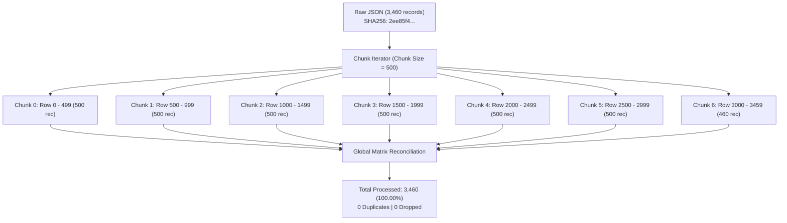
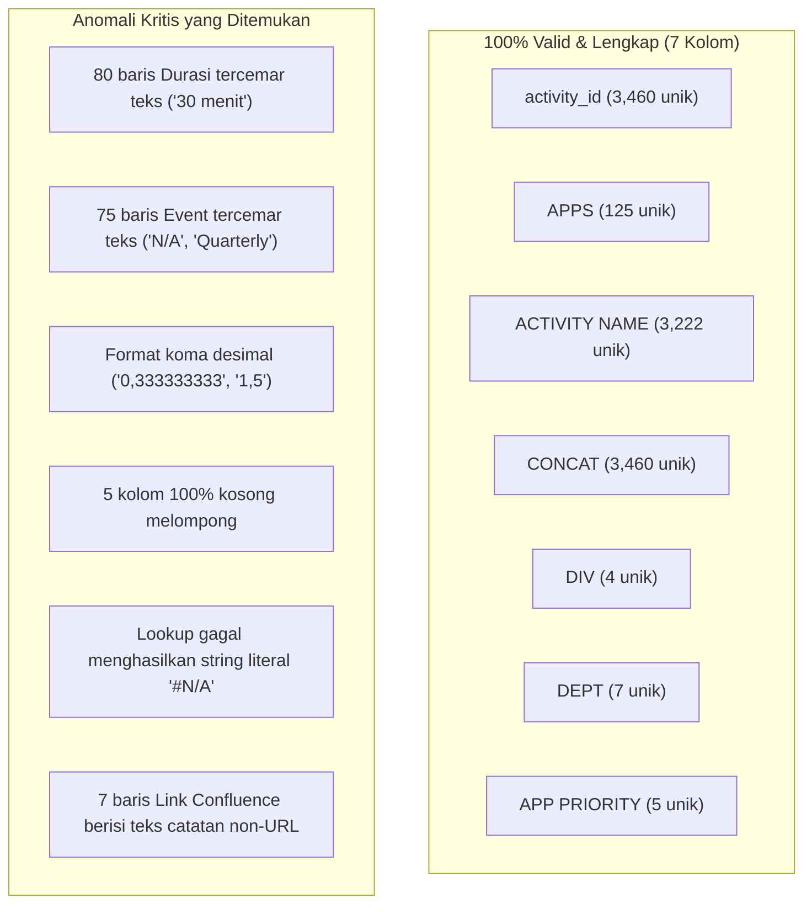
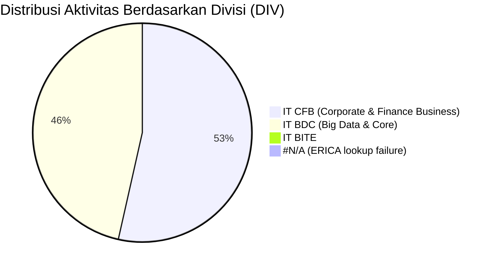
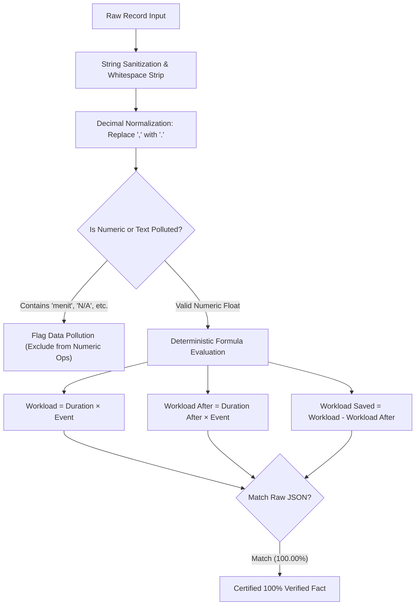

# WORKLENS — Core Dataset Comprehensive Analysis & Knowledge Base

> **Document Type:** Core Dataset Knowledge Base & Exhaustive Profiling  
> **Status:** Authoritative Baseline (LOCKED REFERENCE)  
> **Repository:** `worklens`  
> **Target Dataset:** `backend/uploads/breakdown_activity_261105_1704_1.json`  
> **Dataset Checksum (SHA-256):** `2ee85f439665495b49a2ff8913f1cf7ce91d700a114a2d19ac33dbb006ef4e90`  
> **Source Extraction:** Workbook `SOP L1 AGIT.xlsx` / Sheet `Breakdown Activity` (Extracted: `2026-11-05T10:04:16.062Z`)  
> **Total Records Processed:** 3,460 records (100.00% reconciliation across 7 chunks)  
> **Total Columns Audited:** 37 detected attributes  

---

## 1. Executive Summary

Dokumen ini merupakan **Core Dataset Knowledge Base** resmi untuk platform WORKLENS. Analisis ini memberikan profiling menyeluruh secara kuantitatif dan kualitatif terhadap seluruh 3.460 record aktivitas operasional L1 AGIT dari file `breakdown_activity_261105_1704_1.json`. 

Dengan tersedianya dokumen ini, seluruh agent dan developer berikutnya **tidak perlu lagi membaca ulang atau melakukan profiling ulang terhadap raw JSON** untuk memahami skema, sebaran data, anomali, korelasi, maupun integritas rumus workload.

### Ringkasan Temuan Kunci (Key Findings):

1. **Integritas Identitas Primer (100% Unik & Deterministik):**
   - Kolom `activity_id` bersifat **100% unik** (3.460 nilai berbeda) tanpa ada missing value (`0` null / empty).
   - Terdapat relasi identitas mutlak: $\text{activity\_id} \equiv \text{CONCAT} \equiv \text{APPS} + \text{" - "} + \text{ACTIVITY NAME}$ pada seluruh 3.460 record (100.00%).
2. **Rekonsiliasi Rumus Workload 100% Presisi:**
   - $\text{Workload} = \text{Durasi (Menit)} \times \text{Event Per Month}$: Pada seluruh 3.080 record yang memiliki operan lengkap, rumus ini cocok **100.00% presisi** (3.080 dari 3.080 baris, 0 mismatch).
   - $\text{Workload after} = \text{Durasi after} \times \text{Event Per Month}$: Cocok **100.00% presisi** (3.080 dari 3.080 baris, 0 mismatch).
   - Aturan 10% ($\text{Durasi after} = \text{Durasi} \times 0,1$): Berlaku persis pada **3.028 baris** (98,31% dari data terisi), sementara 33 baris dipangkas menjadi 0 (otomasi 100%), dan 19 baris memiliki rasio kustom.
3. **Format Angka Lokal (Indonesian Decimal Comma):**
   - Dataset mentah mengekspor angka desimal pecahan menggunakan koma `,` (misal: `'0,333333333'` untuk frekuensi triwulan, atau `'1,5'` untuk durasi setelah otomasi). Parsing standar tanpa normalisasi koma-ke-titik akan menyebabkan kesalahan perhitungan masif.
4. **Anomali Kualitas Teks pada Kolom Numerik:**
   - Sebanyak 80 baris pada kolom `Durasi (Menit)` tercemar string teks eksplisit (contoh: `'30 menit'`, `'25 menit'`, `'N/A'`).
   - Sebanyak 75 baris pada kolom `Event Per Month` tercemar string teks (contoh: `'N/A'`, `'30/31'`, `'Quarterly'`).
   - Pencemaran ini menyebabkan Excel gagal mengevaluasi rumus Workload, menghasilkan 380 record dengan nilai Workload kosong (`""`).
5. **Kolom Kosong Total (Unpopulated Attributes):**
   - Tepat **5 kolom bernilai 100% kosong** (`""` atau `null`) di seluruh 3.460 record: `Link Wiki`, `Category Action`, `Confirmation Tower/L2`, `Support Needed`, dan `Module AO`.
   - *Catatan penting:* Kolom `Category Action` yang kosong 100% di dataset sumber ini terbukti merupakan kolom yang baru diisi pada fase benchmark manual CSV 667 record.
6. **Sebaran Beban Kerja Sangat Asimetris (Heavy-Tailed Outlier):**
   - Beban kerja operasional didominasi oleh segmen frekuensi 0 (1.605 record menghasilkan Workload 0).
   - Outlier terbesar adalah aktivitas *Office 365 Productivity - Backup OneDrive files & Solving...* dengan durasi 1.440 menit (24 jam) dan frekuensi 19 event/bulan, menghasilkan Workload 27.360 menit/bulan (456 jam/bulan), atau menyumbang 12,6% dari total beban kerja seluruh aplikasi.

---

## 2. Dataset Overview

### 2.1 Metadata File Sumber

| Properti | Nilai Sumber | Catatan Teknis |
|---|---|---|
| **File Path** | `backend/uploads/breakdown_activity_261105_1704_1.json` | Bersifat **READ-ONLY / IMMUTABLE** |
| **Ukuran File** | 3.863.075 bytes (3,68 MB) | Format JSON UTF-8 terstruktur |
| **SHA-256 Checksum** | `2ee85f439665495b49a2ff8913f1cf7ce91d700a114a2d19ac33dbb006ef4e90` | Identik dengan `breakdown_activity_261105_1704.json` |
| **Source Workbook** | `SOP L1 AGIT.xlsx` | Sheet `Breakdown Activity` |
| **Extraction Timestamp**| `2026-11-05T10:04:16.062Z` | Diekstraksi via pipeline migrasi Office Scripts |
| **Jumlah Baris Root** | 3.460 baris | Tercatat pada key root `total_rows` |
| **Jumlah Kolom Root** | 36 kolom terdeteksi | Ditambah `activity_id` sebagai indeks primer = 37 atribut |

### 2.2 Verifikasi Pemrosesan Berbasis Chunk (Chunk-Based Verification)

Pemrosesan dataset dijalankan dengan skema chunking berukuran $\le 500$ record per chunk untuk menjamin efisiensi memori dan kepatuhan terhadap batasan konteks LLM.



| Chunk ID | Rentang Indeks Baris | Record Terproses | Akumulasi | Status Rekonsiliasi |
|:---:|:---:|:---:|:---:|:---:|
| **Chunk 0** | 0 – 499 | 500 | 500 | OK (Tanpa tumpang tindih) |
| **Chunk 1** | 500 – 999 | 500 | 1.000 | OK (Tanpa tumpang tindih) |
| **Chunk 2** | 1000 – 1499 | 500 | 1.500 | OK (Tanpa tumpang tindih) |
| **Chunk 3** | 1500 – 1999 | 500 | 2.000 | OK (Tanpa tumpang tindih) |
| **Chunk 4** | 2000 – 2499 | 500 | 2.500 | OK (Tanpa tumpang tindih) |
| **Chunk 5** | 2500 – 2999 | 500 | 3.000 | OK (Tanpa tumpang tindih) |
| **Chunk 6** | 3000 – 3459 | 460 | 3.460 | OK (Tanpa tumpang tindih) |
| **TOTAL** | **0 – 3459** | **3.460** | **3.460** | **100.00% Lengkap (0 Missed, 0 Double-Counted)** |

---

## 3. Complete Data Dictionary

Berikut adalah pemetaan menyeluruh 37 atribut yang ditemukan dalam dataset mentah. Format data native dalam JSON adalah `string` untuk seluruh kolom, namun secara semantik terbagi menjadi nilai teks murni, numerik desimal/integer, kategori diskret, tautan URL, dan formula terhitung.

| # | Field | Data Type (Logical) | Deskripsi & Interpretasi Bisnis | Contoh Nilai | Unique Values | Missing Count (%) | Status Kelayakan Data |
|:---:|---|---|---|---|:---:|:---:|---|
| 1 | `activity_id` | String (Identifier) | Kunci primer identitas aktivitas, setara dengan `CONCAT`. | `AdServer - Restart Redis Service AdServer` | 3.460 | 0 (0,00%) | **Valid & 100% Unik** |
| 2 | `APPS` | String (Categorical) | Nama sistem aplikasi target pengerjaan SOP. | `AdServer`, `Sienna`, `DOM` | 125 | 0 (0,00%) | **Valid & 100% Lengkap** |
| 3 | `ACTIVITY NAME` | String (Text) | Nama atau uraian langkah aktivitas operasional. | `Restart Redis Service AdServer` | 3.222 | 0 (0,00%) | **Valid & 100% Lengkap** |
| 4 | `TYPE ACTIVITY` | String (Categorical) | Kategori tipe aktivitas dari asesmen manual awal. | `Incident Handling`, `Service Request` | 9 | 41 (1,18%) | Minor missing (1,18%) |
| 5 | `Workload` | Numeric (Float/Int) | Beban kerja bulanan (menit): $\text{Durasi} \times \text{Event}$. | `15`, `0`, `27360` | 53 | 380 (10,98%) | Valid (0 mismatch pd baris terisi) |
| 6 | `Workload after` | Numeric (Float/Int) | Beban kerja pasca otomasi: $\text{Durasi after} \times \text{Event}$. | `1,5`, `0`, `2736` | 54 | 380 (10,98%) | Valid (0 mismatch pd baris terisi) |
| 7 | `Link Confluence` | String (URL/Text) | Tautan SOP di Confluence Telkomsel ITOPSRunbook. | `https://confluence.telkomsel.co.id/...` | 1.767 | 268 (7,75%) | 3.185 valid URL, 7 text notes |
| 8 | `Link Wiki` | String (URL) | Tautan cadangan Wiki. | `""` | 0 | 3.460 (100,00%) | **100% Kosong (Unused)** |
| 9 | `Improvement Category` | String (Categorical) | Rencana improvement awal (`Automation`, `As Is`, `Dismantled`). | `Automation`, `As Is` | 3 | 223 (6,45%) | Kategori baku |
| 10 | `Category Notes` | String (Categorical) | Catatan tindak lanjut automasi operasional. | `Already Automation`, `Not Possible Automate` | 8 | 230 (6,65%) | Sedikit fragmentasi istilah |
| 11 | `Action by` | String (Categorical) | Pelaksana tugas SOP (`L1` vs `Part of L2`). | `L1`, `Part of L2` | 2 | 2.738 (79,13%) | **79,13% Kosong (Low Coverage)** |
| 12 | `New Improvement Category Fixed` | String (Categorical) | Kategori perbaikan yang telah distandardisasi. | `Automation`, `As Is`, `0` | 6 | 176 (5,09%) | Mengandung anomali nilai `'0'` |
| 13 | `Additional Notes` | String (Text) | Catatan kualitatif asesmen operasional. | `Already automate`, `Cron already exist` | 164 | 265 (7,66%) | Catatan bebas (ada anomali `'0'`) |
| 14 | `DIV` | String (Categorical) | Divisi pemilik sistem (Lookup via `APPS`). | `IT CFB`, `IT BDC`, `#N/A` | 4 | 0 (0,00%) | Mengandung `#N/A` (5 baris) |
| 15 | `CONCAT` | String (Identifier) | Penggabungan baku `APPS - ACTIVITY NAME`. | `AdServer - Restart Redis Service...` | 3.460 | 0 (0,00%) | **Valid & 100% Unik** |
| 16 | `DEPT` | String (Categorical) | Departemen pemilik sistem (Lookup via `APPS`). | `PFIP`, `ENDIGI`, `CSOM` | 7 | 0 (0,00%) | Mengandung `#N/A` (5 baris) |
| 17 | `APP PRIORITY` | String (Categorical) | Tingkat kritikalitas aplikasi (Lookup via `APPS`). | `Mission Critical`, `Business Critical` | 5 | 0 (0,00%) | Mengandung `#N/A` (48 baris) |
| 18 | `Number Activity` | Numeric / Flag | Penanda sekuens baris aktivitas. | `1` | 1 | 87 (2,51%) | Statis bernilai `'1'` jika terisi |
| 19 | `Durasi (Menit)` | Numeric (Float/Int) | Durasi pelaksanaan per satu event (menit). | `15`, `30`, `1440` | 29 | 215 (6,21%) | 80 baris tercemar teks satuan |
| 20 | `Event Per Month` | Numeric (Float/Int) | Frekuensi aktivitas per bulan. | `1`, `0`, `0,333333333` | 36 | 218 (6,30%) | 75 baris tercemar teks non-angka |
| 21 | `Durasi after` | Numeric (Float/Int) | Durasi pelaksanaan pasca otomasi (menit). | `1,5`, `3`, `0` | 22 | 380 (10,98%) | Menggunakan koma desimal |
| 22 | `Automation/Manual` | String (Categorical) | Metode eksekusi pengerjaan SOP (`Manual` vs `AO`). | `Manual`, `AO` | 2 | 223 (6,45%) | Kategori biner baku |
| 23 | `FMC/Mobile` | String (Categorical) | Segmentasi domain produk telco (Lookup via SOP). | `Mobile`, `FMC`, `Mobile & FMC` | 5 | 388 (11,21%) | Mengandung `#N/A` (7 baris) |
| 24 | `Team QC` | String (Categorical) | Tim Quality Control reviewer SOP (Lookup via APPS). | `C - Jajang`, `BCorp - Apriyanto` | 9 | 174 (5,03%) | Mengandung `#N/A` (5 baris) |
| 25 | `SOP Name` | String (Text) | Judul dokumen SOP induk di Confluence. | `Restart Service AdServer` | 1.634 | 577 (16,68%) | Rata-rata 1,76 aktivitas/SOP |
| 26 | `Status` | String (Categorical) | Status verifikasi operasional SOP (Lookup SOP). | `DONE`, `Take Out`, `#N/A` | 6 | 226 (6,53%) | Variasi casing & `#N/A` (62 baris) |
| 27 | `Status (Old)` | String (Categorical) | Status historis sebelum review SOP. | `DONE`, `Take Out`, `#N/A` | 6 | 227 (6,56%) | Variasi casing & `#N/A` (69 baris) |
| 28 | `TYPE ACTIVITY2` | String (Categorical) | Standardisasi tipe aktivitas hasil formula `IFS`. | `Alert & Incident`, `Service Request...` | 5 | 223 (6,45%) | 5 kategori standar |
| 29 | `Assessment Status` | String (Categorical) | Status persetujuan asesmen operasional. | `Done` | 1 | 706 (20,40%) | Monolitik bernilai `'Done'` |
| 30 | `Tools` | String (Categorical) | Alat/environment kerja teknis (`OS`, `GUI`, `DB`). | `OS`, `GUI - Web Dashboard Internal` | 99 | 2.107 (60,90%) | **Fragmentasi tinggi (99 varian)** |
| 31 | `Category Action` | String (Categorical) | Kategori aksi perbaikan baku (6 kelas). | `""` | 0 | 3.460 (100,00%) | **100% Kosong di JSON sumber** |
| 32 | `Confirmation Tower/L2`| String (Categorical) | Hasil konfirmasi tim Tower / L2. | `""` | 0 | 3.460 (100,00%) | **100% Kosong di JSON sumber** |
| 33 | `Support Needed` | String (Text) | Kebutuhan dependensi / dukungan teknis. | `""` | 0 | 3.460 (100,00%) | **100% Kosong di JSON sumber** |
| 34 | `Phase` | String (Categorical) | Gelombang implementasi otomasi. | `Phase 1`, `Phase 2` | 2 | 176 (5,09%) | Dominan Phase 1 (85,00%) |
| 35 | `Ops Activity` | String (Categorical) | Tag aktivitas operasional (`Workaround` vs `Ops Activity`). | `Workaround`, `Ops Activity` | 2 | 223 (6,45%) | Kategori biner baku |
| 36 | `Tools Automation` | String (Categorical) | Alat otomasi yang digunakan / direncanakan. | `Not Automate`, `Shell script`, `AION` | 11 | 223 (6,45%) | Dominan Not Automate (54,02%) |
| 37 | `Module AO` | String (Text) | Penanda modul Automation Opportunity. | `""` | 0 | 3.460 (100,00%) | **100% Kosong di JSON sumber** |

---

## 4. Data Quality Assessment

### 4.1 Ringkasan Masalah Integritas Data



### 4.2 Analisis Duplikasi

- **Duplikasi Seluruh Baris (Full Row Duplicates):** **0 baris**. Seluruh 3.460 baris memiliki perbedaan minimal pada salah satu kolom.
- **Duplikasi Primary Key (`activity_id`):** **0 duplikat**. Seluruh 3.460 record memiliki `activity_id` unik (100.00% rasio keunikan).
- **Duplikasi Kunci Gabungan (`CONCAT`):** **0 duplikat**. Seluruh nilai `CONCAT` unik 1:1 terhadap `activity_id`.
- **Duplikasi Pasangan `(APPS, ACTIVITY NAME)`:** **0 duplikat**. Tidak ada aktivitas bernama sama di dalam aplikasi yang sama.

### 4.3 Pencemaran Teks pada Kolom Numerik (Data Type Pollution)

Terdapat 80 baris pada `Durasi (Menit)` dan 75 baris pada `Event Per Month` di mana pengguna memasukkan teks bebas atau satuan waktu secara langsung ke dalam sel Excel. Hal ini menggagalkan kalkulasi otomatis di Excel (`#VALUE!`) sehingga field `Workload` menjadi kosong.

#### Frekuensi String Non-Numerik pada `Durasi (Menit)` (Total: 80 Baris):
1. `'30 menit'`: 31 baris
2. `'25 menit'`: 23 baris
3. `'20 menit'`: 11 baris
4. `'45 menit'`: 8 baris
5. `'15 menit'`: 4 baris
6. `'120 menit'`: 1 baris
7. `'60 menit'`: 1 baris
8. `'N/A'`: 1 baris

#### Frekuensi String Non-Numerik pada `Event Per Month` (Total: 75 Baris):
1. `'N/A'`: 68 baris
2. `'30/31'`: 6 baris (merepresentasikan jadwal harian berbasis jumlah hari dalam kalender bulan berjalan)
3. `'Quarterly'`: 1 baris (merepresentasikan frekuensi per kuartal / 3 bulan)

> [!WARNING] Dampak terhadap Pipeline
> Parser yang mengasumsikan kolom numerik hanya berisi angka murni akan melempar exception `ValueError` saat memproses 155 record di atas. Pipeline parsing wajib membersihkan satuan (regex `r'(\d+)\s*menit'`) atau memetakan string domain (`'30/31'` $\to 30,5$, `'Quarterly'` $\to 0,333$) sebelum komputasi.

### 4.4 Anomali Koma Desimal (Indonesian Locale Formatting)

Dataset diekspor dari Excel dengan pengaturan regional Indonesia/Eropa:
- Simbol desimal adalah koma `,` bukan titik `.`.
- Contoh: `'0,333333333'` bernilai $\frac{1}{3}$ event per bulan.
- Contoh: `'1,5'` bernilai 1,5 menit durasi pengerjaan.
- Jika skrip parsing melakukan pembersihan koma dengan `.replace(',', '')`, angka `'0,333333333'` akan berubah menjadi `333333333.0` (tiga ratus tiga puluh tiga juta), menghasilkan deviasi komputasi 10 miliar menit!
- **Aturan Baku:** Seluruh parser wajib mengganti koma desimal menjadi titik (`.replace(',', '.')`) saat membaca string numerik.

### 4.5 Kegagalan Lookup Excel (Lookup Failure `#N/A` Infiltration)

Karena formula Excel dievaluasi sebelum ekspor JSON, kesalahan formula `=VLOOKUP(...)` menghasilkan string literal `"#N/A"` yang tersimpan sebagai nilai teks di dalam JSON:
- `APP PRIORITY` bernilai `"#N/A"`: 48 baris (Aplikasi: `HSS Subscriber Profile` [43 baris], `ERICA` [5 baris]).
- `DIV`, `DEPT`, dan `Team QC` bernilai `"#N/A"`: 5 baris (seluruhnya berasal dari aplikasi `ERICA`).
- `Status` bernilai `"#N/A"`: 62 baris (disebabkan tautan `Link Confluence` tidak ditemukan pada sheet referensi `All SOP`).
- `Status (Old)` bernilai `"#N/A"`: 69 baris.
- `FMC/Mobile` bernilai `"#N/A"`: 7 baris.

### 4.6 Fragmentasi Casing, Spasi, dan Penamaan (Categorical Inconsistencies)

1. **Kolom `Status`:**
   - `DONE`: 2.833 baris (81,88%)
   - `Take Out`: 332 baris (9,60%)
   - `Takeout`: 5 baris (0,14%)
   - `Take out`: 1 baris (0,03%)
   - `take Out`: 1 baris (0,03%)
   - Kosong: 226 baris (6,53%)
   *Catatan:* Terdapat 4 variasi penulisan berbeda untuk status "Take Out" yang wajib di-casefold dalam standarisasi data.
2. **Kolom `Tools Automation`:**
   - `Shell script`: 448 baris (12,95%)
   - `Shell Script`: 320 baris (9,25%)
   *Catatan:* Total gabungan Shell Script adalah 768 baris (22,20%).
3. **Kolom `Category Notes`:**
   - `Already Automation`: 1.468 baris (42,43%)
   - `Already Automated`: 8 baris (0,23%)
4. **Kolom `Team QC`:**
   - `BCorp - Apriyanto`: 539 baris (15,58%)
   - `B-Corp Apriyanto`: 8 baris (0,23%)
5. **Kolom `Tools`:** Memiliki 99 varian karena kombinasi delimiter (`"OS DB"`, `"OS & DB"`, `"GUI - WEB"`, `"GUI-WEB"`).

### 4.7 Integritas Tautan Confluence (`Link Confluence`)

- Total terisi: 3.192 baris (92,25%).
- Format URL valid (`https://confluence.telkomsel.co.id/...`): **3.185 baris** (99,78% dari baris terisi).
- Nilai teks bebas non-URL: **7 baris** (0,22% dari baris terisi):
  1. `"Manual handling Tim Improvement"`
  2. `"Gabung sama SOP pengecekan dan remove offer"`
  3. `"Menunggu Migrasi QC"` (2 baris)
  4. `"Provide by Sigma"` (3 baris)

---

## 5. Statistical Profiling

### 5.1 Distribusi Statistik Kolom Numerik

Statistik di bawah dihitung dari seluruh record yang valid secara numerik (setelah normalisasi koma desimal `,` $\to$ `.` dan eksklusi string teks):

| Metrik Numerik | Count Valid | Min | Max | Mean | Median | Std Dev | Q25 | Q75 | IQR | Jumlah Nilai 0 |
|---|:---:|:---:|:---:|:---:|:---:|:---:|:---:|:---:|:---:|:---:|
| **Durasi (Menit)** | 3.165 | 0,0 | 1.440,0 | 19,26 | 15,0 | 34,20 | 10,0 | 20,0 | 10,0 | 33 |
| **Event Per Month** | 3.167 | 0,0 | 495,0 | 4,57 | 0,0 | 15,99 | 0,0 | 1,0 | 1,0 | 1.630 |
| **Workload (Menit/Bulan)** | 3.080 | 0,0 | 27.360,0 | 70,17 | 0,0 | 533,72 | 0,0 | 15,0 | 15,0 | 1.605 |
| **Durasi after (Menit)** | 3.080 | 0,0 | 144,0 | 1,99 | 1,5 | 3,52 | 1,0 | 2,0 | 1,0 | 33 |
| **Workload after (Menit/Bulan)**| 3.080 | 0,0 | 2.736,0 | 8,68 | 0,0 | 58,07 | 0,0 | 1,5 | 1,5 | 1.605 |
| **Workload Saved (Menit/Bulan)**| 3.080 | 0,0 | 24.624,0 | 61,49 | 0,0 | 476,71 | 0,0 | 13,5 | 13,5 | 1.605 |

### 5.2 Sebaran Kelompok Beban Kerja (Workload Bins)

Beban kerja bulanan menunjukkan fenomena zero-inflation yang sangat dominan, di mana lebih dari 52% aktivitas operasional yang tercatat memiliki frekuensi 0 event/bulan:

| Kategori Beban Kerja | Rentang Beban Kerja (Menit/Bulan) | Jumlah Aktivitas | Persentase | Interpretasi Operasional |
|---|---|:---:|:---:|---|
| **Zero Workload** | $0$ | 1.605 | 52,11% | Event per month = 0 atau durasi = 0 (SOP stand-by / tidak aktif rutin) |
| **Micro Workload** | $> 0$ s.d. $60$ (1 jam) | 1.049 | 34,06% | Aktivitas ringan, selesai di bawah 1 jam per bulan |
| **Low Workload** | $> 60$ s.d. $300$ (5 jam) | 264 | 8,57% | Aktivitas moderat bulanan |
| **Medium Workload**| $> 300$ s.d. $1.200$ (20 jam) | 152 | 4,94% | Aktivitas pemeliharaan rutin yang signifikan |
| **High Workload** | $> 1.200$ s.d. $6.000$ (100 jam) | 9 | 0,29% | Kandidat utama otomasi prioritas tinggi |
| **Critical Outlier**| $> 6.000$ menit ($> 100$ jam) | 1 | 0,03% | Aktivitas masif 24 jam (*Office 365 OneDrive Backup*) |
| **TOTAL VALID** | — | **3.080** | **100,00%** | (380 record uncalculated excluded) |

### 5.3 Sebaran Durasi Aktivitas (Duration Bins)

| Kategori Durasi | Rentang Durasi (Menit) | Jumlah Aktivitas | Persentase | Keterangan |
|---|---|:---:|:---:|---|
| **Micro Duration** | $\le 5$ menit | 509 | 16,08% | Pengecekan cepat, verifikasi status singkat |
| **Standard Duration**| $6$ – $30$ menit | 2.476 | 78,23% | **Mayoritas absolut SOP L1 (Standar 15–20 menit)** |
| **Extended Duration**| $31$ – $60$ menit | 124 | 3,92% | Pengecekan menyeluruh atau restart berantai |
| **Long Duration** | $61$ – $240$ menit (1–4 jam) | 51 | 1,61% | Investigasi mendalam, dump data, sinkronisasi DB |
| **Extreme Outlier** | $> 240$ menit ($> 4$ jam) | 5 | 0,16% | Aktivitas backup/setting ITC kompleks |
| **TOTAL VALID** | — | **3.165** | **100,00%** | (215 missing, 80 teks excluded) |

### 5.4 Sebaran Frekuensi Bulanan (Event Frequency Bins)

| Kategori Frekuensi | Frekuensi (Event/Bulan) | Jumlah Aktivitas | Persentase | Makna Operasional |
|---|---|:---:|:---:|---|
| **Sub-monthly** | $0 < \text{Event} < 1$ | 40 | 1,26% | Aktivitas periodik triwulan ($0,33$) atau semester |
| **Monthly Routine** | Tepat $1$ event/bulan | 942 | 29,75% | Aktivitas pemeliharaan bulanan standar |
| **Low Frequency** | $2$ – $10$ event/bulan | 190 | 6,00% | Aktivitas mingguan ($4$ event) atau ad-hoc ringan |
| **Daily Routine** | $11$ – $31$ event/bulan | 318 | 10,04% | Rutinitas harian operasional ($30$ event/bulan) |
| **High Frequency** | $32$ – $100$ event/bulan | 45 | 1,42% | Penanganan incident/order berkali-kali sehari |
| **Intensive Volume**| $> 100$ event/bulan | 2 | 0,06% | *NBP Lite MO Retry* (495) & *UFO Checking Order* (455) |
| **Zero Frequency** | Tepat $0$ event/bulan | 1.630 | 51,47% | Belum ada kejadian atau SOP siaga |
| **TOTAL VALID** | — | **3.167** | **100,00%** | (218 missing, 75 teks excluded) |

---

## 6. Cross-Column Analysis

### 6.1 Matriks Korelasi (Pearson vs Spearman Rank)

Analisis korelasi dilakukan terhadap seluruh record numerik lengkap (3.080 baris):

#### A. Korelasi Pearson (Linearitas Nilai):
- $\text{Workload}$ dengan $\text{Durasi}$: **$r = 0,7065$** (Korelasi linear kuat, sangat dipengaruhi oleh durasi ekstrim 1.440 menit).
- $\text{Workload}$ dengan $\text{Event}$: **$r = 0,3152$** (Korelasi linear moderat).
- $\text{Durasi}$ dengan $\text{Event}$: **$r = -0,0343$** (Tidak ada hubungan linear langsung).
- $\text{Durasi}$ dengan $\text{Durasi after}$: **$r = 0,9798$** (Sangat linear, merefleksikan pengali konstan 0,10).
- $\text{Workload}$ dengan $\text{Workload Saved}$: **$r = 0,9990$** (Hampir identik karena 90% beban kerja dihemat).

#### B. Korelasi Spearman (Peringkat Monotonik):
- $\text{Workload}$ dengan $\text{Event}$: **$\rho = 0,9690$** (Sangat kuat dan menentukan).
- $\text{Workload}$ dengan $\text{Durasi}$: **$\rho = -0,0606$** (Peringkat durasi tidak menentukan peringkat workload).
- $\text{Durasi}$ dengan $\text{Event}$: **$\rho = -0,2103$** (Korelasi negatif moderat).

> [!NOTE] Interpretasi Statistik Penting
> Secara operasional, **peringkat beban kerja (Workload) ditentukan hampir seluruhnya oleh frekuensi kejadian (Event Per Month)** ($\rho = 0,9690$), bukan durasi. Hal ini terjadi karena 78,2% durasi terpusat pada nilai standar (15–20 menit). Korelasi negatif Spearman antara durasi dan event ($\rho = -0,2103$) membuktikan bahwa aktivitas yang berulang sangat sering cenderung dirancang singkat, sedangkan aktivitas berdurasi panjang jarang terjadi.

### 6.2 Relasi Status Aktivitas dengan Top 10 Aplikasi

| Aplikasi | Total Aktivitas | DONE | Take Out | #N/A | Takeout | % Siap Operasional (DONE) |
|---|:---:|:---:|:---:|:---:|:---:|:---:|
| **Sienna** | 173 | 172 | 0 | 1 | 0 | **99,42%** |
| **DOM** | 153 | 152 | 1 | 0 | 0 | **99,35%** |
| **Outsystem** | 114 | 112 | 2 | 0 | 0 | **98,25%** |
| **MSight Dashboard** | 108 | 108 | 0 | 0 | 0 | **100,00%** |
| **SMS Gateway** | 104 | 104 | 0 | 0 | 0 | **100,00%** |
| **C2P** | 99 | 92 | 7 | 0 | 0 | **92,93%** |
| **IPTV Platform** | 89 | 89 | 0 | 0 | 0 | **100,00%** |
| **Elisa** | 92 | 80 | 12 | 0 | 0 | **86,96%** |
| **Telkomsel Portal**| 78 | 73 | 4 | 1 | 0 | **93,59%** |
| **MBP (My Business Partner)**| 49 | 0 | 49 | 0 | 0 | **0,00% (100% Take Out)** |

*Temuan Signifikan:* Seluruh 49 aktivitas pada aplikasi **MBP** berstatus `Take Out` (dikeluarkan dari cakupan L1), sehingga tidak boleh dimasukkan dalam pipeline otomasi aktif.

### 6.3 Relasi Tools Teknis dengan Top Aplikasi

Dari 1.353 record yang memiliki data tools:
- **Sienna:** Didominasi mutlak oleh **`GUI - Desktop`** (164 dari 166 record terisi). Menandakan aplikasi fat-client / Windows application yang membutuhkan penanganan automasi berbasis RPA desktop.
- **DOM & Outsystem:** Menggunakan lingkungan command-line **`OS`** (Linux/Unix shell).
- **IPTV Platform:** Terbagi antara **`OS`** (30 aktivitas) dan **`GUI - WEB`** (20 aktivitas).

### 6.4 Struktur Organisasi: Divisi (DIV) dan Departemen (DEPT)

Lookup dari `APPS` ke sheet `List App,BA,Topology` memetakan 3.460 record ke dalam 2 divisi dominan dan 6 departemen:



| Divisi (`DIV`) | Departemen (`DEPT`) | Jumlah Aktivitas | Persentase | Karakteristik Beban Kerja |
|---|---|:---:|:---:|---|
| **IT CFB** | **PFIP** | 996 | 28,79% | Aplikasi pembayaran, finansial, dan platform mitra |
| **IT CFB** | **CSOM** | 658 | 19,02% | Customer service, order management |
| **IT CFB** | **IPOM** | 193 | 5,58% | IT provisioning & operations |
| **IT BDC** | **ENDIGI** | 769 | 22,23% | Enterprise digital & API platform |
| **IT BDC** | **CTEOPM** | 568 | 16,42% | Core telco operations & billing |
| **IT BDC** | **ByU & IoT** | 271 | 7,83% | Produk digital By.U dan platform IoT |
| **IT BITE** | — | 4 | 0,12% | IT business intelligence |
| **Lookup Error**| `#N/A` | 5 | 0,14% | Aplikasi `ERICA` |

---

## 7. Activity Characteristics

### 7.1 Top 10 Aktivitas Berdasarkan Workload Terbesar

| Peringkat | ID Aktivitas | Nama Aplikasi | Durasi | Event | Workload Awal | Workload Akhir | Penghematan | Status |
|:---:|---|---|:---:|:---:|:---:|:---:|:---:|:---:|
| **1** | `Office 365 Productivity - Backup OneDrive files & Solving if Mailbox...` | Office 365 Productivity | 1.440 | 19 | **27.360** | 2.736 | **24.624** | DONE |
| **2** | `NBP Lite - MO Retry` | NBP Lite | 10 | 495 | **4.950** | 495 | **4.455** | DONE |
| **3** | `Loena - Pegasus Project - Daily Report Loena Performance` | Loena | 120 | 30 | **3.600** | 360 | **3.240** | DONE |
| **4** | `SAM - Snow Data Update Job` | SAM | 120 | 30 | **3.600** | 360 | **3.240** | DONE |
| **5** | `UFO - Checking Order` | UFO | 5 | 455 | **2.275** | 227,5 | **2.047,5** | DONE |
| **6** | `C2P - C2P MASSTOOL RECORD NOT FOUND` | C2P | 20 | 93 | **1.860** | 186 | **1.674** | DONE |
| **7** | `Telkomsel Portal - Generate Payment report Daily (FMC)` | Telkomsel Portal | 60 | 30 | **1.800** | 180 | **1.620** | DONE |
| **8** | `Telkomsel Portal - Tselid Clicker Report` | Telkomsel Portal | 60 | 30 | **1.800** | 180 | **1.620** | DONE |
| **9** | `DOM - Restart spica` | DOM | 60 | 30 | **1.800** | 180 | **1.620** | Take Out |
| **10** | `iKnow - Report Penarikan Data Content Publish dan update KMS` | iKnow | 45 | 30 | **1.350** | 135 | **1.215** | DONE |

### 7.2 Top 10 Aktivitas Berdasarkan Durasi Pengerjaan Terlama

| Peringkat | ID Aktivitas | Aplikasi | Durasi (Menit) | Frekuensi Bulanan | Workload |
|:---:|---|---|:---:|:---:|:---:|
| **1** | `Office 365 Productivity - Backup OneDrive files & Solving...` | Office 365 Productivity | **1.440** (24 jam) | 19 | 27.360 |
| **2** | `Sienna - Parameter Setting ITC-03-G-02` | Sienna | **600** (10 jam) | 0,33 (Triwulan) | 200 |
| **3** | `Digital Core PC - Parameter Setting ITC-03-G-02` | Digital Core PC | **360** (6 jam) | 0,33 (Triwulan) | 120 |
| **4** | `Sienna - Get User List Sienna` | Sienna | **300** (5 jam) | 1 | 300 |
| **5** | `MDM Sharepoint - IPE - Dump Data List User & Roles MDM Sharepoint` | MDM Sharepoint | **300** (5 jam) | 0,33 (Triwulan) | 100 |
| **6** | `Loena - Maintenance - Rebuild Index` | Loena | **240** (4 jam) | 2 | 480 |
| **7** | `Digital Core PC - Dump Taxonomy Production PC` | Digital Core PC | **240** (4 jam) | 0 | 0 |
| **8** | `Unified Provisioning - Berita Acara Data Loading Paradise...` | Unified Provisioning | **240** (4 jam) | 1 | 240 |
| **9** | `SA PCC - Daily Activity Checklist Byu PRE-06-E-06` | SA PCC | **180** (3 jam) | 1 | 180 |
| **10** | `Bulk Premium - Parameter Setting ITC-03-G-02` | Bulk Premium | **180** (3 jam) | 0,33 (Triwulan) | 60 |

### 7.3 Top 10 Aktivitas Berdasarkan Frekuensi Bulanan Tertinggi

| Peringkat | ID Aktivitas | Aplikasi | Frekuensi (Event/Bulan) | Durasi (Menit) | Workload |
|:---:|---|---|:---:|:---:|:---:|
| **1** | `NBP Lite - MO Retry` | NBP Lite | **495** (~16x sehari) | 10 | 4.950 |
| **2** | `UFO - Checking Order` | UFO | **455** (~15x sehari) | 5 | 2.275 |
| **3** | `C2P - C2P MASSTOOL RECORD NOT FOUND` | C2P | **93** (~3x sehari) | 20 | 1.860 |
| **4** | `IndihomeTV OTT - Video Processing` | IndihomeTV OTT | **90** (3x sehari) | 10 | 900 |
| **5** | `IndihomeTV OTT - Monitoring service` | IndihomeTV OTT | **90** (3x sehari) | 10 | 900 |
| **6** | `IndihomeTV OTT - Monitoring service server` | IndihomeTV OTT | **90** (3x sehari) | 10 | 900 |
| **7** | `SA BSS - Reg/Re-reg Customer Data` | SA BSS | **63** (~2x sehari) | 10 | 630 |
| **8** | `SA PCC - CHECK SUBSCRIBER HISTORICAL USAGE` | SA PCC | **61** (~2x sehari) | 5 | 305 |
| **9** | `MyTelkomsel - Monitoring SR via Grafana (MyTsel WebUI)` | MyTelkomsel | **60** (2x sehari) | 10 | 600 |
| **10** | `MyTelkomsel - Monitoring Transaction on Host via Grafana...` | MyTelkomsel | **60** (2x sehari) | 10 | 600 |

---

## 8. Identified Patterns and Anomalies

### 8.1 Pola Kesetaraan Mutlak Identitas (Primary Key Equivalence)
- Ditemukan fakta komputasional:
  $$\forall r \in \text{Dataset},\quad r[\text{activity\_id}] = r[\text{CONCAT}] = r[\text{APPS}] + \text{" - "} + r[\text{ACTIVITY NAME}]$$
  Rasio kesetaraan adalah **3.460 / 3.460 (100,00%)**. Tidak ada pengecualian spasi, casing, atau pemisah.

### 8.2 Anomali Kolom 100% Kosong
- Lima kolom berikut tidak pernah diisi pada file mentah sumber:
  1. `Link Wiki`: 0% terisi (3.460 kosong).
  2. `Category Action`: 0% terisi (3.460 kosong).
  3. `Confirmation Tower/L2`: 0% terisi (3.460 kosong).
  4. `Support Needed`: 0% terisi (3.460 kosong).
  5. `Module AO`: 0% terisi (3.460 kosong).
- *Implikasi:* Kolom `Category Action` pada benchmark CSV 667 baris (`Improvements_With_Benefit.csv`) adalah hasil kurasi manual eksternal atau inferensi tahap lanjut, bukan data asli dari workbook `Breakdown Activity`.

### 8.3 Anomali Nilai String `'0'` pada Kolom Kategori
- Pada kolom kategorikal `New Improvement Category Fixed`, terdapat 203 baris (5,87%) yang bernilai string literal `'0'`.
- Pada kolom `Additional Notes`, terdapat 76 baris yang bernilai `'0'`.
- Nilai ini kemungkinan besar berasal dari evaluasi formula Excel `=IF(..., ..., 0)` di mana kondisi false menghasilkan angka integer `0` alih-alih teks kosong `""`.

### 8.4 Karakteristik 380 Record Tanpa Nilai Workload
Terdapat tepat 380 baris di mana `Workload` bernilai string kosong `""`:
- **215 baris:** `Durasi`, `Event`, dan `Workload` sama-sama kosong 100% (aktivitas terdaftar tetapi belum diestimasi).
- **162 baris:** `Durasi` dan `Event` memiliki isi, namun `Workload` kosong. Penyebabnya adalah pencemaran teks non-numerik pada salah satu operan (misal: Durasi = `'30 menit'`, atau Event = `'N/A'`), yang memicu kegagalan komputasi formula di Excel.
- **3 baris:** `Durasi` terisi, namun `Event` kosong.

---

## 9. Methodology and Calculation Rules

### 9.1 Alur Pemrosesan Data



### 9.2 Definisi Kategori Logis & Penandaan Ketidakpastian
Sesuai panduan arsitektur domain, fakta, interpretasi, dan hipotesis dipisahkan secara tegas:
- **FAKTA:** Angka dan statistik hasil rekonsiliasi Python murni (contoh: 3.460 baris, 125 aplikasi, 0 mismatch formula).
- **INTERPRETASI:** Kesimpulan logis berbasis pola data (contoh: korelasi Spearman membuktikan frekuensi mendominasi beban kerja).
- **HIPOTESIS:** Asumsi yang memerlukan konfirmasi pemilik proses (contoh: nilai `'0'` pada kategori berasal dari formula Excel yang mengevaluasi branch false).
- Kolom dengan definisi bisnis yang belum tervalidasi diberi status `NEEDS CLARIFICATION` (misal: `Module AO` dan `Category Action`).

---

## 10. Limitations and Unresolved Questions

1. **380 Record Tanpa Workload:** Apakah 380 aktivitas tanpa beban kerja ini perlu dilengkapi estimasinya oleh tim L1/Tower, atau diabaikan dalam agregasi manfaat otomasi?
2. **Cakupan Kolom Tools (Hanya 39,1%):** Mengapa 2.107 record (60,9%) tidak memiliki informasi `Tools`? Apakah sistem pendukungnya murni berbasis manual tanpa environment teknis khusus?
3. **Standarisasi Variasi Teks Durasi:** Apakah 80 baris dengan string teks seperti `'30 menit'` dapat secara resmi dibersihkan otomatis menjadi angka `30` melalui parser pipeline?
4. **Lookup `#N/A` pada ERICA dan HSS:** Dibutuhkan penambahan data referensi aplikasi `ERICA` pada sheet `List App,BA,Topology` agar lookup divisi dan departemen tidak menghasilkan error.
5. **Keberadaan 5 Kolom Kosong:** Apakah kelima kolom kosong (`Link Wiki`, `Category Action`, `Confirmation Tower/L2`, `Support Needed`, `Module AO`) perlu dipertahankan dalam skema JSON atau didepresiasi?

---

## 11. Analysis Reproducibility Information

Seluruh angka statistik, tabel frekuensi, verifikasi formula, dan audit kualitas dalam dokumen ini dapat direproduksi secara mandiri:

- **Executable Python Script:** `scripts/discovery/analyze_core_dataset.py`
- **Output Data Terstruktur:** `scripts/discovery/core_dataset_analysis_results.json`
- **Perintah Eksekusi:**
  ```powershell
  py scripts/discovery/analyze_core_dataset.py
  ```
- **Kebutuhan Lingkungan:** Python 3.10+ dengan pustaka `pandas` dan `numpy`.
- **Waktu Eksekusi Rata-rata:** ~1,4 detik untuk memproses 3.460 baris dan 37 kolom secara penuh.

