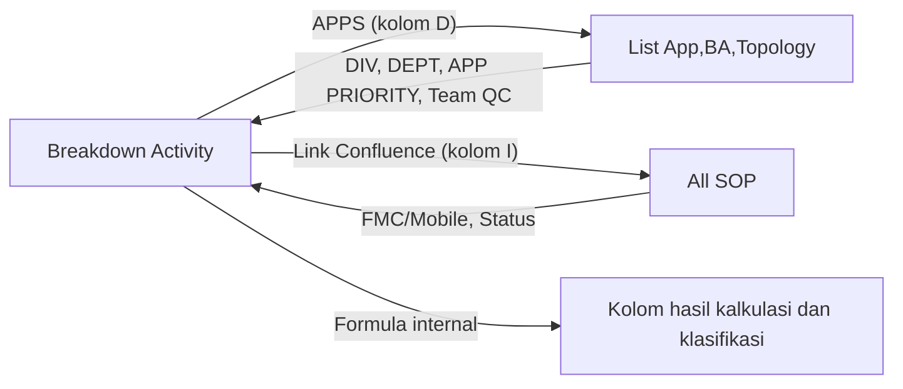

# Breakdown Activity — Struktur Sheet dan Peta Lookup

## 1. Tujuan

Dokumen ini mencatat struktur sheet **`Breakdown Activity`** pada workbook `SOP L1 AGIT.xlsx`, terutama formula dan relasi lookup yang digunakan sheet tersebut.

**Ruang lingkup saat ini:** hanya sheet `Breakdown Activity` dan sheet referensi yang benar-benar dipanggil oleh formula di dalamnya. Ini menjadi dasar untuk tahap awal otomasi pemeriksaan workbook melalui Microsoft Copilot Studio.

## 2. Ringkasan Sheet

- **Rentang sel terdeteksi:** `A1:CI3471`
- **Kolom utama berheader:** `A:AI` (35 kolom)
- **Formula:** sekitar 36.113 sel formula tercatat di XML sheet. Angka ini adalah jumlah sel formula, bukan jumlah formula unik.
- Workbook memiliki beberapa sheet lain yang dipakai sebagai sumber lookup.

> Catatan: area setelah kolom `AI` juga berisi sel tambahan yang tampak seperti area ringkasan atau pelaporan. Area tersebut belum diperlakukan sebagai bagian dari tabel utama karena header dan strukturnya berbeda.

## 3. Struktur Kolom

| Kolom | Nama Header | Fungsi / Interpretasi Awal |
|---|---|---|
| A | DIV | Hasil lookup dari `List App,BA,Topology`, berdasarkan nilai APPS. |
| B | CONCAT | Menggabungkan nama aplikasi dan nama aktivitas; contoh pola `APPS - ACTIVITY NAME`. |
| C | DEPT | Hasil lookup dari `List App,BA,Topology`, berdasarkan nilai APPS. |
| D | APPS | Nama aplikasi; menjadi kunci lookup untuk metadata aplikasi. |
| E | APP PRIORITY | Hasil lookup dari `List App,BA,Topology`, berdasarkan nilai APPS. |
| F | TYPE ACTIVITY | Kategori aktivitas sumber. |
| G | ACTIVITY NAME | Nama aktivitas. |
| H | Link Wiki | Tautan wiki jika tersedia. |
| I | Link Confluence | Tautan dokumentasi Confluence; juga digunakan sebagai kunci lookup pada formula tertentu. |
| J | Number Activity | Jumlah atau angka aktivitas yang dicatat. |
| K | Durasi (Menit) | Durasi aktivitas dalam menit. |
| L | Event Per Month | Frekuensi kejadian per bulan. |
| M | Workload | Hasil perkalian `Durasi (Menit) × Event Per Month`. |
| N | Durasi after | Durasi setelah perbaikan/otomasi; contoh formula menggunakan 10% dari durasi awal. Perlu konfirmasi apakah asumsi 10% berlaku umum. |
| O | Workload after | Hasil perkalian `Durasi after × Event Per Month`. |
| P | Automation/Manual | Menandai aktivitas manual atau otomatis. |
| Q | FMC/Mobile | Hasil lookup dari sheet `All SOP`, menggunakan `Link Confluence`. |
| R | Team QC | Hasil lookup dari `List App,BA,Topology`, menggunakan `APPS`. |
| S | SOP Name | Nama SOP terkait aktivitas; sumber pengisian perlu diverifikasi per bagian data. |
| T | Status | Hasil lookup dari sheet `All SOP`, menggunakan `Link Confluence`. |
| U | Status (Old) | Status lama atau nilai pembanding. |
| V | TYPE ACTIVITY2 | Kategori aktivitas hasil pemetaan formula dari `TYPE ACTIVITY`. |
| W | Improvement Category | Kategori improvement, misalnya `As Is`. |
| X | Additional Notes | Catatan atau penjelasan tambahan. |
| Y | Assessment Status | Status penilaian, misalnya `Done`. |
| Z | Category Notes | Catatan kategori, misalnya `To Be Automated`. |
| AA | Tools | Jenis alat atau lingkungan, misalnya `OS`. |
| AB | Action by | Peran yang melakukan tindakan, misalnya `L1`. |
| AC | Category Action | Kategori tindakan; makna dan aturan pengisiannya perlu dikonfirmasi. |
| AD | New Improvement Category Fixed | Kategori improvement yang telah distandardisasi/diperbaiki. |
| AE | Confirmation Tower/L2 | Konfirmasi dari Tower/L2. |
| AF | Support Needed | Dukungan yang diperlukan. |
| AG | Ops Activity | Jenis aktivitas operasional, misalnya `Workaround`. |
| AH | Tools Automation | Keterangan tools atau status otomasi, misalnya `Not Automate`. |
| AI | Module AO | Modul AO; definisi bisnis detail perlu dikonfirmasi. |

**Penting:** interpretasi di atas merupakan pembacaan awal dari nama header, contoh nilai, dan formula. Kolom yang belum jelas perlu dikonfirmasi kepada pemilik proses.

## 4. Lookup yang Teridentifikasi

### 4.1 `List App,BA,Topology`

Sheet ini digunakan untuk mengambil metadata berdasarkan nama aplikasi pada kolom `D (APPS)`.

| Kolom target | Contoh formula | Sheet sumber | Nilai kunci | Rentang referensi | Indeks hasil | Mode pencocokan |
|---|---|---|---|---|---:|---|
| A — DIV | `=VLOOKUP(D2,'List App,BA,Topology'!$A:$E,5,FALSE)` | `List App,BA,Topology` | `D2` / APPS | `A:E` | 5 | Exact match (`FALSE`) |
| C — DEPT | `=VLOOKUP(D8,'List App,BA,Topology'!$A:$E,3,FALSE)` | `List App,BA,Topology` | `D8` / APPS | `A:E` | 3 | Exact match (`FALSE`) |
| E — APP PRIORITY | `=VLOOKUP(D2,'List App,BA,Topology'!$A:$E,2,FALSE)` | `List App,BA,Topology` | `D2` / APPS | `A:E` | 2 | Exact match (`FALSE`) |
| R — Team QC | `=VLOOKUP(D2,'List App,BA,Topology'!$A:$G,6,FALSE)` | `List App,BA,Topology` | `D2` / APPS | `A:G` | 6 | Exact match (`FALSE`) |

**Relasi konseptual:**

`Breakdown Activity.APPS` → `List App,BA,Topology` → metadata aplikasi (DIV, DEPT, APP PRIORITY, Team QC).

### 4.2 `All SOP`

Sheet ini digunakan untuk mengambil informasi SOP berdasarkan nilai di kolom `I (Link Confluence)`.

| Kolom target | Contoh formula | Sheet sumber | Nilai kunci | Rentang referensi | Indeks hasil | Mode pencocokan |
|---|---|---|---|---|---:|---|
| Q — FMC/Mobile | `=VLOOKUP(I2,'All SOP'!$H:$N,7,FALSE)` | `All SOP` | `I2` / Link Confluence | `H:N` | 7 | Exact match (`FALSE`) |
| T — Status | `=VLOOKUP(I2,'All SOP'!H:I,2,FALSE)` | `All SOP` | `I2` / Link Confluence | `H:I` | 2 | Exact match (`FALSE`) |

**Relasi konseptual:**

`Breakdown Activity.Link Confluence` → `All SOP` → atribut SOP (FMC/Mobile dan Status).

> Catatan: untuk `VLOOKUP`, kolom paling kiri dari rentang pencarian harus berisi nilai kunci. Jadi, formula di atas mengasumsikan nilai `Link Confluence` dicocokkan dengan kolom H di sheet `All SOP`.

## 5. Formula Non-Lookup yang Teridentifikasi

| Kolom target | Contoh formula | Makna awal |
|---|---|---|
| B — CONCAT | `=_xlfn.CONCAT(D2," - ",G2)` | Menggabungkan APPS dan ACTIVITY NAME. |
| M — Workload | `=K2*L2` | Durasi dikalikan frekuensi per bulan. |
| N — Durasi after | `=K2*(1/10)` | Mengambil 10% dari durasi awal pada contoh formula. |
| O — Workload after | `=N2*L2` | Durasi setelah dikalikan frekuensi per bulan. |
| V — TYPE ACTIVITY2 | `=_xlfn.IFS(...)` | Memetakan kategori `TYPE ACTIVITY` ke kategori baru. Aturan lengkap perlu diekstrak dari formula aktual. |

## 6. Peta Relasi Awal



## 7. Aturan Validasi dan Status Pelacakan

Berdasarkan keputusan final, validasi lookup dijalankan dengan klasifikasi status yang terukur tanpa membuat asumsi biner (Error vs Valid) yang prematur:

### 7.1 Klasifikasi Status Formula & Sel
1. **`Formula Present`**: Formula lookup valid, konsisten dengan pola standar kolom, dan merujuk rentang yang benar.
2. **`Hardcoded Value`**: Sel berisi nilai statis/teks langsung (bukan formula). Ditandai untuk ditinjau (`Needs Review`), bukan otomatis dianggap error.
3. **`Missing Formula`**: Formula tidak ada pada baris yang seharusnya menggunakan formula lookup berdasarkan jenis aktivitas yang ditentukan.
4. **`Formula Inconsistent`**: Terdapat formula, namun polanya menyimpang dari formula standar kolom (misal: indeks kolom hasil berbeda, rentang geser, atau mode pencocokan tidak exact).

### 7.2 Klasifikasi Kunci & Kecocokan Lookup
1. **Mandatoriness Kunci (`APPS` & `Link Confluence`)**:
   - Tidak diasumsikan wajib untuk seluruh baris.
   - Jika kunci kosong atau tidak ada lookup pada baris yang belum dapat dipastikan kebutuhannya, beri status **`Needs Review`**, bukan langsung error.
2. **Penanganan Kunci Berbasis URL (`Link Confluence`)**:
   - **Tahap 1 (Exact Match)**: Bersihkan leading/trailing whitespace lalu cocokkan secara eksak dengan sheet `All SOP`.
   - **Tahap 2 (Candidate Matching)**: Jika gagal cocok eksak, evaluasi variasi (trailing slash, protokol `http` vs `https`, atau trailing parameter). Jika ditemukan kecocokan serupa, beri status **`Probable URL Mismatch`** beserta kandidat link yang dimaksud.
3. **Integritas Kunci Sumber (`Duplicate Key in Source Sheet`)**:
   - Deteksi apakah nilai kunci muncul lebih dari sekali pada kolom pertama rentang referensi di `List App,BA,Topology` atau `All SOP`.
   - Jika ada duplikasi dan nilai hasil pada baris-baris duplikat tersebut **berbeda**, laporkan sebagai temuan kritis **`Duplicate Key in Source Sheet (Conflicting Values)`**. Data sumber tidak boleh diubah/dihapus otomatis.
4. **Evaluasi Nilai Runtime & Konsistensi**:
   - Jika formula mengevaluasi ke `#N/A`, `#REF!`, atau `#VALUE!`, tandai **`Unresolved Lookup`**.
   - Jika sel berisi formula atau hardcoded value namun nilainya berbeda dari hasil evaluasi terhadap sheet sumber saat ini, tandai **`Value Mismatch`**.

---

## 8. Format Inventaris Lookup untuk Otomasi

Format output yang dapat dihasilkan oleh Office Scripts atau proses ekstraksi formula:

| Field | Deskripsi |
|---|---|
| `target_sheet` | Sheet tempat formula ditemukan, yaitu `Breakdown Activity`. |
| `target_cell` | Contoh: `A2`. |
| `target_column` | Contoh: `DIV`. |
| `formula` | Formula lengkap dari sel. |
| `lookup_function` | Contoh: `VLOOKUP`. |
| `lookup_key` | Referensi nilai yang dicari, misalnya `D2` atau `I2`. |
| `source_sheet` | Contoh: `List App,BA,Topology`. |
| `source_range` | Contoh: `A:E` atau `H:I`. |
| `return_index` | Indeks kolom hasil pada rentang lookup. |
| `match_mode` | Contoh: `FALSE` / exact match. |
| `validation_status` | Status pemeriksaan formula atau kecocokan data. |
| `notes` | Catatan anomali atau hal yang perlu dikonfirmasi. |

Contoh satu record:

```json
{
  "target_sheet": "Breakdown Activity",
  "target_cell": "A2",
  "target_column": "DIV",
  "formula": "=VLOOKUP(D2,'List App,BA,Topology'!$A:$E,5,FALSE)",
  "lookup_function": "VLOOKUP",
  "lookup_key": "D2",
  "source_sheet": "List App,BA,Topology",
  "source_range": "A:E",
  "return_index": 5,
  "match_mode": "FALSE",
  "validation_status": "Belum divalidasi",
  "notes": "Kunci lookup berasal dari kolom APPS"
}
```

## 9. Langkah Implementasi Awal

Untuk menjaga scope tetap kecil, mulai dari satu proses:

1. **Ekstrak formula dari `Breakdown Activity` saja.**
2. **Kelompokkan formula lookup** berdasarkan sheet sumber, rentang, kolom target, dan pola formula.
3. **Buat inventaris lookup** menggunakan field pada Bagian 8.
4. **Validasi kunci dan sumber** untuk lookup ke `List App,BA,Topology` dan `All SOP`.
5. **Tampilkan hasil ke Copilot Studio** sebagai ringkasan temuan dan daftar anomali.

### Batasan penting

Copilot Studio tidak otomatis menjamin bahwa formula Excel tersedia melalui koneksi yang hanya membaca nilai tabel. Untuk melacak formula secara andal, perlu ada proses ekstraksi formula—misalnya Office Scripts yang dijalankan melalui Power Automate—lalu hasil ekstraksinya diberikan kepada Copilot Studio. Implementasi konektor dan izin SharePoint/Teams tetap perlu diuji pada workbook sebenarnya.

## 10. Catatan Keputusan Desain & Tindak Lanjut

### 10.1 Keputusan Final yang Sudah Ditetapkan
- **Status Non-Biner:** Sel dengan nilai statis atau data kunci belum teridentifikasi ditandai `Hardcoded Value` / `Needs Review`, tidak dianggap error secara sepihak.
- **Pencocokan URL Dua Tahap:** Exact match $\rightarrow$ Candidate matching (`Probable URL Mismatch`).
- **Integritas Sumber:** Deteksi duplikasi kunci di sheet referensi (`Duplicate Key in Source Sheet`), dengan perhatian khusus jika menghasilkan nilai yang saling bertentangan (`Conflicting Values`).
- **Verifikasi Runtime:** Mengevaluasi sel terhadap data sumber aktual untuk mendeteksi `Unresolved Lookup` (`#N/A`) dan `Value Mismatch`.

### 10.2 Hal yang Masih Terbuka (Diluar Scope Inti Lookup Tracker)
- Apakah asumsi `Durasi after = 10% × Durasi` berlaku untuk semua aktivitas (ini terkait kalkulasi, bukan lookup).
- Definisi bisnis kolom operasional (`Module AO`, `Category Action`, dll.).

---

**Status dokumen:** Aturan validasi dan logika tracking lookup telah disepakati dan siap diimplementasikan ke dalam modul ekstraktor/tracker formula.
