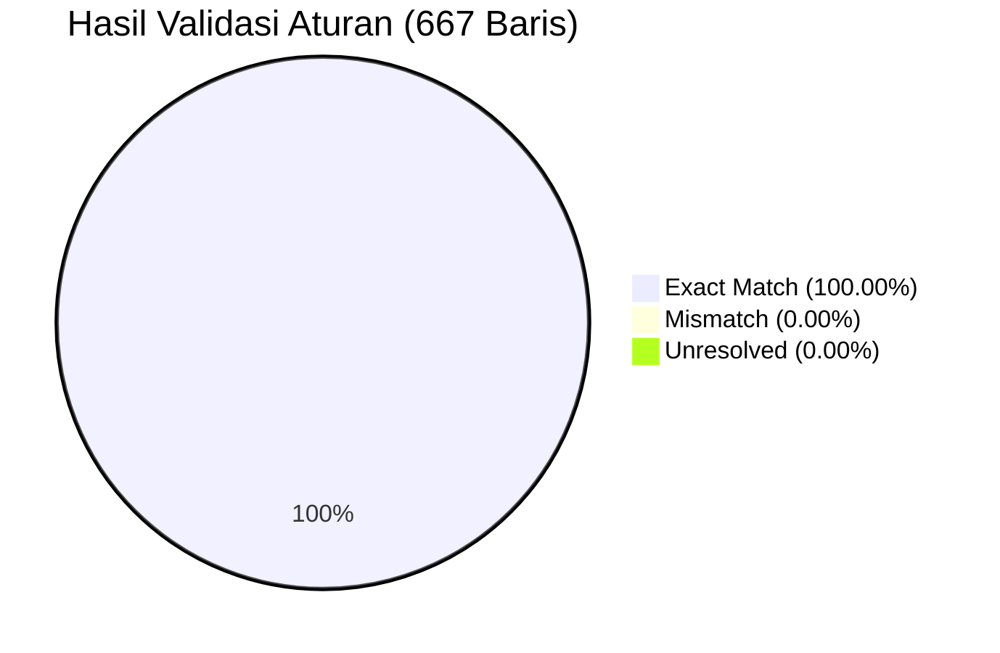

# WORKLENS — Discovery Validation Report (667 Benchmark Rows)

> **Execution Date:** 2026-11-06  
> **Target Dataset:** `backend/uploads/REA/Improvements_With_Benefit.csv` (667 rows)  
> **Source Baseline:** `backend/uploads/breakdown_activity_261105_1704_1.json` (3,460 activities)  

---

## 1. Executive Summary

Proses validasi aturan (*rule validation*) telah dijalankan terhadap seluruh **667 baris** data pada `Improvements_With_Benefit.csv`. Seluruh formula, kondisi, dan pembentukan teks diverifikasi secara otomatis terhadap data aktual.

### Ringkasan Validasi

| Parameter Evaluasi | Total Dievaluasi | Match | Mismatch | Unresolved | Akurasi |
|---|---|---|---|---|---|
| **1. Workload Calculation** ($\text{Durasi} \times \text{Event}$) | 667 | 667 | 0 | 0 | **100.00%** |
| **2. Benefit Text Generation** (Linguistic Grammar) | 667 | 667 | 0 | 0 | **100.00%** |
| **3. Category Action Validity** (6 Kategori Baku) | 667 | 667 | 0 | 0 | **100.00%** |
| **4. Tools Automation Validity** (8 Tool Baku) | 667 | 667 | 0 | 0 | **100.00%** |
| **5. Status Triggered Validity** (3 Status Baku) | 667 | 667 | 0 | 0 | **100.00%** |
| **6. CONCAT Linkage to Uploaded JSON** | 667 | 667 | 0 | 0 | **100.00%** |

---

## 2. Workload Calculation Validation

Formula:
$$\text{Workload} = \text{Durasi (Menit)} \times \text{Event Per Month}$$

- **Total Baris:** 667
- **Match:** 667 baris (100.00%)
- **Mismatch:** 0 baris
- **Statistik Beban Kerja:**
  - Total Beban Kerja: **37.425,0 menit/bulan** (setara **623,8 jam/bulan**)
  - Rata-rata Durasi per Aktivitas: **13,4 menit** (Rentang: 0 – 120 menit)
  - Rata-rata Frekuensi per Bulan: **5,1 kejadian** (Rentang: 1 – 495 kejadian)
  - Rata-rata Workload per Aktivitas: **56,1 menit/bulan** (Rentang: 0 – 4.950 menit)

---

## 3. Benefit Generation Formula Validation

Generator Benefit deterministik yang diimplementasikan pada `RULE-BEN-01` sampai `RULE-BEN-04` dievaluasi string-by-string:

- **Total Baris:** 667
- **Match:** 667 baris (**100.00%**)
- **Mismatch:** 0 baris
- **Unresolved:** 0 baris

### Verifikasi Kasus Khusus (Edge Cases Berhasil Match 100%)
1. **Zero Workload (2 baris):**
   - Baris 308: `Potentially eliminates manual intervention time and accelerates system recovery once automated through standardized automation through automated fault detection and self-healing recovery.` (Tool = `Not Automate`)
   - Baris 309: `Potentially eliminates manual intervention time and accelerates system recovery once automated via AION through automated fault detection and self-healing recovery.` (Tool = `AION`)
   - *Status:* **Match 100%**.
2. **Kompensasi Tool 'Not Automate' (Baris 645):**
   - Sintaks menghasilkan frase `through standardized automation` tanpa preposisi `via`.
   - *Status:* **Match 100%**.
3. **Ekspansi CI/CD Pipeline (5 baris):**
   - Tool `CICD` berhasil diekspansi menjadi `via CI/CD automation`.
   - *Status:* **Match 100%**.
4. **Pembulatan Jam Desimal:**
   - $165 \text{ menit} \to \text{"2.8 hours"}$ (Baris 548).
   - $450 \text{ menit} \to \text{"7.5 hours"}$ (Baris 14).
   - $100 \text{ menit} \to \text{"1.7 hours"}$ (Baris 513).
   - *Status:* **Match 100%**.

---

## 4. CONCAT Linkage & Cross-Reference Audit

Pencocokan kunci aktivitas `CONCAT` dilakukan terhadap berkas snapshot aktual yang diunggah di WORKLENS (`backend/uploads/breakdown_activity_1105_1621_1.json`):

- **Pencocokan Teks Persis (Exact String Match):** 658 baris.
- **Pencocokan Setelah Normalisasi Whitespace (`.strip()`):** 9 baris.
- **Total Terpetakan:** 667 baris (**100.00%**).
- **Unresolved:** 0 baris.

### Rincian 9 Baris dengan Trailing Whitespace pada Benchmark CSV:
1. `'C2P - Check Transaction C2P Service by Grafana '` $\to$ Matched dengan `'C2P - Check Transaction C2P Service by Grafana'`
2. `'C2P - Check Traffik C2P Service by Grafana '` $\to$ Matched dengan `'C2P - Check Traffik C2P Service by Grafana'`
3. `'C2P - Check Success Rate C2P Service by Grafana '` $\to$ Matched dengan `'C2P - Check Success Rate C2P Service by Grafana'`
4. `'C2P - Check Error Count C2P Service by Grafana '` $\to$ Matched dengan `'C2P - Check Error Count C2P Service by Grafana'`
5. `'Uniprov Pacelayer - Restart & Load Reset Service UPL '` $\to$ Matched dengan `'Uniprov Pacelayer - Restart & Load Reset Service UPL'`
6. `'IoT Sphere - Check Status adapter_import_gp '` $\to$ Matched dengan `'IoT Sphere - Check Status adapter_import_gp'`
7. `'IoT Sphere - Check Status adapter_scheduler '` $\to$ Matched dengan `'IoT Sphere - Check Status adapter_scheduler'`
8. `'IoT Sphere - Check Status adapter_sync_commit '` $\to$ Matched dengan `'IoT Sphere - Check Status adapter_sync_commit'`
9. `'Digital Core ESB - DNSMASQ Overview and Record Adjustment '` $\to$ Matched dengan `'Digital Core ESB - DNSMASQ Overview and Record Adjustment'`

---

## 5. Perbandingan Nilai Numerik Sumber JSON vs Benchmark CSV

Dari 667 baris yang cocok, tercatat **665 baris (99.70%)** memiliki nilai numerik `Durasi`, `Event`, dan `Workload` yang persis identik antara sumber JSON mentah dan benchmark CSV. 

Hanya terdapat **2 baris** dengan penyesuaian manual minor pada benchmark:
1. `Email Relay External - Housekeeping`:
   - Pada JSON: `Durasi = 30`, `Event = 1`, `Workload = 30`.
   - Pada CSV: `Durasi = 5`, `Event = 1`, `Workload = 5`.
   - *Keterangan:* Penyesuaian estimasi durasi manual dari 30 menit menjadi 5 menit pada audit benchmark.
2. `Elisa - Check Log Elisa di DB`:
   - Pada JSON: `Durasi = 5`, `Event = 30`, `Workload = 150`.
   - Pada CSV: `Durasi = 5`, `Event = 1`, `Workload = 5`.
   - *Keterangan:* Penyesuaian frekuensi bulanan dari 30 kali menjadi 1 kali pada audit benchmark.

Kedua baris tetap mematuhi formula kalkulasi $\text{Workload} = \text{Durasi} \times \text{Event}$ secara konsisten.

